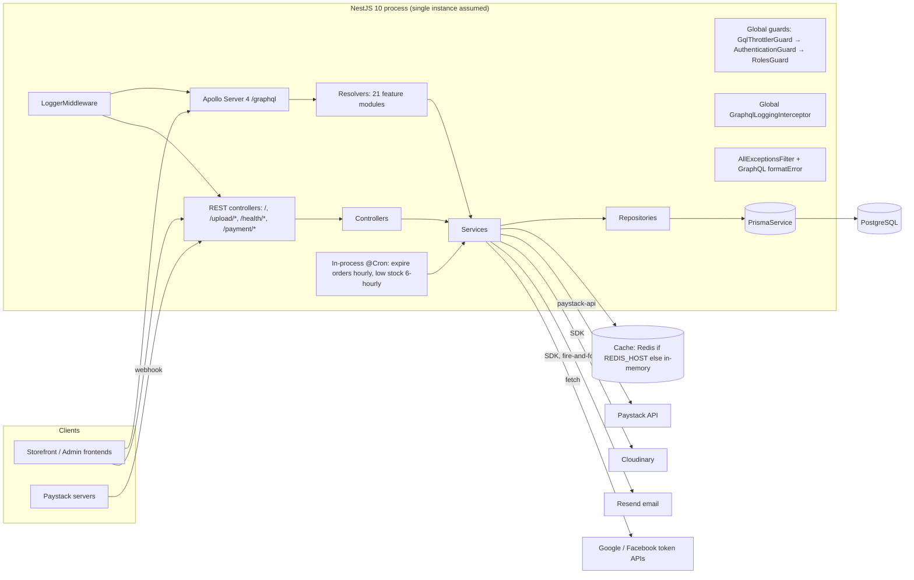

# 00 — System Map (as it actually is)

Audit date: 2026-11-16 · Commit audited: `0f448fa` on `main` plus uncommitted working-tree edits to 7 files (docs, `schema.gql`, email service/templates, `tracing.ts`, `package*.json`).
Sources: code, schema and migrations only. The operation inventory below (§0–§6) was generated by the Cartographer agent (haiku) and spot-checked by the orchestrator. Docs were not trusted (see `06-docs-vs-code-discrepancies.md`).

## Architecture overview

### Request lifecycle (GraphQL)
1. Express → `helmet` (CSP/HSTS in prod) → CORS (`ALLOWED_ORIGINS`, required in prod) → `LoggerMiddleware`.
2. Apollo parses the operation. There are **no depth, complexity, alias or batching limits** (PERF-01).
3. For each **root** Query/Mutation: global guards run in order `GqlThrottlerGuard` (120 req/min/IP; named throttlers opt-in), `AuthenticationGuard` (Bearer by default; `@Auth(None)` = public), `RolesGuard` (`@Roles`, method overrides class). **Guards do not run on `@ResolveField`s** because `fieldResolverEnhancers` is not configured — the root cause of the Critical PII leak SEC-01.
4. `ValidationPipe` (whitelist, forbidNonWhitelisted, transform) validates `@Args` DTOs.
5. `GraphqlLoggingInterceptor` logs operation, truncated query and variables (only `password`/`confirmPassword` masked — PLAT-02).
6. Resolver → service → repository → Prisma. Several resolvers build a Prisma `select` from the GraphQL selection set (`src/commons/useful-functions.ts`).
7. Errors: `AllExceptionsFilter` maps every `HttpException` 4xx to `BAD_USER_INPUT`; Prisma errors are **not** mapped and surface as "Internal server error".

### Request lifecycle (REST) — currently broken
The same global `GraphqlLoggingInterceptor` and the auth guards call `GqlExecutionContext...getContext().req`, which is `undefined` for HTTP. Confirmed by test: **every REST route returns 500**, including the Paystack webhook, `/payment/initialize`, uploads and health (PLAT-01, IAM-07).

### Auth flow
- Sign-up / sign-in (email + bcrypt-12 password) → access JWT (1 h, `JWT_SECRET`) + refresh JWT (24 h, `JWT_REFRESH_SECRET`, SHA hash stored in `RefreshToken`).
- `refreshToken` rotates (revoke old + create new in one `$transaction`) but the revoked check is outside the transaction and unconditional → concurrent refresh both succeed; no reuse detection (IAM-03 / DOC-10).
- Password reset: `forgotPassword` emails a reset JWT (15 min, `JWT_RESET_SECRET`); reset/change password do **not** revoke refresh tokens (IAM-02).
- Google / Facebook: client token verified against provider APIs, identity linked to any existing account with the same email (IAM-01).
- Each Bearer request loads the user from DB and rejects inactive users.

### Checkout and payment flow (as implemented)
`addToCart` (product only, no variant) → `createOrder` (prices every line at `Product.price`, decrements `Product.quantity` atomically in a transaction, records coupon usage, clears cart; shipping fee from `ShippingZone` by exact city match, 0 if none) → optional `finalizeOrder` (customer-callable, rewrites total) → `initiatePayment` (REST `/payment/initialize` — broken — or GraphQL mutation) → Paystack checkout → webhook (REST — broken) or customer `verifyPayment` → `Payment.COMPLETED`, `Order.PROCESSING` (unconditionally). COD orders start at `PROCESSING`; admin `recordCodPayment` sets `DELIVERED`. Full state diagram: `_work/order-lifecycle.md`.

### Background jobs
| Job | Schedule | What it does | Risk |
|---|---|---|---|
| `expired-orders.task.ts` | hourly | Cancels PENDING ONLINE orders older than N h with **no Payment row**, restores stock | Runs on every instance; orders with a pending/failed Payment never expire (ORD-07, CRON-01) |
| `low-stock.task.ts` | every 6 h | Emails admins about low-stock products | Unbounded query; runs on every instance |

No queue, no outbox, no retries; emails are fire-and-forget on the request path.

### Deployment setup
Single multi-stage `Dockerfile` (`node:20-alpine`, Node 20 is EOL; runs as root; no `.dockerignore`; no HEALTHCHECK). `CMD ["node","dist/main"]`, but the build emits `dist/src/main.js` → **the image cannot start** (PERF-18/PLAT-11, confirmed from build output). Prisma CLI is a devDependency, so migrations cannot run from the image. No CI/CD, no IaC, no backup configuration in the repo. OpenTelemetry (`src/tracing.ts`) is never loaded.

### Data model
30 tables (Prisma). See `01-database-schema-review.md` for the model-by-model review and ER diagram.

---

## Inventory (generated by Cartographer, haiku/low)

### Headline counts

| Item | Count |
|---|---|
| GraphQL operations (all resolvers) | 154 |
| - Query | 56 |
| - Mutation | 89 |
| - Field resolvers (`@ResolveField`) | 9 |
| Public GraphQL operations (`@Auth(AuthType.None)`) | 14 |
| REST routes (controllers) | 8 (5 public) |
| Scheduled tasks (`@Cron`) | 2 |
| Unit spec files / `it`/`test` cases | 61 / 706 |
| E2E spec files / cases | 12 / 152 |

Counting notes: `it.each` lines count as one case. Field resolvers are counted separately from Query/Mutation.

### 0. Auth and guard model (how the section 1 table was derived)

- `AuthenticationGuard` is registered as `APP_GUARD` in `src/iam/iam.module.ts:32-35`. `RolesGuard` is registered as `APP_GUARD` in `src/iam/iam.module.ts:36-39`. `GqlThrottlerGuard` is registered as `APP_GUARD` in `src/app.module.ts:143-146`. Nothing else registers guards globally.
- `AuthenticationGuard` (`src/iam/authentication/guards/authentication.guard.ts:23-26`) reads `authType` metadata with `getAllAndOverride([handler, class])`, so method-level `@Auth` overrides class-level `@Auth`. With no metadata it defaults to `AuthType.Bearer`. Bearer runs `AccessTokenGuard` (`access-token.guard.ts:19-34`), which verifies the JWT and loads the user, rejecting when the user is missing or inactive. `AuthType.None` always passes.
- `RolesGuard` (`src/iam/authentication/guards/roles.guard.ts:15-19`) uses `getAllAndOverride([handler, class])` for `@Roles`. Method-level `@Roles` replaces class-level `@Roles`. With no roles metadata the guard returns `true`, so any authenticated user passes. The check is `user.role === role`.
- How to read the table: `Bearer (default)` means neither method nor class has `@Auth`. `**public**` means `@Auth(AuthType.None)` applies. `@Roles` shows the effective list (method overrides class). `-` in the roles column means no role restriction beyond authentication.
- `GqlThrottlerGuard` (`src/commons/guards/gql-throttler.guard.ts:32-107`) applies the `global` throttler (120 req/min) to every route. Named throttlers (`auth`, `forgotPassword`, `passwordReset`, `payment`, `upload`) apply only when a route sets `@Throttle({ name: ... })`.
- Class-level `@Auth` and/or `@Roles` decorators: `@Auth` on cart, users, upload controller, health controller, iam authentication resolver. `@Auth(None)` is at class level on health and iam authentication, and `@Auth(Bearer)` on cart, users and upload. `@Roles` at class level on analytics, cart, inventory, review, sub-categories, tag, tax, users, variant, wishlist. The effective values are in the table below.

### 1. GraphQL operations (all `@Query`, `@Mutation`, `@ResolveField`)

Columns: `#` | module | type | GraphQL operation name (`name:` option if set, else method name) | file:line of the decorator | effective auth | effective `@Roles` | throttle | args (best-effort parse of `@Args`, `@ActiveUser`, `@Info`). `(field)` marks a `@ResolveField`; for those the type is the parent type from `@Resolver`. Generated by an AST-lite extractor over `src/**/*.resolver.ts` (script kept in the scratchpad, not in the repo).

| # | module | type | operation | file:line | auth | @Roles | throttle | args |
|---|---|---|---|---|---|---|---|---|
| 1 | addresses | Query | address | src/addresses/addresses.resolver.ts:20 | Bearer (default) | USER, ADMIN, SUPER_ADMIN | - | addressId: string; @ActiveUser |
| 2 | addresses | Query | userAddresses | src/addresses/addresses.resolver.ts:29 | Bearer (default) | USER, ADMIN, SUPER_ADMIN | - | @ActiveUser |
| 3 | addresses | Query | addresses | src/addresses/addresses.resolver.ts:44 | Bearer (default) | ADMIN, SUPER_ADMIN | - | userId: string; @ActiveUser |
| 4 | addresses | Mutation | createAddress | src/addresses/addresses.resolver.ts:59 | Bearer (default) | USER, ADMIN, SUPER_ADMIN | - | input: CreateAddressInput; @ActiveUser |
| 5 | addresses | Mutation | updateAddress | src/addresses/addresses.resolver.ts:68 | Bearer (default) | USER, ADMIN, SUPER_ADMIN | - | addressId: string; input: UpdateAddressInput; @ActiveUser |
| 6 | addresses | Mutation | deleteAddress | src/addresses/addresses.resolver.ts:81 | Bearer (default) | USER, ADMIN, SUPER_ADMIN | - | addressId: string; @ActiveUser |
| 7 | analytics | Query | salesReport | src/analytics/analytics.resolver.ts:18 | Bearer (default) | ADMIN, SUPER_ADMIN | - | (unnamed): SalesReportArgs; (args) SalesReportArgs |
| 8 | analytics | Query | topProducts | src/analytics/analytics.resolver.ts:23 | Bearer (default) | ADMIN, SUPER_ADMIN | - | (unnamed): TopProductsArgs; (args) TopProductsArgs |
| 9 | analytics | Query | revenueByCategory | src/analytics/analytics.resolver.ts:28 | Bearer (default) | ADMIN, SUPER_ADMIN | - | - |
| 10 | analytics | Query | dashboardSummary | src/analytics/analytics.resolver.ts:33 | Bearer (default) | ADMIN, SUPER_ADMIN | - | - |
| 11 | brand | Mutation | createBrand | src/brand/brand.resolver.ts:19 | Bearer (default) | SUPER_ADMIN, ADMIN | - | input: CreateBrandInput |
| 12 | brand | Mutation | updateBrand | src/brand/brand.resolver.ts:25 | Bearer (default) | SUPER_ADMIN, ADMIN | - | id: string; input: UpdateBrandInput |
| 13 | brand | Mutation | deleteBrand | src/brand/brand.resolver.ts:31 | Bearer (default) | SUPER_ADMIN, ADMIN | - | id: string |
| 14 | brand | Query | brand | src/brand/brand.resolver.ts:37 | **public** | - | - | id: string |
| 15 | brand | Query | brands | src/brand/brand.resolver.ts:43 | **public** | - | - | @Info |
| 16 | cart | Query | cart | src/cart/cart.resolver.ts:27 | Bearer | SUPER_ADMIN, ADMIN, USER | - | @ActiveUser |
| 17 | cart | Mutation | addToCart | src/cart/cart.resolver.ts:32 | Bearer | SUPER_ADMIN, ADMIN, USER | - | input: AddToCartInput; @ActiveUser |
| 18 | cart | Mutation | updateCartItem | src/cart/cart.resolver.ts:39 | Bearer | SUPER_ADMIN, ADMIN, USER | - | input: UpdateCartItemInput; @ActiveUser |
| 19 | cart | Mutation | removeFromCart | src/cart/cart.resolver.ts:46 | Bearer | SUPER_ADMIN, ADMIN, USER | - | cartItemId: string; @ActiveUser |
| 20 | cart | Mutation | clearCart | src/cart/cart.resolver.ts:53 | Bearer | SUPER_ADMIN, ADMIN, USER | - | @ActiveUser |
| 21 | cart | Query | cartWithDiscount | src/cart/cart.resolver.ts:58 | Bearer | SUPER_ADMIN, ADMIN, USER | - | @ActiveUser |
| 22 | categories | Mutation | createCategory | src/categories/categories.resolver.ts:21 | Bearer (default) | SUPER_ADMIN, ADMIN | - | input: CreateCategoryInput |
| 23 | categories | Query | categories | src/categories/categories.resolver.ts:33 | **public** | - | - | @Info |
| 24 | categories | Query | category | src/categories/categories.resolver.ts:47 | Bearer (default) | SUPER_ADMIN, USER, ADMIN | - | id: string |
| 25 | categories | Mutation | updateCategory | src/categories/categories.resolver.ts:58 | Bearer (default) | SUPER_ADMIN, ADMIN | - | id: string; input: UpdateCategoryInput |
| 26 | categories | Mutation | removeCategory | src/categories/categories.resolver.ts:74 | Bearer (default) | SUPER_ADMIN, ADMIN | - | id: string |
| 27 | coupons | Mutation | createCoupon | src/coupons/coupons.resolver.ts:18 | Bearer (default) | ADMIN, SUPER_ADMIN | - | input: CreateCouponInput |
| 28 | coupons | Mutation | updateCoupon | src/coupons/coupons.resolver.ts:24 | Bearer (default) | ADMIN, SUPER_ADMIN | - | id: string; input: UpdateCouponInput |
| 29 | coupons | Mutation | deleteCoupon | src/coupons/coupons.resolver.ts:30 | Bearer (default) | ADMIN, SUPER_ADMIN | - | id: string |
| 30 | coupons | Query | coupons | src/coupons/coupons.resolver.ts:36 | Bearer (default) | ADMIN, SUPER_ADMIN | - | - |
| 31 | coupons | Query | coupon | src/coupons/coupons.resolver.ts:42 | Bearer (default) | ADMIN, SUPER_ADMIN | - | id: string |
| 32 | coupons | Mutation | validateCoupon | src/coupons/coupons.resolver.ts:48 | Bearer (default) | USER, ADMIN, SUPER_ADMIN | - | input: ValidateCouponInput; @ActiveUser |
| 33 | discount | Mutation | createDiscount | src/discount/discount.resolver.ts:16 | Bearer (default) | ADMIN, SUPER_ADMIN | - | createDiscountInput: CreateDiscountInput |
| 34 | discount | Query | discounts | src/discount/discount.resolver.ts:22 | Bearer (default) | ADMIN, SUPER_ADMIN | - | - |
| 35 | discount | Query | discount | src/discount/discount.resolver.ts:28 | Bearer (default) | ADMIN, SUPER_ADMIN | - | id: string |
| 36 | discount | Mutation | updateDiscount | src/discount/discount.resolver.ts:34 | Bearer (default) | ADMIN, SUPER_ADMIN | - | updateDiscountInput: UpdateDiscountInput |
| 37 | discount | Mutation | addToDiscount | src/discount/discount.resolver.ts:40 | Bearer (default) | ADMIN, SUPER_ADMIN | - | modifyDiscountItemsInput: ModifyDiscountItemsInput |
| 38 | discount | Mutation | removeFromDiscount | src/discount/discount.resolver.ts:46 | Bearer (default) | ADMIN, SUPER_ADMIN | - | modifyDiscountItemsInput: ModifyDiscountItemsInput |
| 39 | discount | Mutation | removeDiscount | src/discount/discount.resolver.ts:52 | Bearer (default) | ADMIN, SUPER_ADMIN | - | id: string |
| 40 | iam | Mutation | signUp | src/iam/authentication/authentication.resolver.ts:30 | **public** | - | @Throttle(auth) | input: SignUpInput |
| 41 | iam | Mutation | signIn | src/iam/authentication/authentication.resolver.ts:38 | **public** | - | @Throttle(auth) | input: SignInInput |
| 42 | iam | Mutation | refreshToken | src/iam/authentication/authentication.resolver.ts:46 | **public** | - | @SkipThrottle | input: RefreshTokenInput |
| 43 | iam | Mutation | signOut | src/iam/authentication/authentication.resolver.ts:55 | Bearer | - | @SkipThrottle | input: SignOutInput |
| 44 | iam | Mutation | signInWithGoogle | src/iam/authentication/authentication.resolver.ts:61 | **public** | - | @Throttle(auth) | input: SocialLoginInput |
| 45 | iam | Mutation | signInWithFacebook | src/iam/authentication/authentication.resolver.ts:67 | **public** | - | @Throttle(auth) | input: SocialLoginInput |
| 46 | iam | Mutation | forgotPassword | src/iam/authentication/authentication.resolver.ts:74 | **public** | - | @Throttle(forgotPassword) | input: ForgotPasswordInput |
| 47 | iam | Mutation | resetPassword | src/iam/authentication/authentication.resolver.ts:80 | **public** | - | @Throttle(passwordReset) | input: ResetPasswordInput |
| 48 | inventory | Mutation | restockProduct | src/inventory/inventory.resolver.ts:15 | Bearer (default) | ADMIN, SUPER_ADMIN | - | input: RestockProductInput; @ActiveUser |
| 49 | inventory | Mutation | restockVariant | src/inventory/inventory.resolver.ts:20 | Bearer (default) | ADMIN, SUPER_ADMIN | - | input: RestockVariantInput; @ActiveUser |
| 50 | inventory | Query | inventoryLogs | src/inventory/inventory.resolver.ts:25 | Bearer (default) | ADMIN, SUPER_ADMIN | - | - |
| 51 | inventory | Query | productInventoryLogs | src/inventory/inventory.resolver.ts:30 | Bearer (default) | ADMIN, SUPER_ADMIN | - | productId: string |
| 52 | inventory | Query | variantInventoryLogs | src/inventory/inventory.resolver.ts:35 | Bearer (default) | ADMIN, SUPER_ADMIN | - | variantId: string |
| 53 | order | Query | order | src/order/order.resolver.ts:28 | Bearer (default) | USER, ADMIN, SUPER_ADMIN | - | orderId: string; @ActiveUser |
| 54 | order | Query | userOrders | src/order/order.resolver.ts:37 | Bearer (default) | USER, ADMIN, SUPER_ADMIN | - | @ActiveUser |
| 55 | order | Query | orders | src/order/order.resolver.ts:46 | Bearer (default) | ADMIN, SUPER_ADMIN | - | - |
| 56 | order | Query | viewOrder | src/order/order.resolver.ts:55 | Bearer (default) | ADMIN, SUPER_ADMIN | - | id: string |
| 57 | order | Mutation | createOrder | src/order/order.resolver.ts:64 | Bearer (default) | USER, ADMIN, SUPER_ADMIN | - | input: CreateOrderInput; @ActiveUser |
| 58 | order | Mutation | updateShipping | src/order/order.resolver.ts:81 | Bearer (default) | ADMIN, SUPER_ADMIN | - | input: UpdateShippingInput; @ActiveUser |
| 59 | order | Mutation | updateOrderStatus | src/order/order.resolver.ts:90 | Bearer (default) | ADMIN, SUPER_ADMIN | - | input: UpdateOrderStatusInput; @ActiveUser |
| 60 | order | Mutation | cancelOrder | src/order/order.resolver.ts:99 | Bearer (default) | USER | - | orderId: string; @ActiveUser |
| 61 | order | Mutation | adminCancelOrder | src/order/order.resolver.ts:108 | Bearer (default) | ADMIN, SUPER_ADMIN | - | orderId: string; @ActiveUser |
| 62 | order | Mutation | deleteOrder | src/order/order.resolver.ts:120 | Bearer (default) | ADMIN, SUPER_ADMIN | - | orderId: string; @ActiveUser |
| 63 | order | Mutation | finalizeOrder | src/order/order.resolver.ts:126 | Bearer (default) | USER, ADMIN, SUPER_ADMIN | - | id: string; @ActiveUser |
| 64 | order | Order | user (field) | src/order/order.resolver.ts:132 | Bearer (default) | - | - | - |
| 65 | payment | Mutation | verifyPayment | src/payment/payment.resolver.ts:15 | Bearer (default) | USER | - | verifyPaymentInput: VerifyPaymentInput; @ActiveUser |
| 66 | payment | Query | payments | src/payment/payment.resolver.ts:21 | Bearer (default) | ADMIN, SUPER_ADMIN | - | - |
| 67 | payment | Query | getMyPayments | src/payment/payment.resolver.ts:27 | Bearer (default) | USER | - | @ActiveUser |
| 68 | payment | Query | getUserPayment | src/payment/payment.resolver.ts:33 | Bearer (default) | ADMIN | - | userId: string |
| 69 | payment | Query | payment | src/payment/payment.resolver.ts:39 | Bearer (default) | USER, ADMIN, SUPER_ADMIN | - | id: string; @ActiveUser |
| 70 | payment | Mutation | recordCodPayment | src/payment/payment.resolver.ts:52 | Bearer (default) | ADMIN, SUPER_ADMIN | - | orderId: string; @ActiveUser |
| 71 | payment | Mutation | softDeletePayment | src/payment/payment.resolver.ts:58 | Bearer (default) | ADMIN | - | id: string |
| 72 | payment | Mutation | restorePayment | src/payment/payment.resolver.ts:64 | Bearer (default) | ADMIN | - | id: string |
| 73 | payment | Mutation | removePayment | src/payment/payment.resolver.ts:70 | Bearer (default) | ADMIN | - | id: string |
| 74 | pickup-locations | Mutation | createPickupLocation | src/pickup-locations/pickup-locations.resolver.ts:17 | Bearer (default) | ADMIN, SUPER_ADMIN | - | input: CreatePickupLocationInput |
| 75 | pickup-locations | Mutation | updatePickupLocation | src/pickup-locations/pickup-locations.resolver.ts:23 | Bearer (default) | ADMIN, SUPER_ADMIN | - | id: string; input: UpdatePickupLocationInput |
| 76 | pickup-locations | Mutation | deletePickupLocation | src/pickup-locations/pickup-locations.resolver.ts:29 | Bearer (default) | ADMIN, SUPER_ADMIN | - | id: string |
| 77 | pickup-locations | Query | pickupLocations | src/pickup-locations/pickup-locations.resolver.ts:35 | Bearer (default) | ADMIN, SUPER_ADMIN | - | - |
| 78 | pickup-locations | Query | activePickupLocations | src/pickup-locations/pickup-locations.resolver.ts:41 | **public** | - | - | - |
| 79 | products | Mutation | createProduct | src/products/products.resolver.ts:36 | Bearer (default) | SUPER_ADMIN, ADMIN | - | createProductInput: CreateProductInput |
| 80 | products | Mutation | updateProduct | src/products/products.resolver.ts:45 | Bearer (default) | SUPER_ADMIN, ADMIN | - | productId: string; updateProductInput: UpdateProductInput |
| 81 | products | Mutation | permanentlyDeleteProduct | src/products/products.resolver.ts:55 | Bearer (default) | SUPER_ADMIN, ADMIN | - | productId: string |
| 82 | products | Mutation | archiveProduct | src/products/products.resolver.ts:61 | Bearer (default) | SUPER_ADMIN, ADMIN | - | productId: string |
| 83 | products | Mutation | restoreProduct | src/products/products.resolver.ts:67 | Bearer (default) | SUPER_ADMIN, ADMIN | - | productId: string |
| 84 | products | Mutation | addTagToProduct | src/products/products.resolver.ts:73 | Bearer (default) | SUPER_ADMIN, ADMIN | - | productId: string; tagId: string |
| 85 | products | Mutation | removeTagFromProduct | src/products/products.resolver.ts:82 | Bearer (default) | SUPER_ADMIN, ADMIN | - | productId: string; tagId: string |
| 86 | products | Query | products | src/products/products.resolver.ts:91 | **public** | - | - | paginationArgs: PaginationArgs; filterArgs: ProductFilterArgs; sortArgs: ProductSortArgs; @Info |
| 87 | products | Query | product | src/products/products.resolver.ts:109 | **public** | - | - | productId: string; @Info |
| 88 | products | Product | variants (field) | src/products/products.resolver.ts:117 | Bearer (default) | - | - | - |
| 89 | products | Product | reviews (field) | src/products/products.resolver.ts:122 | Bearer (default) | - | - | - |
| 90 | products | Product | discountedPrice (field) | src/products/products.resolver.ts:127 | Bearer (default) | - | - | - |
| 91 | products | Product | appliedDiscount (field) | src/products/products.resolver.ts:134 | Bearer (default) | - | - | - |
| 92 | returns | Mutation | createReturnRequest | src/returns/returns.resolver.ts:16 | Bearer (default) | USER, ADMIN, SUPER_ADMIN | - | input: CreateReturnRequestInput; @ActiveUser |
| 93 | returns | Mutation | approveReturn | src/returns/returns.resolver.ts:22 | Bearer (default) | ADMIN, SUPER_ADMIN | - | input: ApproveReturnInput |
| 94 | returns | Mutation | rejectReturn | src/returns/returns.resolver.ts:28 | Bearer (default) | ADMIN, SUPER_ADMIN | - | input: RejectReturnInput |
| 95 | returns | Mutation | processRefund | src/returns/returns.resolver.ts:34 | Bearer (default) | ADMIN, SUPER_ADMIN | - | returnRequestId: string |
| 96 | returns | Query | myReturnRequests | src/returns/returns.resolver.ts:40 | Bearer (default) | USER, ADMIN, SUPER_ADMIN | - | @ActiveUser |
| 97 | returns | Query | returnRequests | src/returns/returns.resolver.ts:46 | Bearer (default) | ADMIN, SUPER_ADMIN | - | - |
| 98 | review | Query | review | src/review/review.resolver.ts:27 | Bearer (default) | USER, SUPER_ADMIN, ADMIN | - | reviewId: string |
| 99 | review | Query | productReviews | src/review/review.resolver.ts:35 | Bearer (default) | USER, SUPER_ADMIN, ADMIN | - | productId: string |
| 100 | review | Query | userReviews | src/review/review.resolver.ts:43 | Bearer (default) | USER, SUPER_ADMIN, ADMIN | - | @ActiveUser |
| 101 | review | Mutation | createReview | src/review/review.resolver.ts:51 | Bearer (default) | USER | - | input: CreateReviewInput; @ActiveUser |
| 102 | review | Mutation | updateReview | src/review/review.resolver.ts:63 | Bearer (default) | USER | - | input: UpdateReviewInput; @ActiveUser |
| 103 | review | Mutation | deleteReview | src/review/review.resolver.ts:75 | Bearer (default) | USER | - | reviewId: string; @ActiveUser |
| 104 | review | Mutation | adminDeleteReview | src/review/review.resolver.ts:84 | Bearer (default) | ADMIN, SUPER_ADMIN | - | reviewId: string |
| 105 | review | Review | user (field) | src/review/review.resolver.ts:89 | Bearer (default) | USER, SUPER_ADMIN, ADMIN | - | - |
| 106 | review | Review | product (field) | src/review/review.resolver.ts:94 | Bearer (default) | USER, SUPER_ADMIN, ADMIN | - | - |
| 107 | shipping-zones | Mutation | createShippingZone | src/shipping-zones/shipping-zones.resolver.ts:17 | Bearer (default) | ADMIN, SUPER_ADMIN | - | input: CreateShippingZoneInput |
| 108 | shipping-zones | Mutation | updateShippingZone | src/shipping-zones/shipping-zones.resolver.ts:22 | Bearer (default) | ADMIN, SUPER_ADMIN | - | id: string; input: UpdateShippingZoneInput |
| 109 | shipping-zones | Mutation | deleteShippingZone | src/shipping-zones/shipping-zones.resolver.ts:27 | Bearer (default) | ADMIN, SUPER_ADMIN | - | id: string |
| 110 | shipping-zones | Query | shippingZones | src/shipping-zones/shipping-zones.resolver.ts:32 | Bearer (default) | ADMIN, SUPER_ADMIN | - | - |
| 111 | shipping-zones | Query | shippingZone | src/shipping-zones/shipping-zones.resolver.ts:37 | Bearer (default) | ADMIN, SUPER_ADMIN | - | id: string |
| 112 | shipping-zones | Query | activeShippingZones | src/shipping-zones/shipping-zones.resolver.ts:43 | **public** | - | - | - |
| 113 | shipping-zones | Query | getShippingFee | src/shipping-zones/shipping-zones.resolver.ts:48 | Bearer (default) | ADMIN, SUPER_ADMIN, USER | - | addressId: string; @ActiveUser |
| 114 | sub-categories | Mutation | createSubCategory | src/sub-categories/sub-categories.resolver.ts:18 | Bearer (default) | ADMIN, SUPER_ADMIN | - | input: CreateSubCategoryInput |
| 115 | sub-categories | Query | subCategories | src/sub-categories/sub-categories.resolver.ts:33 | Bearer (default) | USER, ADMIN, SUPER_ADMIN | - | - |
| 116 | sub-categories | Query | subCategory | src/sub-categories/sub-categories.resolver.ts:43 | Bearer (default) | USER, ADMIN, SUPER_ADMIN | - | id: string |
| 117 | sub-categories | Mutation | updateSubCategory | src/sub-categories/sub-categories.resolver.ts:57 | Bearer (default) | ADMIN | - | id: string; input: UpdateSubCategoryInput |
| 118 | sub-categories | Mutation | removeSubCategory | src/sub-categories/sub-categories.resolver.ts:76 | Bearer (default) | ADMIN | - | id: string |
| 119 | tag | Query | tag | src/tag/tag.resolver.ts:19 | Bearer (default) | ADMIN, SUPER_ADMIN, USER | - | tagId: string |
| 120 | tag | Query | tags | src/tag/tag.resolver.ts:25 | Bearer (default) | ADMIN, SUPER_ADMIN, USER | - | - |
| 121 | tag | Mutation | createTag | src/tag/tag.resolver.ts:30 | Bearer (default) | ADMIN, SUPER_ADMIN | - | name: string |
| 122 | tag | Mutation | updateTag | src/tag/tag.resolver.ts:38 | Bearer (default) | ADMIN, SUPER_ADMIN | - | tagId: string; name: string |
| 123 | tag | Mutation | deleteTag | src/tag/tag.resolver.ts:46 | Bearer (default) | ADMIN, SUPER_ADMIN | - | tagId: string |
| 124 | tag | Mutation | addProductsToTag | src/tag/tag.resolver.ts:51 | Bearer (default) | ADMIN, SUPER_ADMIN | - | tagId: string; updateDiscountInput: AddProductsToTagDto |
| 125 | tag | Mutation | removeProductsFromTag | src/tag/tag.resolver.ts:58 | Bearer (default) | ADMIN, SUPER_ADMIN | - | tagId: string; updateDiscountInput: RemoveProductsFromTagDto |
| 126 | tax | Mutation | createTax | src/tax/tax.resolver.ts:15 | Bearer (default) | ADMIN, SUPER_ADMIN | - | input: CreateTaxInput |
| 127 | tax | Mutation | updateTax | src/tax/tax.resolver.ts:20 | Bearer (default) | ADMIN, SUPER_ADMIN | - | id: string; input: UpdateTaxInput |
| 128 | tax | Mutation | deleteTax | src/tax/tax.resolver.ts:25 | Bearer (default) | ADMIN, SUPER_ADMIN | - | id: string |
| 129 | tax | Query | taxes | src/tax/tax.resolver.ts:30 | Bearer (default) | ADMIN, SUPER_ADMIN | - | - |
| 130 | tax | Query | tax | src/tax/tax.resolver.ts:35 | Bearer (default) | ADMIN, SUPER_ADMIN | - | id: string |
| 131 | users | Mutation | createUser | src/users/users.resolver.ts:32 | Bearer | SUPER_ADMIN | - | createUserInput: CreateUserInput |
| 132 | users | Query | users | src/users/users.resolver.ts:41 | Bearer | ADMIN, SUPER_ADMIN | - | filter: UserPaginateArgs |
| 133 | users | Query | userById | src/users/users.resolver.ts:47 | Bearer | ADMIN, SUPER_ADMIN | - | id: string |
| 134 | users | Query | userByEmail | src/users/users.resolver.ts:56 | Bearer | ADMIN, SUPER_ADMIN | - | email: string |
| 135 | users | Query | userByProviderId | src/users/users.resolver.ts:64 | Bearer | ADMIN, SUPER_ADMIN | - | providerId: string |
| 136 | users | Mutation | updateUser | src/users/users.resolver.ts:70 | Bearer | ADMIN, SUPER_ADMIN | - | id: string; updateUserInput: UpdateUserInput |
| 137 | users | Mutation | updateMyProfile | src/users/users.resolver.ts:79 | Bearer | USER, ADMIN, SUPER_ADMIN | - | updateMyProfileInput: UpdateUserInput; @ActiveUser |
| 138 | users | Mutation | changeUserPassword | src/users/users.resolver.ts:87 | Bearer | USER, ADMIN, SUPER_ADMIN | - | input: ChangeUserPasswordInput; @ActiveUser |
| 139 | users | Mutation | removeUser | src/users/users.resolver.ts:97 | Bearer | ADMIN, SUPER_ADMIN | - | id: string |
| 140 | users | Mutation | archiveUser | src/users/users.resolver.ts:103 | Bearer | ADMIN, SUPER_ADMIN | - | id: string |
| 141 | users | Mutation | deArchiveUser | src/users/users.resolver.ts:109 | Bearer | ADMIN, SUPER_ADMIN | - | id: string |
| 142 | users | Query | userProfile | src/users/users.resolver.ts:118 | Bearer | USER, ADMIN, SUPER_ADMIN | - | @ActiveUser |
| 143 | users | User | addresses (field) | src/users/users.resolver.ts:123 | Bearer | SUPER_ADMIN | - | - |
| 144 | users | User | orders (field) | src/users/users.resolver.ts:128 | Bearer | SUPER_ADMIN | - | - |
| 145 | variant | Query | variant | src/variant/variant.resolver.ts:19 | Bearer (default) | ADMIN, SUPER_ADMIN, USER | - | variantId: string |
| 146 | variant | Query | productVariants | src/variant/variant.resolver.ts:28 | Bearer (default) | ADMIN, SUPER_ADMIN, USER | - | productId: string |
| 147 | variant | Query | variants | src/variant/variant.resolver.ts:37 | Bearer (default) | ADMIN, SUPER_ADMIN, USER | - | - |
| 148 | variant | Mutation | createVariant | src/variant/variant.resolver.ts:45 | Bearer (default) | ADMIN, SUPER_ADMIN | - | input: CreateVariantInput |
| 149 | variant | Mutation | updateVariant | src/variant/variant.resolver.ts:53 | Bearer (default) | ADMIN, SUPER_ADMIN | - | input: UpdateVariantInput |
| 150 | variant | Mutation | deleteVariant | src/variant/variant.resolver.ts:61 | Bearer (default) | ADMIN, SUPER_ADMIN | - | variantId: string |
| 151 | wishlist | Query | wishlist | src/wishlist/wishlist.resolver.ts:17 | Bearer (default) | USER, ADMIN, SUPER_ADMIN | - | @ActiveUser |
| 152 | wishlist | Mutation | addToWishlist | src/wishlist/wishlist.resolver.ts:25 | Bearer (default) | USER, ADMIN, SUPER_ADMIN | - | productId: string; @ActiveUser |
| 153 | wishlist | Mutation | removeFromWishlist | src/wishlist/wishlist.resolver.ts:33 | Bearer (default) | USER, ADMIN, SUPER_ADMIN | - | productId: string; @ActiveUser |
| 154 | wishlist | Mutation | clearWishlist | src/wishlist/wishlist.resolver.ts:44 | Bearer (default) | USER, ADMIN, SUPER_ADMIN | - | @ActiveUser |

Field-resolver and nested-type notes (facts):
- `User.addresses` and `User.orders` (rows 143-144, `src/users/users.resolver.ts:123,128`) have no method-level `@Roles`. The class-level `@Roles(Role.SUPER_ADMIN)` at `src/users/users.resolver.ts:20` therefore applies to them.
- `ResolveField`s with no `@Auth` resolve to `Bearer (default)` (rows 64, 88-91, 105-106, 143-144). Public Queries `products` and `product` (rows 86-87) return `Product` objects whose `variants`, `reviews`, `discountedPrice` and `appliedDiscount` fields (rows 88-91) are resolved by Bearer-default field resolvers. Whether Nest runs the global `AuthenticationGuard` for each field resolver is **Suspected (needs verification)**: not tested in this pass.

### 2. REST routes (`src/**/*.controller.ts`)

No global route prefix (`setGlobalPrefix` not found in `src`). `AuthenticationGuard` and `GqlThrottlerGuard` are global and therefore also apply to REST routes.

| # | method | path | file:line | auth | throttle |
|---|---|---|---|---|---|
| 1 | GET | `/` | `src/app.controller.ts:8` | Bearer (no `@Auth` on `AppController`) | global |
| 2 | GET | `/health` | `src/health/health.controller.ts:20` (class `@Auth(None)` at line 9) | public | global |
| 3 | GET | `/health/live` | `src/health/health.controller.ts:26` | public | global |
| 4 | GET | `/health/ready` | `src/health/health.controller.ts:31` | public | global |
| 5 | POST | `/upload/multiple-images` | `src/commons/upload.controller.ts:29` (class `@Auth(Bearer)` at line 24) | Bearer | `upload` 10/min |
| 6 | POST | `/upload/single-image` | `src/commons/upload.controller.ts:48` | Bearer | `upload` 10/min |
| 7 | POST | `/payment/initialize` | `src/payment/payment.controller.ts:16` (`@Throttle` at line 15) | Bearer (default) | `payment` 5/min |
| 8 | POST | `/payment/webhook` | `src/payment/payment.controller.ts:22` | public (`@Auth(None)` at line 21) | global only |

Notes (facts): `POST /payment/webhook` reads the `x-paystack-signature` header (`src/payment/payment.controller.ts:24-28`). `POST /upload/*` use multer `memoryStorage` with a 5 MB limit (`src/commons/upload.controller.ts:17-22`).

### 3. Scheduled tasks

`ScheduleModule.forRoot()` is registered in `src/app.module.ts:133`.

| file:line | schedule | method | what it does |
|---|---|---|---|
| `src/inventory/tasks/low-stock.task.ts:13` (registered in `src/inventory/inventory.module.ts:10`) | `CronExpression.EVERY_6_HOURS` | `checkLowStock` | Reads products and variants below threshold and writes warn logs. No persistence, no notification. |
| `src/order/tasks/expired-orders.task.ts:15` (registered in `src/order/order.module.ts:18`) | `CronExpression.EVERY_HOUR` | `cancelAbandonedOrders` | Calls `ordersService.expireAbandonedOrders(1)` to cancel unpaid orders older than 1 hour, and logs the count. |

### 4. Environment variables

Columns: variable | validated in Joi (`src/config/env.validation.ts`) | in `.env.example` | used where (file:line). `process.env.X` and `configService.get`/`getOrThrow` are both listed.

| var | Joi | .env.example | used where |
|---|---|---|---|
| DATABASE_URL | required | yes | `prisma/schema.prisma:14` (`env("DATABASE_URL")`) |
| PORT | number, default 3000 | yes | `src/main.ts:77` |
| NODE_ENV | enum dev/prod/test, default development | yes | `src/app.module.ts:96`; `src/main.ts:17,35,41`; `src/commons/error-formatters/grapqhl-error.formatter.ts:25`; `src/commons/filters/all-exceptions.filter.ts:19` (`=== 'development'`) |
| ALLOWED_ORIGINS | optional string | yes | `src/main.ts:42-43` (required at startup when NODE_ENV=production, `src/main.ts:45-50`) |
| JWT_SECRET | required, min 32 | yes | `src/iam/config/jwt.config.ts:4` |
| JWT_REFRESH_SECRET | required, min 32 | yes | `src/iam/config/jwt.config.ts:5` |
| JWT_RESET_SECRET | required, min 32 | **no** | `src/iam/config/jwt.config.ts:6` |
| JWT_TOKEN_AUDIENCE | required | yes | `src/iam/config/jwt.config.ts:7` |
| JWT_TOKEN_ISSUER | required | yes | `src/iam/config/jwt.config.ts:8` |
| JWT_ACCESS_TOKEN_TTL | number, default 3600 | yes | `src/iam/config/jwt.config.ts:9` (`parseInt(... ?? '3600')`) |
| JWT_REFRESH_TOKEN_TTL | number, default 86400 | yes | `src/iam/config/jwt.config.ts:10` |
| JWT_RESET_TOKEN_TTL | number, default 900 | **no** | `src/iam/config/jwt.config.ts:11` |
| GOOGLE_CLIENT_ID | required | yes | `src/iam/authentication/social/google-authentication.service.ts:57` |
| GOOGLE_CLIENT_SECRET | required | yes | **not read anywhere in `src`** |
| FACEBOOK_APP_ID | required | yes | `src/iam/authentication/social/facebook-authentication.service.ts:32` |
| FACEBOOK_APP_SECRET | required | yes | `src/iam/authentication/social/facebook-authentication.service.ts:33` |
| PAYSTACK_SECRET_KEY | required | yes | `src/payment/payment.service.ts:32,390`; `src/returns/returns.service.ts:136` |
| PAYSTACK_CALLBACK_URL | optional uri | yes | `src/payment/payment.service.ts:277` |
| CLOUDINARY_CLOUD_NAME | required | yes | `src/commons/cloudinary.service.ts:14`; `src/health/indicators/cloudinary.health-indicator.ts:11` |
| CLOUDINARY_API_KEY | required | yes | `src/commons/cloudinary.service.ts:15`; `src/health/indicators/cloudinary.health-indicator.ts:12` |
| CLOUDINARY_API_SECRET | required | yes | `src/commons/cloudinary.service.ts:16`; `src/health/indicators/cloudinary.health-indicator.ts:13` |
| REDIS_HOST | optional | commented out only (`.env.example:43`) | `src/config/cache.config.ts:13`; `src/health/indicators/redis.health-indicator.ts:20` |
| REDIS_PORT | number, default 6379 | commented out only (`.env.example:44`) | `src/config/cache.config.ts:14` |
| REDIS_PASSWORD | optional | commented out only (`.env.example:45`) | `src/config/cache.config.ts:15` |
| RESEND_API_KEY | optional | **no** | `src/notifications/email/email.service.ts:22` |
| RESEND_FROM_EMAIL | optional email | **no** | `src/notifications/email/email.service.ts:23` (fallback `noreply@franko.shop`) |
| LOG_LEVEL | enum, default info | yes | `src/commons/logger.service.ts:12` |
| OTEL_ENABLED | **no** | **no** | `src/tracing.ts:17` (file not imported anywhere, see section 5) |
| OTEL_EXPORTER_OTLP_ENDPOINT | **no** | **no** | `src/tracing.ts:19` (default `http://localhost:4318/v1/traces`) |
| OTEL_SERVICE_NAME | **no** | **no** | `src/tracing.ts:24` |
| npm_package_version | n/a (npm-set) | n/a | `src/tracing.ts:25` |
| SUPER_ADMIN_EMAIL | **no** (seed only) | yes | `prisma/seeders/main.ts:150` |
| SUPER_ADMIN_PASSWORD | **no** (seed only) | yes | `prisma/seeders/main.ts:151` |

Outside `src`: `test/e2e/auth.e2e-spec.ts:361-363,418-420` (JWT_RESET_SECRET, JWT_TOKEN_AUDIENCE, JWT_TOKEN_ISSUER) and `test/e2e/payment-return.e2e-spec.ts:19` (PAYSTACK_SECRET_KEY).

Gaps, as facts: read by the app but missing from `.env.example`: JWT_RESET_SECRET, JWT_RESET_TOKEN_TTL, RESEND_API_KEY, RESEND_FROM_EMAIL, OTEL_*. Validated but never read in `src`: GOOGLE_CLIENT_SECRET. Read but not validated: OTEL_*, npm_package_version, SUPER_ADMIN_* (seed).

### 5. External services

| service | files | what it does (fact) |
|---|---|---|
| Paystack | `src/payment/payment.service.ts` (`paystack-api` import line 12, client init line 32, callback line 277, secret read line 390); `src/payment/constant.ts:1,3` (`api.paystack.co/transaction/initialize`, `/transaction/verify`); `src/payment/payment.controller.ts:22-29` (webhook); `src/returns/returns.service.ts:9,136-140` (axios `POST https://api.paystack.co/refund`); `src/payment/dto/paystack.dto.ts`, `src/payment/enums/paystack-event.enum.ts`, `src/types/paystack-api.d.ts` (types) | initialize and verify transactions, receive webhooks, issue refunds |
| Cloudinary | `src/commons/cloudinary.service.ts` (SDK config lines 14-16; `sharp` resize then upload); `src/commons/upload.controller.ts`; `src/health/indicators/cloudinary.health-indicator.ts` | image upload and readiness check. `multer-storage-cloudinary` is in `package.json` but not imported in `src`. |
| Resend | `src/notifications/email/email.service.ts:3` (import), `:22-23` (config), `:47-53` (`send`), methods at lines 27-43 (welcome, order confirmation, order status, payment confirmation, password reset) | transactional email. Without `RESEND_API_KEY` it logs a warning instead of sending (`:49`). |
| Google | `src/iam/authentication/social/google-authentication.service.ts:44-45` (`oauth2.googleapis.com/tokeninfo` and `www.googleapis.com/oauth2/v3/userinfo`, token passed in the query string), `:57` (client id) | social sign-in. `google-auth-library` is in `package.json` but not imported in `src`. |
| Facebook | `src/iam/authentication/social/facebook-authentication.service.ts:32-33` (config), `:52` (`graph.facebook.com/me?...&access_token=`), `:64-65` (`graph.facebook.com/debug_token`) | social sign-in. |
| Redis | `src/config/cache.config.ts:3,9-33` (`@keyv/redis`; Redis only when `REDIS_HOST` is set, else in-memory, TTL 5 min); `src/health/indicators/redis.health-indicator.ts:3-4,20` | cache store and readiness check |
| OpenTelemetry | `src/tracing.ts:10-25` (NodeSDK, OTLP HTTP exporter, auto-instrumentations) | **not loaded**: a grep of `src`, `test`, `prisma`, `package.json`, `nest-cli.json` and `tsconfig*.json` finds no import of `tracing` other than the file itself. |
| PostgreSQL (Prisma) | `prisma/schema.prisma:14` | primary store |

### 6. Global providers, middleware, pipes, filters, interceptors

| kind | registration (file:line) | detail |
|---|---|---|
| Guard APP_GUARD | `src/app.module.ts:143-146` | `GqlThrottlerGuard` (global 120/min; named throttlers opt-in) |
| Guard APP_GUARD | `src/iam/iam.module.ts:32-35` | `AuthenticationGuard` (default Bearer) |
| Guard APP_GUARD | `src/iam/iam.module.ts:36-39` | `RolesGuard` |
| Interceptor APP_INTERCEPTOR | `src/app.module.ts:139-142` | `GraphqlLoggingInterceptor` |
| Middleware | `src/app.module.ts:149-152` | `LoggerMiddleware` on `*` |
| Global pipe | `src/main.ts:68-75` | `ValidationPipe` (transform, whitelist, forbidNonWhitelisted, implicit conversion) |
| Global exception filter | `src/main.ts:64-65` | `AllExceptionsFilter` (registered with `app.useGlobalFilters`); GraphQL errors go through `formatError` in `src/app.module.ts:97` |
| GraphQL error formatter | `src/app.module.ts:97`; `src/commons/error-formatters/grapqhl-error.formatter.ts` | `formatError(logger)` |
| Apollo plugin | `src/app.module.ts:98` | `ApolloServerPluginLandingPageLocalDefault` |
| GraphQL config | `src/app.module.ts:91-104` | `playground: false`; introspection on unless `NODE_ENV=production`; `sortSchema`; `autoSchemaFile: 'schema.gql'` |
| Helmet | `src/main.ts:12-37` | CSP and HSTS only when `NODE_ENV=production` |
| CORS | `src/main.ts:39-58` | origins from `ALLOWED_ORIGINS`; dev fallback to four localhost origins |
| Multer | `src/app.module.ts:109-111` | `MulterModule` `dest: './upload'` (controllers pass memoryStorage per interceptor) |
| Throttler config | `src/app.module.ts:57-88` | `global` 120/60s, `auth` 5/60s, `passwordReset` 3/1h, `forgotPassword` 3/1h, `payment` 5/60s, `upload` 10/60s |
| Cache | `src/app.module.ts:56`; `src/config/cache.config.ts` | global CacheModule |
| Config | `src/app.module.ts:51-55` | `ConfigModule.forRoot` global, Joi schema, `abortEarly: false` |
| Schedule | `src/app.module.ts:133` | `ScheduleModule.forRoot()` |
| Shutdown hooks | `src/main.ts:81-89` | SIGTERM and SIGINT call `app.close()` |
| Trust proxy | `src/main.ts:11` | `trust proxy` = 1 |

Not verified: relative order of the three APP_GUARD providers across modules.

### 7. Dependencies (`npm ls --depth=0`, installed versions)

Runtime (`dependencies`): @apollo/server 4.11.3, @keyv/redis 5.1.6, @nestjs/apollo 12.2.2, @nestjs/cache-manager 3.1.0, @nestjs/common 10.4.15, @nestjs/config 3.3.0, @nestjs/core 10.4.15, @nestjs/graphql 12.2.2, @nestjs/jwt 11.0.0, @nestjs/mapped-types 2.0.6, @nestjs/passport 10.0.3, @nestjs/platform-express 10.4.15, @nestjs/schedule 6.1.1, @nestjs/terminus 11.1.1, @nestjs/throttler 6.5.0, @opentelemetry/auto-instrumentations-node 0.72.0, @opentelemetry/exporter-trace-otlp-http 0.214.0, @opentelemetry/resources 2.6.1, @opentelemetry/sdk-node 0.214.0, @opentelemetry/sdk-trace-base 2.6.1, @opentelemetry/semantic-conventions 1.40.0, @prisma/client 6.19.2, axios 1.14.0, bcrypt 5.1.1, cache-manager 7.2.8, class-transformer 0.5.1, class-validator 0.14.1, cloudinary 1.41.3, dataloader 2.2.3, google-auth-library 9.15.1, graphql 16.10.0, graphql-parse-resolve-info 4.14.1, graphql-type-json 0.3.2, helmet 8.1.0, joi 18.1.2, keyv 5.6.0, multer-storage-cloudinary 4.0.0, passport 0.7.0, passport-local 1.0.0, paystack-api 2.0.6, reflect-metadata 0.1.14, resend 6.10.0, rxjs 7.8.1, sharp 0.34.3, winston 3.17.0, winston-daily-rotate-file 5.0.0.

Dev (`devDependencies`): @faker-js/faker 9.8.0, @nestjs/cli 10.4.9, @nestjs/schematics 10.2.3, @nestjs/testing 10.4.15, @types/bcrypt 5.0.2, @types/express 4.17.21, @types/jest 29.5.14, @types/multer 1.4.12, @types/node 20.17.12, @types/passport-local 1.0.38, @types/supertest 2.0.16, @typescript-eslint/eslint-plugin 6.21.0, @typescript-eslint/parser 6.21.0, eslint 8.57.1, eslint-config-prettier 9.1.0, eslint-plugin-prettier 5.2.1, jest 29.7.0, prettier 3.4.2, prisma 6.19.2, source-map-support 0.5.21, supertest 6.3.4, ts-jest 29.2.5, ts-loader 9.5.2, ts-node 10.9.2, tsconfig-paths 4.2.0, typescript 5.7.3.

### 8. Tests

Unit (`src/**/*.spec.ts`, Jest `rootDir: src`): 61 files, 706 `it`/`test` lines.

| module | spec files | cases |
|---|---|---|
| addresses | 3 | 35 |
| analytics | 1 | 7 |
| app (root `app.controller.spec.ts`) | 1 | 1 |
| brand | 3 | 23 |
| cart | 3 | 48 |
| categories | 3 | 34 |
| commons | 2 | 2 |
| coupons | 2 | 36 |
| discount | 3 | 62 |
| iam | 7 | 27 |
| inventory | 2 | 19 |
| order | 3 | 50 |
| payment | 4 | 45 |
| products | 3 | 55 |
| returns | 2 | 30 |
| review | 3 | 31 |
| sub-categories | 3 | 31 |
| tag | 3 | 35 |
| tax | 1 | 14 |
| users | 3 | 56 |
| variant | 3 | 34 |
| wishlist | 3 | 31 |

Modules with no unit spec file at all (per the listing above): `shipping-zones`, `pickup-locations`, `health`, `notifications`, `currency`, `prisma`, `config`. Per-file detail is in the listing; no tests were executed in this pass.

E2E (`test/e2e/*.e2e-spec.ts`, Jest config `test/jest-e2e.json`): 12 files, 152 cases (auth 16, cart 9, catalogue 9, category 14, order 11, payment-return 11, review-coupon 13, sub-category 10, tag 21, user-account 9, variant 24, wishlist 5). Not executed in this pass. Baseline (`docs/audit/_work/baseline.md`) records `test/helpers/db.helper.ts` failing typecheck and no `.env.test`.

