# 01 — Database schema & data-integrity review

Reviewed by: Schema & Data-Integrity reviewer (Opus 5.5, high effort), 2026-11-16. Status: **final**. Orchestrator re-verified DB-01 (`payment.service.ts:248-259`), DB-06 (`order.service.ts:401-405`, repeat cancel; repro test ORD-01 on `audit/repro-tests`), DB-08 (`git show --stat 6b649e6` deletes 23 migration files and adds the squashed `first_migration`), PERF-02/PERF-03 index gaps (`schema.prisma:359,372`). Reconciliation: DB-06 is rated **Critical** in `SUMMARY.md` (any customer can trigger it repeatedly). The gap analysis (`_work/gap-analysis.md`) refines §11, and the ADRs in `docs/roadmap/ADRs/` turn §11's options into proposals.

Scope: `prisma/schema.prisma` (556 lines, 25 models, 12 enums), `prisma/migrations/20260412120208_first_migration/migration.sql`, `prisma/migrations/20260413212251_drop_tax_rate_and_created_tax_table/migration.sql`, `prisma/seeders/{main,seed-context}.ts`, `src/prisma/prisma.service.ts`, all 20 `src/**/*.repository.ts`. Where a schema problem only shows up through service code, the service path was traced and cited.

Method: read-only. No database was available, so migration drift was checked by reading the SQL line by line against the schema (no `prisma migrate diff`). Deleted migrations were recovered from git history (`git show 6b649e6^:prisma/migrations/...`). Baseline: `prisma validate` passes, `prisma format --check` fails, and the e2e DB helper does not compile against the current schema (`docs/audit/_work/baseline.md`).

Confirmation levels follow the brief: **Confirmed by reading** (full path traced), **Suspected** (needs a DB or test to verify). No finding here is "Confirmed by test", because this review could not run anything against a database.

---

## 1. Overview

The schema is a conventional single-shop e-commerce model: users, addresses, a two-level category tree, products with an optional size/color `Variant`, cart, order, a single `Payment` per order, discounts, coupons, returns, an inventory log, pickup locations, shipping zones and a flat `Tax` table.

What is good:
- Money columns that matter most (`Order.totalAmount`, `OrderItem.priceAtOrder`, `Payment.amount`, `Variant.price`, `Product.price`) are `Decimal(10,2)`, not Float. A 2026-04 migration (`20260402000000_fix_monetary_fields_to_decimal`, now squashed) moved them off Float.
- Orders and order items use `onDelete: Restrict` against products, variants, users, addresses and pickup locations, so you cannot hard-delete catalogue or customer rows that orders point to.
- `Order.shippingAddressSnapshot` (JSONB) keeps the delivery address as it was at checkout.
- Refresh-token rotation runs in a batch `$transaction` (`src/users/users.repository.ts:122-138`), and stock decrement plus the order insert run in one interactive transaction (`src/order/order.service.ts:362-391`).
- Migration SQL matches the schema exactly (section 9). There is no column, index, enum or default drift.

What is structurally wrong for the business:
1. **Order history is not self-contained.** No tax, shipping fee, subtotal, currency, product name, SKU or variant attributes are stored on the order. VAT reports, refunds and historical analytics depend on live, editable catalogue rows (section 6, DB-04/DB-05).
2. **Payments are mutable and deletable.** There is one `Payment` row per order (`orderId @unique`). A pending attempt is **hard-deleted** when the customer retries, admins can hard-delete payments, and `Order → Payment` cascades. There is no attempt, event or refund history and no webhook idempotency key (DB-01, DB-02, DB-03).
3. **Stock is a single mutable counter with no guards.** There is no CHECK, no reservation table and no conditional state transitions, so cancel, delete and refund paths can each restore the same stock again (DB-06, DB-07).
4. **Variants are not used.** Cart and order never set `variantId`. `Variant.quantity` is a second, unused stock counter (DB-12).
5. **The migration history was squashed** into one `first_migration` after 23 migrations had already shipped. Any database created before 2026-04-12 can no longer `migrate deploy` cleanly, and fresh databases now number orders from 1 instead of 10001 (DB-08).

---

## 2. Model-by-model

| Model | Purpose | Notes / problems |
|---|---|---|
| `User` (17-43) | Account, role, lockout, reset token | `email` is unique but case-sensitive at DB level. The app lowercases on sign-up and sign-in (`src/iam/authentication/dto/sign-up.input.ts:7`), but the seeder does not (DB-17). `passwordResetToken` has no index, yet `findByResetToken` filters on it (`src/users/users.repository.ts:163-167`). Relation field names are singular for lists (`order`, `authProvider`, `auditLog`). There is no anonymisation or erasure fields for data-protection requests. |
| `RefreshToken` (45-56) | Rotating refresh tokens | `tokenHash @unique` plus a redundant `@@index([tokenHash])` (55). Cascades with the user, which is correct. |
| `AuthProvider` (58-68) | Social login link | `providerId @unique` (62) makes provider IDs unique **across** providers. That is semantically wrong and makes `@@unique([provider, providerId])` (66) redundant. `provider` is a free `String`, not an enum. |
| `Address` (70-84) | Customer address book | Ghana addresses need `region`, landmark, GhanaPostGPS digital address and phone. There is only `street/city/state/zipCode/country`, and `zipCode` is **required** although Ghana has no postal codes in common use. The `Order.shippingAddress` FK is `Restrict` (317), so a customer cannot delete an address ever used on an order (DB-14). The back-relation is named `Order` (81, PascalCase). |
| `Category` (86-99) | Top-level category | `discountId` (95-96) makes Category→Discount **one-to-many**. A category can only be in one discount, and attaching it to discount B silently detaches it from A (DB-19). There is no `slug`, ordering or parent (the tree is fixed at two levels). |
| `SubCategory` (101-113) | Second level | `@@unique([name, categoryId])`. FK to category is `Restrict`, which is correct. There is no `slug`. |
| `Brand` (115-123), `Tag` (125-131) | Catalogue facets | Fine. Case-insensitive lookups (`mode: 'insensitive'`) cannot use the unique index, but the tables are small. |
| `Variant` (133-153) | Size/color option with own price and stock | Hard-coded `size`/`color` columns with **no SKU or barcode**, no uniqueness on `(productId, size, color)`, `lowStockThreshold` is nullable with a default (it duplicates `Product.lowStockAlert` under a different name), and the `Product` FK is `Restrict`. It is **never used by cart or order** (DB-12). |
| `Product` (155-209) | Sellable item | Has three nullable price columns: `price`, `currentPrice` (unused anywhere in `src`) and `basePrice` (added nullable with no backfill, DB-10). `currency` is nullable, per product, and ignored in totals (DB-11). `status` (`DRAFT/PUBLISHED/ARCHIVED`) is never filtered on, so `@@index([isActive, status])` is dead and DRAFT products are listable (DB-13). `stockStatus` is nullable and only ever set to `IN_STOCK` on restock (`src/inventory/inventory.service.ts:31`), so it goes stale. `quantity` has no CHECK. `deliveryOptions`, `selectedDeliveryRegions` and `expiryDate` are stored but not referenced by any query or service (grep). `sku @unique` plus a redundant `@@index([sku])` (204). |
| `Review` (238-253) | Product review | `score Int` with no CHECK (the DTO enforces 1..5 at `src/review/dto/create-review.input.ts:13-14`). There is no `@@unique([userId, productId])`, so the service does check-then-create (`src/review/review.repository.ts:13-15`) and is racy. `deleted`/`deletedAt` exist but reviews are **hard-deleted** (`src/review/review.service.ts:81,86`) and reads do not filter `deleted` (DB-16). It cascades on both user and product delete. |
| `Discount` (255-274) | Automatic price discount | `value Decimal` has **no precision**, which becomes `DECIMAL(65,30)` (migration line 214). There is no CHECK for `PERCENTAGE ≤ 100` or `endDate > startDate`. The relation shapes are inconsistent (m:n to Product, 1:n to Variant and Category) (DB-19). |
| `Cart` (276-283), `CartItem` (285-304) | Shopping cart | There is no unique key on `(cartId, productId, variantId)`, so concurrent "add to cart" can create duplicate lines (`src/cart/cart.repository.ts:28-48`). `quantity` has no CHECK > 0. `originalPrice`/`discountedPrice` are nullable price caches. |
| `Order` (306-341) | Order header | `totalAmount` is `Decimal(10,2)`, but `discountTotal` and `totalWithOutDiscount` are `DECIMAL(65,30)` (311-312). There is no `subtotal`, `shippingFee`, `taxTotal`, `currency`, `paidAt`, `cancelledAt` or status history (DB-04). `deleted` plus `deletedAt` are both stored (redundant). `orderNumber` is `autoincrement()`. The `couponId` FK is `SetNull`. |
| `OrderItem` (343-362) | Order line | It snapshots `priceAtOrder`, `originalPrice` and `discountAmount` only. There is no product name, SKU, variant attributes, tax rate or amount, or currency (DB-05). The `Order` FK is `Cascade` (350). |
| `Payment` (364-378) | Payment for an order | `orderId @unique` (366) allows one row per order and `onDelete: Cascade` (367). `currency` and `paymentMethod` are free `String` (369-370) while `Order.paymentMethod` is an enum. `transactionId` (the Paystack reference) is **not unique and not indexed**, yet it is the webhook lookup key (DB-03). Soft-delete columns exist alongside a hard-delete mutation (DB-02). |
| `WishList` (380-387) | Saved products | Implicit m:n `_ProductToWishList`, which is fine. The model name `WishList` is inconsistent with the `wishlist` module. |
| `AuditLog` (389-401) | Admin action log | `entity`/`action` are free strings. `userId` is `SetNull` on user delete (good). There is no `createdAt` index and no read path exists (no `auditLog.find*` in `src`). There is no immutability protection: the table is ordinary and an UPDATE/DELETE grant is available to the app role. |
| `Coupon` (452-469) | Code-based discount | `code @unique` plus a redundant `@@index([code])` (467). `usedCount` is a denormalised counter with no CHECK against `usageLimit`, and it is incremented after a non-locking check (DB-09). There is no per-customer limit, start date, applicability (category/product) or max-discount cap. |
| `CouponUsage` (471-483) | Redemption record | `orderId @unique` but **no relation/FK to `Order`** (475; the migration has no FK either) (DB-15). `@@unique([couponId, userId])` (480) hard-codes "once per customer, forever", and cancelled orders permanently burn the use (DB-09). `user` is `Cascade` (477). `@@index([couponId])` is redundant with the unique's prefix. |
| `ReturnRequest` (485-501) | Return/refund request | It is order-level only, with no item lines, quantities or condition. `refundAmount` is set, but there is **no refund record** (provider refund id, status, timestamps) (DB-03). FKs are `Restrict`, which is good. The `@@index([status])` is unused (`findAll` has no filter). |
| `InventoryLog` (503-520) | Stock movement log | `quantityAfter` is computed by the app. The `product` FK is **`Cascade`** (513), so deleting a product erases its stock history. `variant` is `SetNull`. `actorId` is a plain string (acceptable for audit). Several stock mutations write no log at all (DB-07). `@@index([action])` is unused. |
| `PickupLocation` (522-535) | Click-and-collect point | Pickup orders do not snapshot the location, so editing a location rewrites the history of past orders. FK from `Order` is `Restrict`. There are no opening hours or phone. |
| `ShippingZone` (537-547) | City→fee mapping | `cities String[]`, matched with `has` (`src/shipping-zones/shipping-zones.repository.ts:32-37`). Nothing stops the same city appearing in two zones, and then `findFirst` returns an arbitrary zone. There is no currency, no free-shipping threshold and no weight/size dimension. |
| `Tax` (549-556) | Flat list of active tax rates | `rate Decimal(5,4)`. There is no country/region, no compounding order, no effective dates, and no link to products or orders. Rates are summed additively in JS floats (`src/tax/tax.repository.ts:28-31`). A tax change **rewrites every taxable product's `price`** via raw SQL outside any transaction (`src/tax/tax.service.ts:55-63`) (DB-10, DB-20). |

---

## 3. Money types

| Column | DB type | Assessment |
|---|---|---|
| `Product.price/currentPrice/basePrice`, `Variant.price`, `CartItem.*Price`, `Order.totalAmount`, `Order.couponDiscount`, `OrderItem.*`, `Payment.amount`, `Coupon.value/minimumOrderAmount`, `Discount.minimumPurchase`, `ReturnRequest.refundAmount`, `ShippingZone.fee` | `DECIMAL(10,2)` | Correct type. The 99,999,999.99 ceiling is fine for GHS. **Product.price is nullable** (DB-10). |
| `Discount.value`, `Order.discountTotal`, `Order.totalWithOutDiscount` | `DECIMAL(65,30)` (no `@db.Decimal`) | Inconsistent precision. It lets values like 0.333333… be persisted and then compared with 2-dp totals (DB-18). |
| `Tax.rate` | `DECIMAL(5,4)` | Fine (allows up to 9.9999, i.e. 999.99 %). There is no CHECK `0 ≤ rate < 1`. |
| `Payment.currency` | `TEXT` default `'GHS'` | Free text, not the `Currency` enum used by `Product.currency`. |
| `Order` | — | **No currency column.** Totals are implicitly GHS, yet `Product.currency` can be USD/EUR/GBP/NGN and is ignored when summing (`src/order/order.service.ts:341-343`) (DB-11). |

Application arithmetic is outside this report's scope (the Money reviewer owns it), but it bears on the schema. Totals are computed with JS `Number` (`src/order/order.service.ts:312,341-343`, `src/coupons/coupons.service.ts:103-106`), and only the final total is rounded via `toFixed(2)`. The Decimal columns therefore protect storage, not the computation.

Minor units versus Decimal is a direction question (section 11).

---

## 4. Constraints

**Missing CHECK constraints.** Prisma cannot declare these, so they would need raw SQL in a migration. None exist (confirmed by reading both migration files).

| Proposed constraint | Why it matters | Current enforcement |
|---|---|---|
| `Product.quantity >= 0`, `Variant.quantity >= 0` | Last line of defence against overselling | Checkout re-checks after decrement (`src/order/order.service.ts:364-367`). Restock, adjust and refund paths do not. |
| `CartItem.quantity > 0`, `OrderItem.quantity > 0` | Zero or negative lines create negative totals | DTO only. |
| `price/basePrice/Variant.price/fee/amount >= 0` | Negative prices pay the customer | `@IsNumberString` on `basePrice` (`src/products/dto/create-product.input.ts:55`) accepts a leading `-` (validator.js `isNumeric` allows a sign). **Suspected**, not tested. |
| `Review.score BETWEEN 1 AND 5` | Rating integrity | DTO only (`src/review/dto/create-review.input.ts:13-14`). |
| `Discount/Coupon: type='PERCENTAGE' → value <= 100`, `value > 0` | A percentage over 100 drives totals to zero (clamped at `src/order/order.service.ts:312`) | None found in schema. |
| `Coupon.usedCount <= usageLimit` | Stops over-redemption under concurrency | None (DB-09). |
| `Discount.endDate > startDate` | — | None in schema. |
| `Order.fulfillmentType='DELIVERY' → shippingAddressSnapshot IS NOT NULL`, `'PICKUP' → pickupLocationId IS NOT NULL` | Every order must be fulfillable | Service only. |

**Missing unique constraints:**
- `Review @@unique([userId, productId])` (one review per customer per product). Today it is a racy check-then-insert at `src/review/review.repository.ts:13-15`.
- `CartItem @@unique([cartId, productId, variantId])`. Today it is a racy find-then-upsert at `src/cart/cart.repository.ts:28-48`. Note that PostgreSQL treats NULL `variantId` as distinct, so it needs `NULLS NOT DISTINCT` (PG15+) or the default-variant design.
- `Variant @@unique([productId, size, color])` and a `Variant.sku` unique.
- `Payment.transactionId @unique` (provider reference).
- A city should belong to at most one `ShippingZone`. This needs a `ShippingZoneCity(zoneId, city @unique)` table, which a `String[]` cannot enforce.

**Wrong or over-strong uniques:**
- `CouponUsage @@unique([couponId, userId])`. It blocks multi-use-per-customer coupons and keeps the use after a cancelled order (DB-09).
- `AuthProvider.providerId @unique`. This should only be unique per provider.

**FK integrity gaps:**
- `CouponUsage.orderId` has no FK (DB-15).
- `InventoryLog.actorId` and `AuditLog.entityId` have no FK. That is acceptable for an audit trail, but should be documented as intentional.

**Implicit m:n tables** (`_ProductToTag`, `_ProductToWishList`, `_DiscountToProduct`) have composite PKs `(A,B)` plus a `B` index (migration lines 436-457, 643-649). That is correct for Prisma 6. They cannot carry attributes (e.g. when an item was wishlisted, or discount priority). Switch to explicit join models if those are needed.

---

## 5. Indexes vs query patterns

**Redundant indexes** (pure write and storage cost):

| Index | Redundant with |
|---|---|
| `Product_sku_idx` (schema 204, migration 514) | `Product_sku_key` unique (508) |
| `Coupon_code_idx` (467 / 589) | `Coupon_code_key` (586) |
| `RefreshToken_tokenHash_idx` (55 / 472) | `RefreshToken_tokenHash_key` (466) |
| `CouponUsage_couponId_idx` (482 / 601) | prefix of `CouponUsage_couponId_userId_key` (604) |
| `Order_userId_idx` (337 / 553) | prefix of `Order_userId_status_idx` (556) |
| `AuthProvider_provider_providerId_key` (66 / 478) | implied by `providerId` unique (but fix the semantics, not the index) |

**Unused or low-value indexes** (no matching `where`/`orderBy` in any repository or service):
- `Product_isActive_status_idx`: `status` is never filtered.
- `Order_deleted_idx`: a boolean that is almost always false, so it is not selective.
- `Order_trackingNumber_idx`: there is no lookup by tracking number.
- `ReturnRequest_status_idx`.
- `InventoryLog_action_idx`.

**Query patterns without a supporting index:**

| Query (file:line) | Pattern | Suggested index |
|---|---|---|
| Paystack webhook / verify → `src/payment/payment.repository.ts:20-24` | `Payment WHERE transactionId = ? AND deleted = false` | `@@unique([transactionId])` (also gives idempotency) |
| Abandoned-order job → `src/order/order.repository.ts:165-176` | `Order WHERE status='PENDING' AND paymentMethod='ONLINE' AND createdAt < ? AND deleted=false AND NOT EXISTS payment` | `@@index([status, createdAt])` (partial `WHERE deleted = false` via SQL) |
| Customer order list → `src/order/order.repository.ts:28-34` | `WHERE userId=? AND deleted=false ORDER BY createdAt DESC` | `@@index([userId, createdAt])` |
| Analytics → `src/analytics/analytics.service.ts:107-114` | `Order WHERE deleted=false AND createdAt >= today` | `@@index([createdAt])` |
| Admin order list → `src/order/order.repository.ts:36-41` | Unbounded `findMany` with items and product | Pagination, not an index |
| Inventory history → `src/inventory/inventory.repository.ts:29-41` | `WHERE productId=? ORDER BY createdAt DESC` (also variant) | `@@index([productId, createdAt])`, `@@index([variantId, createdAt])` |
| Inventory all → `src/inventory/inventory.repository.ts:23-27` | Unbounded `ORDER BY createdAt DESC` | Pagination |
| Password reset → `src/users/users.repository.ts:163-167` | `User WHERE passwordResetToken = ?` | `@@index([passwordResetToken])` or a separate token table |
| Product search → `src/products/products.service.ts:205-211` | `name`/`description` `search` (preview `fullTextSearchPostgres`, which becomes `to_tsvector(...) @@ to_tsquery(...)`) | GIN expression index on `to_tsvector('simple', name \|\| ' ' \|\| coalesce(description,''))`. Without it every search is a sequential scan. The raw user text is joined with `&` and passed to `to_tsquery`. Input containing tsquery operators (`!`, `:`, `(`) is **suspected** to raise a SQL error, which surfaces as a 500. |
| Product list default sort → `src/products/products.service.ts:222-227` | `ORDER BY createdAt DESC` (or `price`, `name`) plus cursor on `id` | `@@index([createdAt])`. A price-range filter (`:213-214`) would benefit from `@@index([price])`. |
| Low stock → `src/inventory/inventory.repository.ts:61-80`, `src/analytics/analytics.service.ts:118-125` | `quantity <= COALESCE(lowStockAlert, 5)` | Not indexable as written. Acceptable at the current size. |
| Shipping zone by city → `src/shipping-zones/shipping-zones.repository.ts:32-37` | `cities @> ARRAY[?]` | GIN on `cities` if zones grow. Better, a normalised `ShippingZoneCity` table. |

**Transactions and isolation.** Every transaction runs at PostgreSQL's default **READ COMMITTED**. There is no `isolationLevel`, no `SELECT … FOR UPDATE` and no conditional update anywhere in `src` (grep for `isolationLevel` and `FOR UPDATE` finds nothing). The transactions are:
- `src/order/order.service.ts:362` (checkout), `:410` (cancel) and `:438` (soft delete).
- `src/inventory/inventory.service.ts:28,59` (restock).
- `src/returns/returns.service.ts:106` (refund).
- `src/users/users.repository.ts:123` (token rotation).

Atomic `increment`/`decrement` keeps single counters correct, but every check-then-act sequence (order status, coupon limit, review and cart uniqueness, payment state) is racy.

Two repository methods are also called *inside* a transaction callback but use the root client, so they run **outside** the transaction:
- `OrdersRepository.updateStatus` (`src/order/order.repository.ts:100-113`), called at `src/order/order.service.ts:421`.
- `OrdersRepository.softDelete` (`:115-121`), called at `src/order/order.service.ts:442`.

(DB-07.)

---

## 6. Cascade and delete risks

For every `onDelete`, this is what deleting the parent does to business history. "Reachable" means a GraphQL mutation can trigger the deletion today.

| Parent deleted | Child | Rule | Effect on history | Reachable? |
|---|---|---|---|---|
| `Order` | `OrderItem` | **Cascade** (350) | Order lines are lost | Only on hard delete. Orders are soft-deleted (`src/order/order.repository.ts:115-121`), so it is not reachable today but there is no guard. |
| `Order` | `Payment` | **Cascade** (367) | Payment record is lost | Same as above |
| `Order` | `ReturnRequest` | Restrict | Blocks | — |
| `Order` | `CouponUsage` | *no FK* | Usage row is orphaned | — |
| `Payment` | — | hard `delete` | **Financial record destroyed** | **Yes**: admin `remove` (`src/payment/payment.resolver.ts:68-72` → `src/payment/payment.service.ts:231-234`), and automatically on retry (`src/payment/payment.service.ts:248-259`) (DB-01, DB-02) |
| `Product` | `Review` | **Cascade** (247) | Reviews are lost | Yes, `src/products/products.service.ts:51-55`, when the product has no cart or order items |
| `Product` | `InventoryLog` | **Cascade** (513) | **Stock audit trail lost** | Yes, same path |
| `Product` | `Variant` | Restrict | Product delete fails with a 500 (P2003 is not mapped by `src/commons/filters/all-exceptions.filter.ts:12-17`) | Yes |
| `Product` | `CartItem`, `OrderItem` | Restrict | Blocks (good). Service pre-checks. | — |
| `Product` | `_DiscountToProduct`, `_ProductToTag`, `_ProductToWishList` | Cascade | Join rows removed (fine) | — |
| `Variant` | `InventoryLog` | SetNull (514) | Log loses variant attribution | Yes, `src/variant/variant.service.ts:66` |
| `Variant` | `OrderItem`, `CartItem` | Restrict | Blocks | — |
| `User` | `Order`, `ReturnRequest` | Restrict | A user with orders cannot be deleted (good for history). There is **no anonymisation path**, so erasure requests cannot be honoured without breaking FKs. | `src/users/users.service.ts:215-219` returns a generic 500 for users with orders |
| `User` | `Review`, `Address`, `Cart`, `WishList`, `RefreshToken`, `AuthProvider` | Cascade | Acceptable (personal data) | Yes |
| `User` | `CouponUsage` | **Cascade** (477) | Redemption history deleted while `Coupon.usedCount` keeps counting, so the counter disagrees with the rows | Yes, for users with no orders. In practice a usage always has an order, so this is mostly theoretical. |
| `User` | `AuditLog` | SetNull | Audit is kept, actor lost | Yes |
| `Address` | `Order.shippingAddress` | **Restrict** (317) | A customer **cannot delete any address ever used on an order**. They get "Internal server error" (P2003 is unmapped) even though the snapshot already preserves history (DB-14). | Yes, `src/addresses/addresses.service.ts:74-77` |
| `PickupLocation` | `Order` | Restrict | Blocks delete. There is no snapshot, so edits rewrite history. | Yes |
| `Coupon` | `CouponUsage` | Restrict | A used coupon cannot be deleted (good) | Yes, with a 500 error |
| `Coupon` | `Order.couponId` | SetNull | Unreachable while usages exist | — |
| `Discount` | `OrderItem.discountId`, `CartItem.discountId`, `Variant/Category.discountId` | SetNull | **Order lines lose which discount was applied** (the amount survives) | Yes, `src/discount/discount.service.ts:159` |
| `Category` | `SubCategory` / `Product` | Restrict / SetNull | Service blocks when products exist (`src/categories/categories.service.ts:96-97`) | — |
| `Tax` | — | hard delete, then reprices every taxable product | No history of which rate applied when (DB-04, DB-20) | Yes |
| `Review` | — | hard delete despite `deleted`/`deletedAt` columns | Moderation history lost | Yes |

**Soft-delete consistency.** There are three different patterns:
- `Order` and `Payment` have `deleted` plus `deletedAt`.
- `Review` has the columns but hard-deletes.
- `Product` uses `isActive` as an archive flag, and also has `status=ARCHIVED`, which is unused.

Reads are inconsistent:
- `OrdersRepository.findById` (`src/order/order.repository.ts:21-26`) ignores `deleted`, so a soft-deleted order can still be cancelled, which restores stock again.
- `PaymentRepository.findByOrderId` (`src/payment/payment.repository.ts:26-28`) ignores `deleted`.
- `ReviewRepository.findByProduct` ignores `deleted`.

There is no Prisma client extension or middleware enforcing soft delete (`src/prisma/prisma.service.ts` is a bare `PrismaClient`).

**Snapshots.**
- `OrderItem` snapshots unit price (`priceAtOrder`, taken from `product.price` at `src/order/order.service.ts:323`), `originalPrice` (the same value) and `discountAmount`.
- It does **not** snapshot product name, SKU, image, variant options, tax rate or amount, or currency.
- `Order` snapshots the delivery address (`src/order/order.service.ts:82-88`) but **not** the pickup location, shipping fee, tax, subtotal or customer name.
- Analytics joins the **live** `Product.name` and `Product.categoryId` (`src/analytics/analytics.service.ts:44-56,73-85`). Renaming or re-categorising a product therefore rewrites past revenue reports.

---

## 7. Missing models (needed for *current* behaviour to be correct)

| Missing | Why today's behaviour needs it | Evidence |
|---|---|---|
| **PaymentAttempt** (or allow many `Payment` per order) | Retrying payment deletes the previous pending row. A late success on the old Paystack reference then finds no row: the customer is charged and the order stays unpaid. | `src/payment/payment.service.ts:248-259` (delete), `:301` (new reference), `:365-367` → `:68-70` → `:335-337` (webhook lookup throws NotFound) |
| **PaymentEvent / WebhookEvent** (`provider`, `eventId` unique, payload, processedAt) | Duplicate webhooks are deduplicated only by re-verifying with Paystack. There is no audit of what the provider told us and no replay protection. | `src/payment/payment.service.ts:167-197` |
| **Refund** (`returnRequestId`/`paymentId`, amount, provider refund id, status, idempotency key) | `processRefund` calls Paystack *before* any DB write and records nothing but `ReturnRequest.status='REFUNDED'`. A retry after a DB failure can refund twice, and there is no reconciliation key. | `src/returns/returns.service.ts:104-109` |
| **StockReservation** (orderId, variantId, locationId, qty, expiresAt) | Unpaid online orders decrement real stock immediately and rely on a sweep to give it back. There is no record of *what is reserved versus sold*, which is why cancel, delete and refund can each "give back" the same stock (DB-06). | `src/order/order.service.ts:362-391`, `:150-157` |
| **OrderStatusHistory** (orderId, from, to, actor, at, reason) | Status changes are free-form updates. AuditLog covers admin calls only, not customer cancel or webhook paths. Needed for disputes and SLAs. | `src/order/order.repository.ts:100-113` |
| **OrderTaxLine / tax fields on Order and OrderItem** | Ghana VAT and levies must be reported per invoice. Today tax is folded into `Product.price`, and the rate in force at checkout is not recorded anywhere. | `src/tax/tax.service.ts:55-63`, `src/products/products.service.ts:101-105` |
| **Shipment / Fulfilment** (carrier, tracking, items, status, timestamps) | `trackingNumber`/`carrier` on Order allows only one shipment and no partial fulfilment. | schema 321-322 |
| **ReturnItem** | Returns are whole-order. Refunding stock restores *every* line (`src/returns/returns.repository.ts:51-58`). | — |
| **Variant-aware cart and order lines** | `variantId` exists but is never written (DB-12). | `src/cart/cart.repository.ts:35-48`, `src/order/order.service.ts:316-327` |

---

## 8. Naming

These are low severity but worth one consistent pass during the redesign:
- Plural relation fields are named in the singular: `User.order`, `User.authProvider`, `User.auditLog`, `Product.cartItem`, `Product.orderItem`, `Variant.cartItem`, `Variant.orderItem`.
- `Address.Order` is PascalCase.
- `WishList` vs `wishlist`; `subcategory`/`subcategoryId` vs model `SubCategory`.
- `totalWithOutDiscount` (and `src/discount/discount.repository.ts:159` sets it to `totalAmount - discountTotal`, which reads as the opposite of its name).
- The same concept has two names: `lowStockAlert` vs `lowStockThreshold`.
- Enum names mix singular and plural (`DeliveryOptions`), and `Payment.paymentMethod` is `String` while `Order.paymentMethod` is an enum.
- `deleted` plus `deletedAt` is redundant (`deletedAt IS NOT NULL` suffices).
- DTO files are still named `create-tax-rate.input.ts` after the model became `Tax`.

---

## 9. Migration health

**Drift (schema vs migration SQL, by reading).** Every model, column, type, nullability, default, enum value, unique, index and FK in `schema.prisma` matches `first_migration` plus `drop_tax_rate_and_created_tax_table`. Specifically:
- `Product.taxRate` and table `TaxRate` are created in the first migration and dropped in the second.
- `Product.basePrice` and table `Tax` are added in the second.
- `Decimal` without `@db.Decimal` maps to `DECIMAL(65,30)`.
- `autoincrement()` maps to `SERIAL`.
- The implicit m:n tables use the Prisma 6 `_AB_pkey` form.

**No drift found.** This is *not* verified against a live database (no `.env.test` or shadow DB, see baseline).

**Squash.** Commit `6b649e6` ("feat: add pickup locations, shipping zones, and super admin seed") deleted 23 migrations dated 2025-03-11 to 2026-04-11 and replaced them with `20260412120208_first_migration` (`git log --diff-filter=D -- prisma/migrations`). The implications are below (DB-08).

1. **Existing databases cannot upgrade via `prisma migrate deploy`.** Their `_prisma_migrations` table lists the 23 old names and not `first_migration`, so deploy would try to run `CREATE TYPE "ProductStatus"` and fail. `prisma migrate dev` would report modified history and offer a reset, which drops data. The fix is a one-off baseline per environment: check `prisma migrate diff --from-url <db> --to-schema-datamodel prisma/schema.prisma` is empty (or reconcile it), then `prisma migrate resolve --applied 20260412120208_first_migration`. Whether any non-local database exists is **unknown** to this reviewer.
2. **Order-number semantics changed silently.** The deleted hand-written migration `20260411220000_add_order_number_sequence` created `order_number_seq START 10001` with an explanatory comment. `first_migration` uses `SERIAL` (migration line 254), so fresh databases number orders **1, 2, 3…**. That exposes order volume to customers and diverges from older environments, whose sequence is named `order_number_seq`, not `Order_orderNumber_seq`. That naming difference may also appear as drift in `migrate diff` (**Suspected**).
3. **History is lost.** The intent recorded in deleted migrations (e.g. "Float is unsuitable for currency") is now only in git history.

**Second migration is destructive.** It drops `Product.taxRate` and the `TaxRate` table with no data migration, and adds `basePrice` as nullable **with no backfill from `price`** (migration lines 9-13). Every product that existed before the migration, and every seeded product (`prisma/seeders/main.ts:126-140` sets `price` only), has `basePrice = NULL`. The tax recompute skips them (`WHERE "basePrice" IS NOT NULL`). Toggling `isTaxable` on such a product computes the price from `Number(null) = 0` (`src/products/products.service.ts:111-115`) (DB-10).

**Tooling.**
- `prisma format --check` fails.
- `package.json#prisma` (`seed` config at `package.json:115-117`) is deprecated and removed in Prisma 7, and should move to `prisma.config.ts`.
- The seeder runs via `ts-node`, and both `ts-node` and `@faker-js/faker` are devDependencies (`package.json:70,71,94`). Seeding the super admin in a production image built with `--omit=dev` will fail.
- `test/helpers/db.helper.ts:49` calls `prisma.taxRate`, which no longer exists. Its cleanup also omits `pickupLocation`, `shippingZone`, `tax`, `couponUsage`, `returnRequest` and `inventoryLog`.

**Seeder safety** (`prisma/seeders/main.ts`):
- There is **no environment guard.** `prisma db seed` (which also runs automatically after `migrate reset` and `migrate dev` resets) inserts 11 categories, the subcategories (including a "Yam" subcategory under "Phones", line 13), 10 brands with `example.com` logos and **500 fake products** with random prices, `isActive: true` and random stock (lines 115-147). Because the storefront ignores `status` (DB-13), running the seed against production to bootstrap the super admin would publish 500 orderable fake products.
- It is **not idempotent.** Products get `sku: faker.string.uuid()` (line 128), so `skipDuplicates` never matches, and every run adds 500 more.
- Super admin (lines 149-171):
  - The env values are read correctly, never logged, and the password is bcrypt-hashed. That is good.
  - The email is **not trimmed or lowercased**, while sign-in lowercases input (`src/iam/authentication/dto/sign-in.input.ts:9`), and `findByEmail` is exact-match (`src/users/users.repository.ts:45-47`). A `SUPER_ADMIN_EMAIL` containing uppercase creates an admin who can never log in.
  - `upsert … update: {}` never rotates the password and never promotes an existing account with that email. The latter is safe, but it is silent.
  - It logs "Super admin seeded" even when it skipped (line 178).
  - It uses bcrypt cost 10 where the app uses 12 (`src/iam/hashing/bcrypt.service.ts:20`).
  - There is no password-strength check.

**PrismaService** (`src/prisma/prisma.service.ts`) is a bare `PrismaClient`. It has no log configuration (slow-query visibility), no `transactionOptions` (default 5 s interactive-transaction timeout, which checkout with up to 50 items doing sequential awaits could approach) and no soft-delete extension. `$connect` on init and `$disconnect` on destroy are correct.

---

## 10. Findings

| ID | Severity | Category | Description | Evidence (file:line) | Confirmation | Business impact | Recommended fix |
|---|---|---|---|---|---|---|---|
| DB-01 | High | Data integrity | Only one `Payment` per order (`orderId @unique`). Retrying payment **hard-deletes** the pending row. A late success on the earlier Paystack reference then cannot be matched, and the webhook throws NotFound. | `prisma/schema.prisma:366`; `src/payment/payment.service.ts:248-259`, `:301`, `:365-367` → `:68-70` → `:335-337` | Confirmed by reading | Customer is charged but the order stays PENDING or gets auto-cancelled by the expiry sweep. This means refund handling and support load, and chargebacks. | Add a `PaymentAttempt` model (many per order, unique `reference`). Never delete attempts. Resolve the webhook by reference across all attempts. **Status: Fixed in ddc81cb (P0-C.1): payment ledger (PaymentIntent per order, many PaymentAttempt with unique reference); retries create a new attempt, old ones become ABANDONED, never deleted.** |
| DB-02 | High | Data integrity | Financial records are deletable: an admin `remove` mutation hard-deletes `Payment`, and `Order → Payment` is `onDelete: Cascade`. | `src/payment/payment.resolver.ts:68-72`; `src/payment/payment.service.ts:231-234`; `prisma/schema.prisma:367` | Confirmed by reading | Reconciliation against Paystack becomes impossible, and it is an insider-fraud vector (delete the evidence of a payment). It also breaks tax and audit record-keeping. | Remove the hard delete. Make `Payment.order` `Restrict`. Make payments append-only (status transitions plus events). Optionally `REVOKE DELETE` for the app role. **Status: Fixed in ddc81cb (P0-C.1): `removePayment` removed; ledger tables have BEFORE DELETE triggers; Order→payment FKs are Restrict. Soft-delete/restore mutations remain (PAY-11).** |
| DB-03 | Medium | Data integrity | `Payment.transactionId` (the Paystack reference and webhook key) is neither unique nor indexed. There is no webhook-event or refund table, so there is no DB-level idempotency. | `prisma/schema.prisma:372`; `src/payment/payment.repository.ts:20-24`; `src/returns/returns.service.ts:104-109` | Confirmed by reading | Duplicate or concurrent webhooks are processed twice, and every lookup is a sequential scan. A refund retry can pay out twice with no record. | `transactionId @unique`. Add a `WebhookEvent(provider, eventId @unique)` model and a `Refund` model with a provider id and idempotency key. |
| DB-04 | High | Business logic | Orders store no tax amount or rate, subtotal, shipping fee or currency. Tax is baked into `Product.price` and the rates in force at checkout are not recorded. Changing a tax rewrites all product prices. | `prisma/schema.prisma:306-341, 549-556`; `src/order/order.service.ts:312`; `src/tax/tax.service.ts:55-63` | Confirmed by reading | Output VAT and levies cannot be reported per invoice, and shipping cannot be refunded or reported separately. This is legal and accounting exposure. | Add `subtotal`, `shippingFee`, `discountTotal`, `taxTotal`, `currency` to `Order`. Add per-line `taxRate`/`taxAmount` (or `OrderTaxLine`). Keep the tax config with effective dates. **Status: Partly fixed in 53c3da4 (P0-B.4): `Order.subtotal`, `Order.shippingFee` (+ `pickupLocationSnapshot`, P0-B.5) added. `currency`, `taxTotal`, `discountTotal` still missing.** |
| DB-05 | Medium | Data integrity | `OrderItem` does not snapshot product name, SKU, variant options or image, and analytics read the live product name and category. | `prisma/schema.prisma:343-362`; `src/analytics/analytics.service.ts:44-56,73-85` | Confirmed by reading | Renaming or re-categorising products rewrites invoices, emails and past revenue reports, which weakens dispute evidence. | Add `productName`, `sku`, `variantLabel`/options JSON and `imageUrl` to `OrderItem`, written at checkout. Report from the snapshots. |
| DB-06 | High | Data integrity | Stock restoration is not tied to state. (1) Cancel does not reject already-CANCELLED orders, so each repeat call restores stock again. (2) Admin soft-delete restores stock for any status, including DELIVERED. (3) Refunding a cancelled paid order restores stock a second time. Reads ignore `deleted`. | `src/order/order.service.ts:193-198, 401-405, 407-422, 437-443`; `src/order/order.repository.ts:21-26`; `src/returns/returns.service.ts:106-109`; `src/returns/returns.repository.ts:51-58` | Confirmed by reading (cross-ref: order, returns owners) | Any customer can inflate stock without limit by repeatedly cancelling their own order. That leads to overselling, failed deliveries, refunds and reputational damage. | Use conditional transitions (`updateMany where {id, status: {in: [...]}}` and check the count). Add a reservation/ledger model so stock is released once per reservation. Add CHECK `quantity >= 0`. **Status: Fixed in 9028bb3 + a54fded (P0-B.1/B.2): conditional transitions with count check; delete and refund never restore. CHECK `quantity >= 0` and reads ignoring `deleted` remain (P0-B.8 / later).** |
| DB-07 | Medium | Data integrity | Transaction boundaries leak. `updateStatus` and `softDelete` run on the root client inside a `$transaction` callback. Several stock mutations write no `InventoryLog` (soft delete, refund restore). Everything is READ COMMITTED with check-then-act. | `src/order/order.repository.ts:100-121`; `src/order/order.service.ts:421, 438-443`; `src/returns/returns.repository.ts:51-58` | Confirmed by reading | The inventory log cannot reconcile to on-hand stock, and partial failures leave status and stock out of step. | Pass `tx` through every repository call. Make `InventoryLog` (or a stock-movement ledger) mandatory on every quantity change. Use `Serializable` or row locks where a decision depends on a read. |
| DB-08 | High | Data integrity | Migration history was squashed after 23 migrations had shipped. Existing DBs cannot `migrate deploy`, and the order-number sequence changed from starting at 10001 to `SERIAL` from 1. | `git log --diff-filter=D -- prisma/migrations` (commit `6b649e6`); `prisma/migrations/20260412120208_first_migration/migration.sql:254`; deleted `20260411220000_add_order_number_sequence` | Confirmed by reading (history); env impact Suspected | A deploy to any pre-existing environment fails, or someone runs `migrate reset` and loses data. Customers see low order numbers that reveal volume. | Inventory every environment. Baseline each with `migrate diff` plus `migrate resolve --applied`. Add a migration `ALTER SEQUENCE … RESTART 10001` (or start value) if 10001 is still wanted. Never edit applied migrations again. |
| DB-09 | Medium | Business logic | The coupon usage limit is check-then-increment with no lock or CHECK, so concurrent checkouts exceed `usageLimit`. `@@unique([couponId,userId])` hard-codes one use per customer, and cancelled orders burn the use without decrementing `usedCount`. | `src/coupons/coupons.service.ts:93-100`; `src/coupons/coupons.repository.ts:61-64`; `prisma/schema.prisma:458, 480` | Confirmed by reading | Over-redemption of limited promos is direct revenue loss. Customers who cancel lose their coupon, which is bad CX. Multi-use and loyalty coupons cannot be offered. | Conditional increment (`UPDATE … SET usedCount=usedCount+1 WHERE id=? AND (usageLimit IS NULL OR usedCount<usageLimit)` and check the row count). Add a `perCustomerLimit` column and drop the unique. Release usage on cancel. |
| DB-10 | Medium | Data integrity | `Product.price` and `basePrice` are nullable. Migration 2 added `basePrice` with no backfill, and the seeder sets only `price`. Toggling `isTaxable` on such a product sets `price = 0.00`. `currentPrice` is dead. | `prisma/schema.prisma:162-165`; `prisma/migrations/20260413212251_.../migration.sql:9-10`; `prisma/seeders/main.ts:129`; `src/products/products.service.ts:111-115` | Confirmed by reading | Products can go on sale at GHS 0 after a routine admin edit. | Backfill `basePrice = price` (taxable products need a reverse computation). Make `price` and `basePrice` NOT NULL with CHECK ≥ 0. Drop `currentPrice`. |
| DB-11 | Medium | Business logic | `Product.currency` (5 currencies) is ignored when summing order totals. `Order` has no currency, and `Payment.currency` is free text. | `prisma/schema.prisma:164, 369`; `src/order/order.service.ts:341-343` | Confirmed by reading | A USD-priced product is charged as the same number of GHS, mispricing by about 15x. | Until multi-currency is designed, restrict products to GHS (DB CHECK or remove the field). Store `currency` on Order, OrderItem and Payment as the enum. |
| DB-12 | Medium | Business logic | Variants are modelled but never sold. Cart and order never set `variantId`, `Variant.quantity` is a second stock counter that is never decremented, there is no variant SKU, and there is no uniqueness on `(productId,size,color)`. | `prisma/schema.prisma:133-153, 289, 347`; `src/cart/cart.repository.ts:35-48`; `src/order/order.service.ts:316-327` | Confirmed by reading | Fashion and electronics (size, colour, storage) cannot be sold correctly. Admin-entered variant prices and stock are silently ignored. | See section 11 (every product has ≥1 variant as the sellable unit). In the short term, hide the variant APIs or wire them end-to-end. |
| DB-13 | Medium | Business logic | The `Product.status` lifecycle is never enforced in queries, so the `isActive,status` index is unused and DRAFT products are listable and orderable. The seeder creates `isActive: true` products. | `prisma/schema.prisma:179, 208`; `src/products/products.service.ts:200-219`; `prisma/seeders/main.ts:131` | Confirmed by reading (no `PUBLISHED` filter anywhere in `src`) | Unfinished or draft listings, and seed data, are exposed to customers. | Pick one lifecycle field (`status`), filter storefront queries on it, and drop or derive `isActive`. |
| DB-14 | Medium | Data integrity | `Order.shippingAddress` is `Restrict`, so customers cannot delete an address used by any order, and the P2003 error surfaces as a generic 500. | `prisma/schema.prisma:317`; `src/addresses/addresses.service.ts:74-77`; `src/commons/filters/all-exceptions.filter.ts:12-17` | Confirmed by reading | Customers see "Internal server error" when tidying their address book. Support tickets follow. | Make the FK `SetNull` (the snapshot already preserves history), or soft-delete addresses. Map P2002, P2003 and P2025 in the filter. |
| DB-15 | Low | Data integrity | `CouponUsage.orderId` has no FK to `Order`. | `prisma/schema.prisma:475`; migration has no FK for it | Confirmed by reading | Orphan usages are possible, and you cannot join from usage to order in Prisma. | Add the `order Order @relation(... onDelete: Restrict)` relation. |
| DB-16 | Low | Data integrity | `Review` has no `@@unique([userId,productId])` and no score CHECK. Soft-delete columns are unused because deletes are hard. | `prisma/schema.prisma:238-253`; `src/review/review.repository.ts:13-15, 78-87` | Confirmed by reading | Duplicate reviews skew ratings, and moderation history is lost. | Add the unique, CHECK 1..5, and either use soft delete or drop the columns. |
| DB-17 | Medium | Security | The seeder has no environment guard and is not idempotent (500 fake products per run). The super-admin email is not normalised. | `prisma/seeders/main.ts:115-147, 128, 150-170, 178` | Confirmed by reading | Bootstrapping production with `db seed` publishes 500 fake, orderable products, and an uppercase env email locks out the super admin. | Split the seed into `seed:admin` (prod-safe, normalised email, idempotent) and `seed:demo` (refuses when `NODE_ENV=production`). Use deterministic SKUs. |
| DB-18 | Low | Data integrity | `Discount.value`, `Order.discountTotal` and `totalWithOutDiscount` are `DECIMAL(65,30)`. | `prisma/schema.prisma:260, 311-312`; migration lines 214, 256-257 | Confirmed by reading | Inconsistent rounding between components of the same order. | Use `@db.Decimal(10,2)` (or `(7,4)` for percentages) and round at the boundary. |
| DB-19 | Medium | Business logic | Discount relations are inconsistent: Product is m:n, but Variant and Category are 1:n via `discountId`. Assigning a category to a new discount silently removes it from the old one. Deleting a discount nulls `OrderItem.discountId`. | `prisma/schema.prisma:95-96, 143-144, 264-268, 356-357` | Confirmed by reading | Promotions silently stop applying, and historical attribution of discounts is lost. | Use explicit join tables for all targets (with priority). `OrderItem` should snapshot discount name and type, and the FK should be `Restrict` or the discount soft-deleted. |
| DB-20 | Medium | Bug | Tax recompute raw SQL binds a JS float multiplier to `ROUND(numeric * $1, 2)`. If Prisma types `$1` as float8, `round(double precision, integer)` does not exist in PostgreSQL and the call errors *after* the tax row was saved (not in a transaction). Rates are also summed as JS floats. | `src/tax/tax.service.ts:15-35, 55-63`; `src/tax/tax.repository.ts:28-31` | Suspected (needs a DB run) | Creating a tax could save the rate but leave product prices stale, so customers are charged pre-tax prices. | Cast explicitly (`${multiplier}::numeric`), compute the rate sum in SQL `numeric`, and wrap tax write plus reprice in one transaction. Better: compute tax at checkout instead of rewriting prices. |
| DB-21 | Low | Performance | Redundant indexes (Product.sku, Coupon.code, RefreshToken.tokenHash, CouponUsage.couponId, Order.userId) and unused ones (`isActive,status`, `deleted`, `trackingNumber`, ReturnRequest.status, InventoryLog.action). | Section 5 | Confirmed by reading | Wasted write I/O and storage, though minor. | Drop them in the next migration. **Status: Fixed in 26efe7d (P0-O.6): dropped RefreshToken.tokenHash, Product.sku, Coupon.code, CouponUsage.couponId, Order.userId, Order.deleted, Order.trackingNumber, ReturnRequest.status, InventoryLog.action indexes. Kept Product(isActive, status): the public catalogue filter uses it since P0-A.3.** |
| DB-22 | Medium | Performance | Hot queries lack indexes: Payment by reference, order expiry sweep, customer orders by date, analytics by `createdAt`, inventory history, reset-token lookup, and full-text search (sequential scan, possible tsquery syntax 500). | Section 5 table | Confirmed by reading (plans not run) | Checkout, webhook and search latency will grow linearly with data. | Add the indexes listed in section 5. Use `websearch_to_tsquery`/`plainto_tsquery` with a GIN index. |
| DB-23 | Medium | Data integrity | Deleting a product cascades its `InventoryLog` and `Review` rows. | `prisma/schema.prisma:247, 513`; `src/products/products.service.ts:51-55` | Confirmed by reading | The stock audit trail disappears, so shrinkage and theft investigations lose evidence. | Make `InventoryLog.product` `Restrict` and archive products instead of deleting them. |
| DB-24 | Medium | Data integrity | There is no erasure or anonymisation path: users with orders cannot be deleted (Restrict, surfaced as a 500), and there are no fields to pseudonymise them. | `prisma/schema.prisma:310, 496`; `src/users/users.service.ts:215-219` | Confirmed by reading | Data-subject erasure requests (Ghana Data Protection Act, 2012) cannot be honoured while keeping order history. | Add `anonymizedAt` and pseudonymise PII on User and Address. Keep order snapshots. |
| DB-25 | Low | Data integrity | `AuthProvider.providerId` is globally unique rather than per provider. `provider` is a free string. | `prisma/schema.prisma:61-62, 66` | Confirmed by reading | A collision across providers would block a legitimate sign-up (unlikely but wrong). | Drop the column-level `@unique` and make `provider` an enum. |
| DB-26 | Low | Data integrity | Uniqueness is not enforced for cart lines (`cartId,productId,variantId`) or for a city across shipping zones. Pickup orders do not snapshot the location. | `prisma/schema.prisma:285-304, 537-547, 318-319`; `src/cart/cart.repository.ts:18-48`; `src/shipping-zones/shipping-zones.repository.ts:32-37` | Confirmed by reading | Duplicate cart lines and an arbitrary shipping fee when zones overlap. Historical pickup details change. | Add a unique on cart lines. Use a `ShippingZoneCity` table with `city @unique`. Add a pickup snapshot JSON. |
| DB-27 | Low | Docs | `CLAUDE.md` says the global filter maps Prisma errors to GraphQL errors. It maps nothing: P2002 and P2003 become `INTERNAL_SERVER_ERROR` unless a repository catches them. | `CLAUDE.md:71`; `src/commons/filters/all-exceptions.filter.ts:12-29` | Confirmed by reading | Users get opaque 500s for constraint violations, and the docs mislead contributors. | Map known Prisma codes in the filter, or fix the doc. |
| DB-28 | Low | Tests | The e2e DB helper references the dropped `taxRate` model and does not clean the newer tables. There are no tests for the seeder or migrations. | `test/helpers/db.helper.ts:49`; baseline | Confirmed by reading (and baseline typecheck) | The e2e suite cannot run, so data-integrity regressions go unnoticed. | Fix the helper. Add a CI step running `prisma migrate diff --exit-code` against a shadow DB, plus an e2e seed test. |
| DB-29 | Info | Data integrity | `PrismaService` has no logging, transaction timeout or soft-delete extension. The `package.json#prisma` seed config is deprecated in Prisma 7. `prisma format --check` fails. `ts-node` and faker are devDependencies needed by the seed. | `src/prisma/prisma.service.ts:1-14`; `package.json:70-117`; baseline | Confirmed by reading | Slow queries are invisible. Checkout transactions could hit the default 5 s timeout. Prod seeding fails without dev deps. | Configure `log: ['warn','error']` plus a slow-query event, set `transactionOptions`, move to `prisma.config.ts`, and run `prisma format`. |

---

## 11. Proposed multi-vertical direction (options, not decisions)

Target verticals are fashion, electronics, pharmacy, groceries, furniture, beauty and digital/courses. The platform is Ghana-first, with MoMo, pay-on-delivery, delivery zones and multi-location stock. Each decision below lists options with trade-offs. **The human decides.** Suggested ADR titles are in brackets.

### 11.1 Catalogue shape: product types and attributes [ADR: catalogue attribute model]

| Option | How | Pros | Cons |
|---|---|---|---|
| A. Typed EAV | `ProductType` → `AttributeDefinition(code, dataType, unit, isFilterable, isVariantAxis, required)`. Values in `ProductAttributeValue(productId, attributeId, valueText/valueNumber/valueBool/valueOptionId)`. | Validated, facet-filterable with plain indexes, admin UI can be generated from definitions | Many joins. Reporting queries get verbose. More migrations up front. |
| B. JSONB per product | `Product.attributes JSONB` validated against a JSON Schema stored on `ProductType`. GIN index. | Simplest, flexible, one query | Weak DB guarantees, harder facet counts, and type drift hides in JSON |
| C. Hybrid *(commonly used)* | Definitions as in A, values in JSONB as in B, plus a denormalised `ProductFacet(productId, attributeCode, value)` table maintained on write for filtering | Flexible storage with fast facets | Two representations to keep in sync |

Vertical-specific attributes that must fit whichever option is chosen:
- Pharmacy: `requiresPrescription`, dosage form, strength.
- Groceries: weight or volume, sold-by-weight, perishable.
- Electronics: warranty months, serial tracking.
- Furniture: dimensions, assembly, oversize delivery.
- Digital/courses: access duration.

### 11.2 Variants as the sellable unit [ADR: sellable unit]

| Option | How | Pros | Cons |
|---|---|---|---|
| A. Always ≥1 variant | Every product has a default variant. Price, SKU, barcode, stock and weight live on `Variant`. `ProductOption(productId, name, position)` → `ProductOptionValue` → `VariantOptionValue(variantId, optionValueId)`, with a unique option combination per product. | One code path for cart, order and stock. Removes the Product/Variant dual counters (DB-12). | Simple products need a hidden default variant. Requires a data migration. |
| B. Optional variants | Keep Product-level price and stock for simple products, and variants only when options exist | Less data for simple catalogues | Every query and rule exists twice, which is the source of today's DB-12 bug |

### 11.3 Money representation [ADR: money representation]

| Option | Pros | Cons |
|---|---|---|
| A. `Decimal(12,2)` plus `currency` enum on every money-bearing row (keep Decimal) | Smallest change. Human-readable in SQL. Exact in Postgres. | Prisma `Decimal` ↔ JS needs discipline (decimal.js everywhere, not `Number`). GraphQL must expose strings. |
| B. Integer minor units (`BigInt amountMinor` + `currency`; pesewas for GHS) | Integer arithmetic. Matches Paystack's subunit API. No float leakage. | Every display needs formatting. Currencies with other exponents need a table. Requires migrating all columns. |

Both need an explicit rounding policy (per line vs per order, half-up vs bankers) and tax computed at checkout rather than baked into the list price.

### 11.4 Stock: locations, reservations, ledger [ADR: inventory model]

The core tables are:
- `StockLocation(id, type: WAREHOUSE|STORE|PICKUP_POINT|DROPSHIP, address, isActive)`.
- `InventoryLevel(variantId, locationId, onHand, reserved, @@unique([variantId, locationId]), CHECK onHand>=0, reserved>=0, reserved<=onHand)`.
- `StockMovement` (append-only ledger: type, qty, reference type and id, actor) replacing `InventoryLog`.
- `StockReservation(orderId, variantId, locationId, qty, expiresAt, status)`.

| Option | Pros | Cons |
|---|---|---|
| A. Model all locations now, run with one | No schema change when the second store opens. Pickup locations can share the table. | More moving parts on day one |
| B. Single counter on Variant plus reservation table now; locations later | Smaller step that already fixes DB-06 | A second migration later touches every stock query |

### 11.5 Batches, lots and serials [ADR: lot/serial tracking]

`ProductType.trackingMode: NONE | LOT | SERIAL`:
- **LOT** (pharmacy, groceries, beauty): `InventoryLot(variantId, locationId, lotNumber, expiryDate, onHand)`, with FEFO allocation at fulfilment and recall lookup by lot.
- **SERIAL** (phones and electronics, warranty): `SerialUnit(variantId, serial @unique, status, locationId, orderItemId?)`.

The decision is whether allocation to a lot or serial happens at reservation, which is stricter but more complex, or at fulfilment, which is simpler and the common choice.

### 11.6 Fulfilment and digital goods [ADR: fulfilment types]

`Variant.fulfilmentKind: PHYSICAL | DIGITAL | SERVICE`.
- Physical: `Shipment` / `ShipmentItem`, with a delivery zone and fee snapshot on the order.
- Digital and courses: `DigitalAsset` and `Entitlement(userId, variantId, orderItemId, grantedAt, expiresAt, revokedAt)`, granted on payment capture and revoked on refund.
- Mixed carts split into fulfilment groups.

### 11.7 Orders and payments [ADR: order and payment ledger]

**Order:**
- Totals: `subtotal`, `discountTotal`, `shippingTotal`, `taxTotal`, `grandTotal`, `currency`.
- Snapshots: customer, address and pickup.
- `OrderStatusHistory`.

**OrderLine:**
- Snapshot of name, SKU, option label, unit price, quantity and image.
- `OrderLineTax(rateName, rate, amount)` and `OrderLineDiscount(source, code, amount)`.

**Payments:**
- `Payment(orderId, method: MOMO|CARD|BANK|POD, provider, status, amount, currency)` — many per order.
- `PaymentAttempt(reference @unique)`, `PaymentEvent(provider, eventId @unique, payload)`.
- `Refund(paymentId, amount, providerRefundId @unique, status, idempotencyKey @unique)`.

**Pay-on-delivery:** a `CashCollection` record (rider, amount, collectedAt, remittedAt), so cash orders are reconcilable.

### 11.8 Tenancy [ADR: tenancy]

| Option | How | Pros | Cons |
|---|---|---|---|
| A. Single shop (status quo) | No tenant column | Simplest | A marketplace or SaaS later means touching every table |
| B. Marketplace (multi-vendor, one storefront) | `Seller` table, `sellerId` on Product/Variant/StockLocation/OrderLine, `SellerOrder` sub-orders, payouts and commission ledger | Matches "many shops, one Ghana storefront" | Payout, KYC and dispute workflows; split payments with the provider |
| C. Multi-tenant SaaS, shared DB | `tenantId` on every table, composite uniques `(tenantId, sku)`, Postgres RLS via `SET app.tenant_id` per transaction | One deployment, many brands | RLS with Prisma needs a client extension that sets the session variable per transaction, every unique becomes composite, and cross-tenant leaks are the top risk |
| D. DB- or schema-per-tenant | Separate DB or schema | Strong isolation | Migrations fan out per tenant, and operational cost |

Low-regret move regardless of choice: give every unique business key a scope column now (e.g. `@@unique([sellerId, sku])` with a single default seller), which makes B or C cheaper later.

### 11.9 Proposed core ER (illustrative; option A in 11.1–11.4, tenancy left open)

```mermaid
erDiagram
    PRODUCT_TYPE ||--o{ ATTRIBUTE_DEFINITION : defines
    PRODUCT_TYPE ||--o{ PRODUCT : classifies
    CATEGORY ||--o{ CATEGORY : parent_of
    CATEGORY }o--o{ PRODUCT : lists
    BRAND ||--o{ PRODUCT : makes
    PRODUCT ||--o{ PRODUCT_ATTRIBUTE_VALUE : has
    ATTRIBUTE_DEFINITION ||--o{ PRODUCT_ATTRIBUTE_VALUE : typed_by
    PRODUCT ||--o{ PRODUCT_OPTION : has
    PRODUCT_OPTION ||--o{ OPTION_VALUE : offers
    PRODUCT ||--|{ VARIANT : sold_as
    VARIANT ||--o{ VARIANT_OPTION_VALUE : combines
    OPTION_VALUE ||--o{ VARIANT_OPTION_VALUE : used_in
    VARIANT ||--o{ PRICE : priced_by
    STOCK_LOCATION ||--o{ INVENTORY_LEVEL : holds
    VARIANT ||--o{ INVENTORY_LEVEL : stocked_as
    INVENTORY_LEVEL ||--o{ INVENTORY_LOT : split_into
    VARIANT ||--o{ SERIAL_UNIT : tracked_as
    VARIANT ||--o{ STOCK_MOVEMENT : moves
    STOCK_LOCATION ||--o{ STOCK_MOVEMENT : at
    CUSTOMER ||--o{ ADDRESS : saves
    CUSTOMER ||--o{ ORDER : places
    ORDER ||--|{ ORDER_LINE : contains
    VARIANT ||--o{ ORDER_LINE : snapshot_of
    ORDER_LINE ||--o{ ORDER_LINE_TAX : taxed_by
    ORDER_LINE ||--o{ ORDER_LINE_DISCOUNT : discounted_by
    ORDER ||--o{ ORDER_STATUS_HISTORY : records
    ORDER ||--o{ STOCK_RESERVATION : reserves
    VARIANT ||--o{ STOCK_RESERVATION : reserved
    ORDER ||--o{ SHIPMENT : fulfilled_by
    SHIPMENT ||--|{ SHIPMENT_ITEM : ships
    ORDER_LINE ||--o{ SHIPMENT_ITEM : shipped_in
    ORDER ||--o{ PAYMENT : paid_by
    PAYMENT ||--o{ PAYMENT_ATTEMPT : tried_as
    PAYMENT ||--o{ PAYMENT_EVENT : logs
    PAYMENT ||--o{ REFUND : refunded_by
    ORDER_LINE ||--o{ ENTITLEMENT : grants
    CUSTOMER ||--o{ ENTITLEMENT : holds

    PRODUCT_TYPE {
        string id PK
        string code UK
        string trackingMode "NONE LOT SERIAL"
        string fulfilmentKind "PHYSICAL DIGITAL SERVICE"
    }
    VARIANT {
        string id PK
        string productId FK
        string sku UK
        string barcode UK
        int weightGrams
        boolean isDefault
    }
    PRICE {
        string id PK
        string variantId FK
        string currency
        decimal amount "or bigint minor units"
        datetime validFrom
        datetime validTo
    }
    INVENTORY_LEVEL {
        string variantId FK
        string locationId FK
        int onHand "CHECK >= 0"
        int reserved "CHECK 0..onHand"
    }
    STOCK_RESERVATION {
        string id PK
        string orderId FK
        string variantId FK
        string locationId FK
        int qty
        datetime expiresAt
        string status "HELD RELEASED CONSUMED"
    }
    ORDER {
        string id PK
        int orderNumber UK
        string currency
        decimal subtotal
        decimal discountTotal
        decimal shippingTotal
        decimal taxTotal
        decimal grandTotal
        json addressSnapshot
        string status
    }
    ORDER_LINE {
        string id PK
        string orderId FK
        string variantId FK
        string productName
        string sku
        json optionsSnapshot
        int quantity
        decimal unitPrice
        decimal lineTotal
    }
    PAYMENT {
        string id PK
        string orderId FK
        string method "MOMO CARD POD"
        string provider
        string status
        decimal amount
        string currency
    }
    PAYMENT_ATTEMPT {
        string id PK
        string paymentId FK
        string reference UK
        string status
    }
    PAYMENT_EVENT {
        string id PK
        string provider
        string eventId UK
        json payload
        datetime processedAt
    }
    REFUND {
        string id PK
        string paymentId FK
        decimal amount
        string providerRefundId UK
        string idempotencyKey UK
        string status
    }
```

### 11.10 Suggested sequencing (for the roadmap owner)

1. **Phase 0, integrity fixes without a redesign:**
   - DB-06 conditional transitions and CHECKs.
   - DB-01/02/03 payment attempts and no deletes.
   - DB-08 environment baselining.
   - DB-10 backfill.
   - DB-17 seed split.
2. **Phase 1:** order and line snapshots plus tax lines (DB-04/05), and a money-representation decision.
3. **Phase 2:** variant-as-sellable-unit and inventory ledger with reservations.
4. **Phase 3:** product types and attributes, lots and serials, locations, digital entitlements.
5. **Phase 4:** tenancy model.
