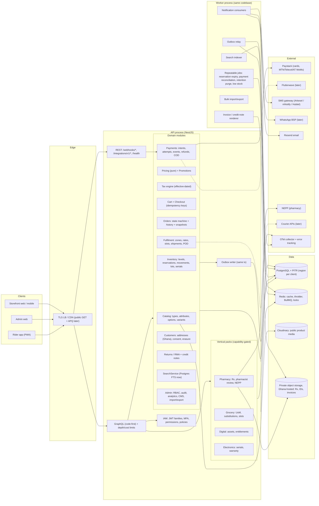
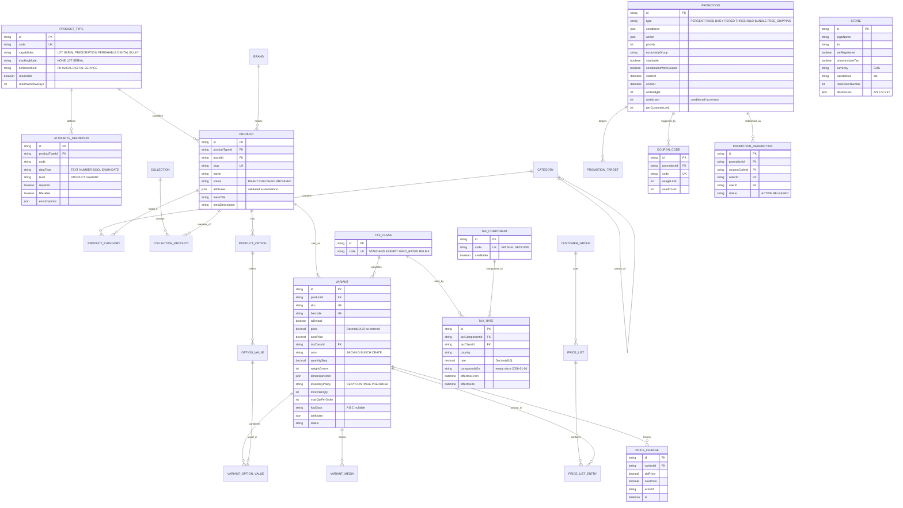
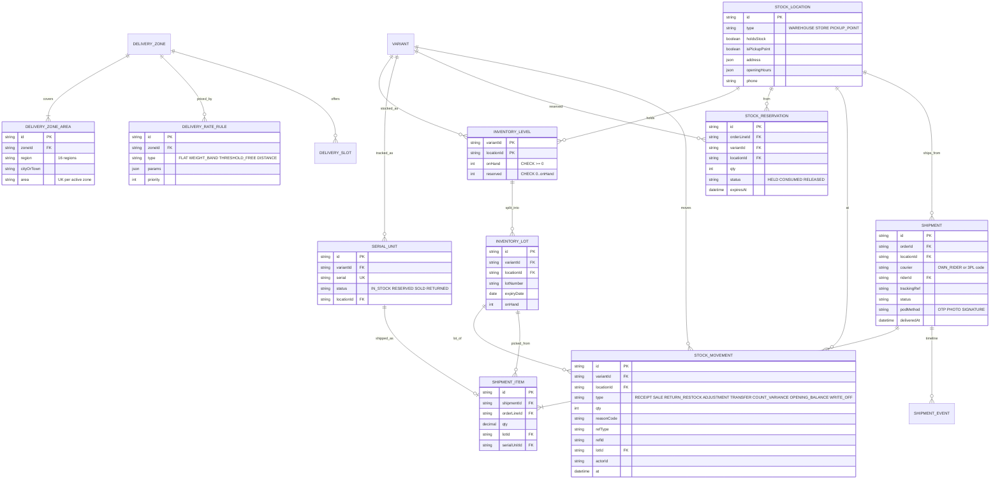
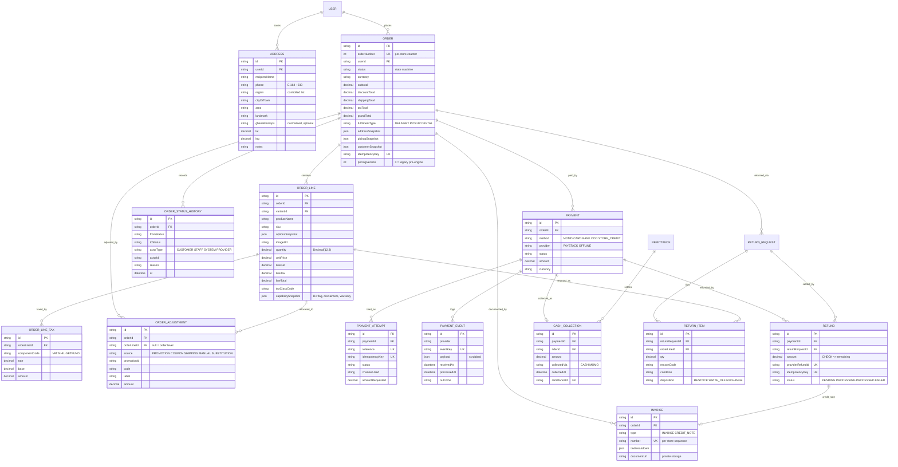
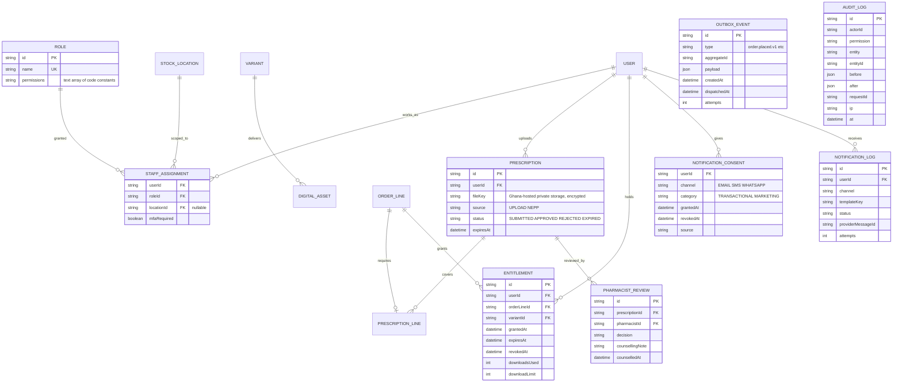

# Domain gap analysis: current backend vs target platform (prompt §3)

Author: Domain Gap Analyst (Claude Opus 5.5, high effort), 2026-11-16. Read-only.

Inputs: target spec `CLAUDE_CODE_AUDIT_AND_ROADMAP_PROMPT_1.md` §3 and §6; `tmp/audit/progress.md` (verified Critical/High list); `01-database-schema-review.md`; `02-security-review.md`; `03-performance-review.md`; `05-dependencies-and-ops.md`; `_work/money-flow.md`; `_work/order-lifecycle.md`; `_work/ghana-research.md`; `tmp/audit/cartography.md`; every `modules/*.md` (verdict, summary, findings). I spot-checked `prisma/schema.prisma` (all 556 lines), `schema.gql` money field types, `src/payment/payment.service.ts:261-305` and `src/order/order.service.ts:370-391`.

Finding IDs (DB-, SEC-, PERF-, MONEY-, DISC-, CPN-, TAX-, CUR-, ORD-, PAY-, IAM-, PLAT-, OBS-, OPS-, DEP-, etc.) refer to the module and area reports. I re-cite file:line where I read the code myself.

## Conventions

**State** (strict; a feature that exists but is broken counts as Defective, not Present):
- **Absent**: no model, no code.
- **Partial**: some of the capability exists and works; material parts are missing.
- **Defective**: present but wrong, unsafe or unreachable in a way that loses money, stock, data or trust.
- **Present**: works and is fit for the target with minor polish.

**Effort** (one developer working with Claude Code; assumption, not measured): **S** ≤ 2 days · **M** 3–7 days · **L** 2–4 weeks · **XL** > 1 month.

**Launch class**:
- **Must**: required to take real money from a real client.
- **Must-if-X**: required only if the first client is in vertical X.
- **Competitive**: a differentiator worth building soon after launch.
- **Later**: valuable, not urgent.

**Assumptions** (mark them wrong and the classification shifts):
- A1. The first client is one general-retail store (fashion, electronics, beauty or mixed) in Ghana, selling in GHS only. Pharmacy, grocery and digital/courses come later as "vertical packs".
- A2. No environment holds real customer or order data yet. This is **unknown** (DB-08). If it is false, every migration step in section 5 needs the "existing data" branch.
- A3. Ghana facts come from `_work/ghana-research.md` and were not independently re-verified by me.
- A4. Whether the first client is VAT-registered is unknown. Under Act 1151 the goods registration threshold is GHS 750,000 (research §1.4).

---

## 0. Bottom line

1. **What the code is today:** a single-store, de-facto-GHS, physical-goods-only shop. Its catalogue CRUD is reasonable. The money, stock, payment and order-state paths all exist, but each is defective.
   - **Money:** discounts are shown but not charged (MONEY-01). Shipping silently becomes 0 (MONEY-02). Tax is baked into the list price and never recorded (TAX-03, DB-04).
   - **Stock:** cancelling an order repeatedly inflates stock (DB-06).
   - **Payments:** a retry deletes the in-flight payment (DB-01). A replayed verify revives cancelled or delivered orders (PAY-01). Every REST route returns 500, including the webhook (PLAT-01, IAM-07).
2. **Matrix totals:** of **102** capability rows derived from §3.1–3.10, **47 are Absent**, **17 Partial**, **37 Defective** and **1 Present** (SSRF, 9.11). Nothing that touches money, stock or payments is Present. 61 rows are launch-gating for a general-retail first client, in full or for a minimal subset.
3. **Three structural absences drive most of the gaps.** Everything else hangs off these:
   - **No sellable unit.** Everything is `Product`. `Variant` exists but is never sold (DB-12).
   - **No ledgers.** Payments, stock, tax and order status are mutable rows or counters. History is overwritten or deleted (DB-01/02/04/06/07).
   - **No asynchronous infrastructure.** There is no job queue and no outbox. Two in-process crons run on every replica. Email is fire-and-forget (PERF-05, PERF-14, cron-jobs.md).
4. **The target needs a re-founded core, not more features on the current one.** The sequence that follows from the evidence is:
   - Phase 0 stabilises today's single-store behaviour (no new models beyond payment attempts, events, refunds and status history).
   - Phase 1 replaces the core (variant-as-unit, money type, pricing function, tax lines, ledgers, outbox, RBAC).
   - Only after that do vertical packs make sense.
5. **Recommended answers to the §6 decisions** (detail in section 3):
   - Single-store-per-deployment ("silo") now, with a documented path to pooled multi-tenant.
   - Hybrid attribute model (typed definitions, JSONB values, typed capability tables).
   - Paystack first, with pay-on-delivery in scope but risk-gated.
   - Postgres search first.
   - GraphQL first-party, plus REST only for inbound integrations.
   - Professional advice before pharmacy, before tax invoicing goes live, and on any funds-holding model.

---

## 1. Capability matrix (target §3.1–3.10)

### 1.1 Multi-vertical product model (§3.1)

| # | Capability | State | Evidence | Gap | Effort | Launch class |
|---|---|---|---|---|---|---|
| 1.1 | Product types with variant option axes (size × colour × material; storage × colour) | Defective | `Variant` hard-codes `size`/`color` (`schema.prisma:133-153`). There is no SKU or barcode on the variant and no uniqueness on the combination. The cart and order never set `variantId` (`cart.repository.ts:35-48`, `order.service.ts:316-328`). VAR-01, DB-12. | `ProductOption`, `OptionValue` and `VariantOptionValue` with a unique combination per product. Variant SKU, barcode, price, stock, weight and media. A variant-aware cart, order and stock. | L | Must |
| 1.2 | Per-type attribute definitions with validation (descriptive or filterable attributes) | Absent | `Product` has fixed columns only (`schema.prisma:155-209`). There is no `ProductType` or attribute model. | `ProductType`, `AttributeDefinition` (dataType, unit, required, filterable) and validated JSONB values on Product and Variant (section 2.2). | L | Competitive (minimal product type: Must, because it carries the capability flags) |
| 1.3 | Expiry dates | Partial | `Product.expiryDate` (`schema.prisma:185`) is stored and read by nothing (DB review §2). | Expiry belongs to a lot, not a product. It needs auto-delisting and a "do not ship below X shelf life" rule (FDA). | M | Must-if-grocery/pharmacy |
| 1.4 | Batch/lot numbers and FEFO picking | Absent | No lot model. | `InventoryLot` (lotNumber, expiry, onHand per location), FEFO allocation at fulfilment, and a recall lookup by lot. | L | Must-if-pharmacy/grocery |
| 1.5 | Storage conditions / cold chain; perishable delivery windows | Absent | — | `storageCondition` capability on the product type, a courier-eligibility rule (pharmacy policy s.4.2.2: no courier delivery of ≤ 8 °C or injectable medicines unless the cold chain is ensured), and delivery slots. | M | Must-if-pharmacy/grocery |
| 1.6 | Pharmacy: prescription-required flag, prescription upload, pharmacist approval | Absent | — | `Prescription`, a pharmacist review state machine, FDA class A/B/C on the variant, a designated pharmacist (staff role), a counselling-call record, and NEPP linkage (research §4.1). Prescription files must be stored in Ghana (s.4.6). | XL | Must-if-pharmacy (legal gate) |
| 1.7 | Pharmacy: restricted/controlled items, purchase quantity limits, disclaimers | Absent | — | Per-variant `maxQtyPerOrder` / `maxQtyPerPeriod`, a narcotics/psychotropics block (policy s.4.8.1), disclaimer text acknowledged at checkout and snapshotted on the order. | M | Must-if-pharmacy |
| 1.8 | Groceries: weight-based and unit-of-measure pricing | Absent | `CartItem.quantity` and `OrderItem.quantity` are `Int` (`schema.prisma:290,348`). Price is per unit only. | `Variant.uom` (EACH, KG, BUNCH, CRATE…), decimal quantity with a step, and `Decimal(12,3)` quantity on lines. Weighed-at-pick adjustment (authorise an estimated amount, capture the actual). | L | Must-if-grocery |
| 1.9 | Groceries: substitutions | Absent | — | A substitution preference per line, picker substitution with customer approval, and a price difference via an order adjustment. | M | Must-if-grocery |
| 1.10 | Scheduled delivery slots | Absent | — | `DeliverySlot` (zone, window, capacity) plus reservation of a slot at checkout. | M | Must-if-grocery; Competitive otherwise |
| 1.11 | Electronics: serial/IMEI tracking per unit | Absent | — | `SerialUnit` (serial unique, status, location, orderLineId) with capture at dispatch. | L | Competitive (Must-if phone retailer offering warranty) |
| 1.12 | Electronics: warranty periods, condition (new/refurbished/used) | Absent | — | Attributes (condition, warrantyMonths) on the variant. Warranty start = delivery date, kept on the order line snapshot. | S (after 1.2) | Must-if-electronics (condition is a disclosure under Act 772 s.47 "sufficient description") |
| 1.13 | Fashion: size charts, fit notes, colour swatches, per-variant images | Absent | Only `Product.images String[]` (`schema.prisma:175`). There are no variant media or option-value swatches. | `VariantMedia`, `OptionValue.swatch` (hex or image), and a `SizeChart` content block linked to a product type or brand. | M | Must-if-fashion (variant images); Competitive (size charts) |
| 1.14 | Furniture: dimensions and weight for freight; bulky-item delivery | Absent | — | `weightGrams` and `lengthMm`/`widthMm`/`heightMm` on the variant, a `bulky` flag, and weight/size delivery rules (row 5.1). | M | Later (Must-if-furniture) |
| 1.15 | Furniture: assembly options; made-to-order with lead times | Absent | — | Add-on options priced as order adjustments, and `leadTimeDays` on the variant to drive the delivery promise. | M | Later |
| 1.16 | Digital products: no shipping, instant or scheduled access, licences, download limits | Absent | `FulfillmentType` is only `DELIVERY | PICKUP` (`schema.prisma:433-436`). Every order needs an address or a pickup location. | `fulfilmentKind` on the product type, `DigitalAsset`, `Entitlement` (granted on capture, revoked on refund), signed expiring download URLs, a download counter, and licence keys. | L | Later |
| 1.17 | Courses: enrolment, progress hooks, subscription access | Absent | — | `Entitlement` plus outbound events (`entitlement.granted`) consumed by an LMS. A recurring subscription. Paystack MoMo does not support recurring charges (research §2.1), so a card or a manual renewal flow is needed. | XL | Later |
| 1.18 | Services/bookings: appointment slots | Absent | — | `BookableResource`, `Slot` and `Booking`, with a fulfilmentKind of SERVICE. | XL | Later |
| 1.19 | Bundles/kits | Absent | — | `BundleComponent(bundleVariantId, componentVariantId, qty)`. Stock is drawn from the components. Price is fixed or computed. | L | Competitive |
| 1.20 | Gift cards | Absent | — | A gift card is a stored-value liability with its own ledger, so it falls under the same legal question as the wallet (row 6.8). Its tax treatment at sale vs redemption is an adviser question. | L | Later |
| 1.21 | Pre-orders and back-orders | Partial | `StockStatus` has `PREORDER`/`BACKORDER` (`schema.prisma:217-222`), but no behaviour uses it. Checkout rejects any order beyond stock. The field goes stale (DB review §2). | A per-variant `inventoryPolicy` (DENY / CONTINUE / PREORDER with a release date), allowing negative available stock only under policy, and a promise date on the line. | M | Competitive |
| 1.22 | Wholesale/tiered (B2B) pricing; minimum order quantities | Absent | — | `PriceList` (by customer group) with quantity breaks, `minOrderQty` / `orderQtyStep` on the variant, customer groups, and a business TIN on the customer for VAT invoices. | L | Competitive |

### 1.2 Pricing and promotions (§3.2)

| # | Capability | State | Evidence | Gap | Effort | Launch class |
|---|---|---|---|---|---|---|
| 2.1 | Discounts at product/variant/category/collection/brand/cart level | Defective | Product is m:n to Discount, but variant and category are 1:n through `discountId`, so a category can belong to only one discount (DB-19, `schema.prisma:95-96,143-144,264-268`). Collection, brand and cart-level discounts do not exist. Discounts are **never applied to the amount charged** (MONEY-01, `order.service.ts:316-328`). | A single promotions model with explicit targets (section 2.4), applied by the same pricing function in catalogue, cart and checkout. | L | Must (correct, or switched off at launch) |
| 2.2 | Coupons: global and per-user limits | Defective | The global limit is checked outside the transaction and then incremented unconditionally, so concurrent redemptions overspend it (CPN-01, DB-09, `coupons.repository.ts:61-64`). The per-user limit is hard-coded as one use forever (`schema.prisma:480`). A cancelled order does not release its use (CPN-02). | A conditional increment, a `perCustomerLimit`, and release on cancel or expiry. | M | Must |
| 2.3 | Coupons: first-order only, specific customers/segments, specific products/categories, free-shipping coupons | Absent | `Coupon` has code, type, value, limits, expiry and minimum only (`schema.prisma:452-469`). | Coupon conditions (first order, customer group, targets) and a free-shipping action. | M | Competitive |
| 2.4 | Timed/flash sales with countdowns and limited quantity | Partial | `Discount.startDate`/`endDate` exist (`schema.prisma:261-262`), but application is defective (2.1). There is no quantity budget. | A promotion schedule plus a per-promotion unit budget, decremented atomically. Hot-SKU contention needs the conditional stock update (PERF-04). | M | Competitive |
| 2.5 | Buy X get Y, bundle pricing, tiered/volume, spend X save Y | Absent | `DiscountType` is only `PERCENTAGE | FLAT` (`schema.prisma:428-431`). | Promotion action types (BXGY, TIERED, ORDER_THRESHOLD, FIXED_PRICE_BUNDLE) with line allocation. | L | Competitive |
| 2.6 | Stacking and priority rules; deterministic best price | Defective | `selectBestDiscount` compares a raw percentage number with a cedi amount (DISC-02, `discount.service.ts:255-268`). No stacking rule exists between coupons and automatic discounts (coupons.md). | An `exclusivityGroup` + `priority` + `stackable` model and a defined algorithm with tie-breaks (section 2.4). | M | Must (a written, tested rule, even a simple one) |
| 2.7 | Price history and audit trail of price changes | Absent | `AuditService` is called only from `OrderService` (audit-log.md). The tax re-price rewrites every product price with raw SQL (`tax.service.ts:55-63`). | An append-only `PriceChange(variantId, old, new, actor, reason, at)` and an audit entry on every price, tax or promotion mutation. | S | Must (audit entry); Competitive (customer-visible history) |
| 2.8 | Correct money handling: no floats, explicit rounding | Defective | The DB uses `Decimal(10,2)`, but every computation converts with `Number()` and uses five different rounding modes. Three columns are `DECIMAL(65,30)` (money-flow §3, MONEY-06, DB-18). GraphQL exposes money as `Float` (`schema.gql:433,863,884,925`). | One `Money` type and one rounding policy throughout, and a GraphQL `Money` type (section 2.3). | L | Must |

### 1.3 Checkout, payments and money (§3.3)

| # | Capability | State | Evidence | Gap | Effort | Launch class |
|---|---|---|---|---|---|---|
| 3.1 | MoMo (MTN, Telecel, AT), cards, bank transfer | Defective | Paystack initialize sends no `channels` (`payment.service.ts:270-277`), so the available methods are whatever the Paystack account enables. Paystack Ghana covers cards plus all three MoMo networks at 1.95% (research §2.1). The route is unreachable: `POST /payment/initialize` returns 500 (PLAT-01, IAM-07). The client chooses the currency (CUR-01). | Fix the REST context. Fix the currency server-side. Record the method actually used (from the verify payload) on the attempt. | S (fix) | Must |
| 3.2 | Pay on delivery | Defective | COD orders are created as `PROCESSING` (`order.service.ts:378-381`). `recordCodPayment` moves **any** status to `DELIVERED` (order-lifecycle #8). Currency is hard-coded GHS. There is no risk gate, no cash-collection or remittance record, and no rider. | COD as a payment method with risk gates (verified phone, active-order cap per phone/address, basket cap, area allow-list, blacklist) and a `CashCollection` + remittance ledger (section 2.6). | M | Must (if COD is offered, which is recommended) |
| 3.3 | Payment-provider abstraction | Absent | Paystack calls are hard-wired in `payment.service.ts`. The refund goes through raw axios (`returns.service.ts:136-140`). | A provider port with two implementations at launch, Paystack and Offline/COD (section 2.6). | M | Must (data model); Competitive (2nd online provider) |
| 3.4 | Idempotent payment initialisation; payment retries | Defective | Re-initialise **deletes** the pending row (DB-01, `payment.service.ts:248-259`). The reference is `orderId-Date.now()`. A FAILED attempt hits `orderId @unique` and the order is stuck forever (order-lifecycle §2). Order status is not checked, so a CANCELLED order can be paid (MONEY-04). | `PaymentAttempt` (many per order, unique reference, never deleted), an idempotency key on initiate, a status precondition, and a lock on the amount. | M | Must |
| 3.5 | Webhook: signature verification, replay protection, idempotent processing | Defective | The HMAC is computed over `JSON.stringify(dto)` rather than the raw body, and compared with a non-constant-time `===` (SEC-04, `payment.service.ts:377-392`). There is no event table (DB-03). The order update is unconditional (PAY-01). The webhook returns 200 even when processing fails (PERF-06). The endpoint returns 500 today (PLAT-01). | Raw body with `timingSafeEqual`, a `PaymentEvent(provider, eventKey unique)`, a 200 response after persisting, async processing, and conditional transitions. Amount and currency must match the order (MONEY-04). | M | Must |
| 3.6 | Reconciliation job for missed webhooks | Absent | cron-jobs.md: "the jobs the payment flow actually needs … don't exist". | A scheduled verify of attempts still PENDING after N minutes, plus a daily settlement report diff against Paystack. | M | Must |
| 3.7 | Partial and full refunds | Defective | The refund is called before any DB write, there is no `Refund` record, the amount is unbounded, a double-click refunds twice, and **every** item is restocked (MONEY-05, DB-03, returns.md REWRITE, `returns.service.ts:88-110`). COD orders cannot be refunded. | A `Refund` (amount ≤ remaining refundable, idempotency key, provider refund id, async status), a manual refund method for COD/MoMo, and a credit note. | L | Must (full + capped partial) |
| 3.8 | Split payments (multi-vendor) | Absent | — | Only relevant under a marketplace (decision D1). Paystack subaccounts or splits. A legal check is required (BoG Notice 43, research §2.3). | XL | Later |
| 3.9 | FX rates; multi-currency display vs settlement | Defective | `CurrencyService` is unused and has hard-coded rates (currency.md). `Product.currency` is ignored when summing (DB-11). The charge currency is client input (CUR-01). | For launch, **GHS only, enforced server-side** (S). Later, display-only conversion from a dated `ExchangeRate` table, with settlement always in GHS. | S (lock to GHS) / M (display FX) | Must (lock); Later (FX) |
| 3.10 | Tax engine for VAT 15% + NHIL 2.5% + GETFund 2.5% (non-compounding since 2026-01-01), exemptions by category | Defective | Tax is baked into `Product.price` by summing rates as floats (`tax.service.ts:15-35,55-63`). An edit that omits `isTaxable` strips tax, or sets the price to 0 (TAX-01). The re-price SQL probably errors (TAX-02, Suspected). No tax is stored on the order (DB-04). Only a boolean `isTaxable` exists. | Components, tax classes, effective-dated rates, per-line per-component tax computed at checkout and stored (section 2.5). | L | Must (legal: per-invoice VAT/levy reporting) |
| 3.11 | Invoices/receipts (PDF); credit notes | Absent | Only an order-confirmation email exists (notifications.md). There is no invoice number or document. | `Invoice` (sequential number per store, TIN, line tax breakdown, receipt reference) and `CreditNote` on refund. PDF rendered by a worker. Keep a seam for GRA E-VAT/FED (research §1.7). | M | Must (tax receipt with breakdown); Competitive (PDF) |

### 1.4 Inventory (§3.4)

| # | Capability | State | Evidence | Gap | Effort | Launch class |
|---|---|---|---|---|---|---|
| 4.1 | Stock reservation with expiry during checkout | Defective | Stock is decremented at order creation. The hourly expiry only takes ONLINE orders **with no Payment row** (`order.repository.ts:165-176`), so an abandoned PENDING payment holds stock forever (PERF-06). The expiry is not idempotent across instances (PERF-05). There is no reservation record. | `StockReservation` (HELD/CONSUMED/RELEASED, `expiresAt`), released exactly once by a conditional update, run by a single-instance job. | L | Must |
| 4.2 | Concurrency-safe stock updates | Partial | Checkout decrements atomically inside a transaction (order.md). **Every restore path is unconditional**: repeated cancel inflates stock (DB-06, Critical), as do delete and refund. There is no `CHECK quantity >= 0`. Locks are taken in cart order, a deadlock risk (PERF-04). | Conditional decrement (`WHERE available >= n`), CHECK constraints, sorted lock order, restore only on a winning state transition. | M | Must |
| 4.3 | Multi-location / multi-warehouse / multi-branch | Absent | `PickupLocation` is an address with no stock (`schema.prisma:522-535`). | `StockLocation` + `InventoryLevel(variant, location)` (section 2.7). | L | Competitive (Must-if the client has more than one branch) |
| 4.4 | Batch/lot and expiry tracking; serial tracking | Absent | — | See rows 1.4 and 1.11. Tracking mode on the product type. | L | Must-if-pharmacy/grocery; Must-if-phones |
| 4.5 | Stock movements ledger | Defective | `InventoryLog` exists, and restock writes it correctly (inventory.md). Product/variant update overwrites quantity without a log, and the soft-delete and refund restores write none (DB-07). Deleting a product cascades its log (DB-23, `schema.prisma:513`). The ledger cannot reconcile with stock. | An append-only `StockMovement` written in the same transaction as every level change, `Restrict` on the FK, and a nightly reconciliation check. | M | Must |
| 4.6 | Stock adjustments with reasons | Partial | The `ADJUSTMENT` enum value exists (`schema.prisma:445-450`), but there is no adjustment operation. Admin edits set an absolute quantity (inventory.md). | `adjustStock(variant, location, delta, reasonCode, note)` with reason codes (damage, theft, count correction, expiry write-off). | S | Must |
| 4.7 | Stock-take | Absent | — | `StockCount` session (snapshot, counted quantities, variance posted as adjustments). | M | Competitive |
| 4.8 | Low-stock notifications to staff | Partial | A cron every 6 h writes warn **log lines only** (`low-stock.task.ts:13`; cartography §3). | Notification to users holding the inventory permission (depends on 6.9). | S | Competitive |
| 4.9 | Supplier and purchase-order basics | Absent | — | `Supplier`, `PurchaseOrder`, `PurchaseOrderLine`, and goods receipt posting movements (and lots), with cost price feeding margins (row 7.3). | L | Later |

### 1.5 Delivery and fulfilment (§3.5)

| # | Capability | State | Evidence | Gap | Effort | Launch class |
|---|---|---|---|---|---|---|
| 5.1 | Delivery zones and fee rules (flat, distance, weight/size, zone, free above threshold) | Defective | `ShippingZone.cities String[]` is matched exactly against free-text `Address.city`. **A missing match means a fee of 0** (MONEY-02, SHZ-01, `shipping-zones.service.ts:9,53-60`). Overlapping zones return an arbitrary match. Only a flat fee exists. The fee is not stored on the order (shipping-zones.md REWRITE). | Zones over a controlled region→area list, rule types (flat, weight band, free-over threshold, distance later), no silent zero, and a fee snapshot on the order. | M (launch subset) / L (full) | Must |
| 5.2 | Ghana Post GPS digital address; landmark-style fields | Absent | `Address` has street/city/state/**required zipCode**/country (`schema.prisma:70-84`). | Region (controlled, 16), city/town, area, landmark, GPS code (normalised, optional, unverified), recipient name and phone, lat/lng, delivery notes (research §7). | M | Must |
| 5.3 | Pickup points / click-and-collect | Defective | The chosen pickup location is **never validated** (PCK-01). There is no snapshot, opening hours or phone, and no "ready for pickup" status. | Validate the location. Snapshot it. Add a READY_FOR_PICKUP state and a collection code (OTP). | S | Must (if offered) |
| 5.4 | Shipment creation, tracking numbers, status timeline, proof of delivery, rider assignment, courier abstraction | Partial | There is a single `trackingNumber`/`carrier` on `Order` (`schema.prisma:321-322`). `updateShipping` emails "SHIPPED" without changing status (order-lifecycle #10). There is no status history, rider, proof of delivery or courier integration. | `Shipment`/`ShipmentItem`/`ShipmentEvent`, rider assignment (staff role), proof of delivery (OTP code or photo), and a courier port with a manual/own-riders implementation first. | L | Must (shipment + own riders + proof of delivery); Later (3PL APIs) |
| 5.5 | Order splitting into multiple shipments; partial fulfilment | Absent | — | Shipments per location or availability; line-level fulfilled quantities. | L | Competitive |
| 5.6 | Customer-visible order and delivery tracking | Partial | A customer can read their own order status. There is no timeline (no `OrderStatusHistory`, DB review §7). Real-time is not needed (decision D5). | Status history exposed to the owner; SMS on each milestone. | M | Must (timeline + SMS) |

### 1.6 Customer experience (§3.6)

| # | Capability | State | Evidence | Gap | Effort | Launch class |
|---|---|---|---|---|---|---|
| 6.1 | Guest checkout | Absent | `Cart.userId` is required and unique (`schema.prisma:278`). `createOrder` needs a Bearer token (cartography). | Guest cart keyed by a token. Phone-verified checkout (SMS OTP) with an implicit account. Order lookup by order number + phone. | M | Competitive (high conversion value in Ghana) |
| 6.2 | Saved carts | Defective | A per-user server cart persists, but lines are product-only, concurrent adds create duplicate lines, prices drift, and DRAFT/ARCHIVED products are not checked (cart.md REWRITE, DB-26). | Variant-aware lines, `@@unique(cartId, variantId)`, price recomputed on read by the pricing function. | M | Must |
| 6.3 | Abandoned-cart recovery | Absent | — | A job plus a consented SMS/WhatsApp/email reminder, respecting the NCA promotional window (research §8.1). | M | Competitive |
| 6.4 | Wishlists | Defective | It works per user, but returns inactive/draft products, has a racy read-modify-write, and declares a non-null `Wishlist.user` with no resolver (wishlist.md). | Filter by status, add a unique join, fix the field. | S | Competitive |
| 6.5 | Recently viewed | Absent | — | Client-side or a small per-user table. | S | Later |
| 6.6 | Product Q&A | Absent | — | `ProductQuestion`/`Answer` with moderation. | M | Later |
| 6.7 | Verified-purchase reviews with moderation and media | Defective | **REV-01/SEC-01 Critical**: `Review.user` exposes reviewer PII anonymously. There is no verified-purchase check, no DB uniqueness, no moderation and no media. Soft-delete columns are unused (review.md). | A public reviewer projection, `orderLineId` for verified purchase, a moderation status, media, a rating aggregate. | M | Must (PII fix, Phase 0); Competitive (rest) |
| 6.8 | Loyalty points, referrals, store credit, wallet | Absent | — | A ledger per program. **Store credit and wallet are stored value: BoG e-money/PSP licensing question** (legal). Store credit as a refund method is useful for returns. | L each | Later (store credit: Competitive) |
| 6.9 | Notifications: email, SMS, WhatsApp, in-app; templates; preferences; queue with retries | Defective | Email only (Resend), fire-and-forget. Errors are ignored (NOT-01). The payment email is never sent (NOT-05). HTML is unescaped (SEC-02). There is no `.catch`, so a DB error can crash the process (PERF-14). notifications.md REWRITE. | Outbox → queue → channel adapters (email, SMS gateway; WhatsApp later), stored templates, preferences/consent, delivery log, retries (section 2.9). | L | Must (email + SMS transactional with retry); Competitive (WhatsApp); Later (in-app) |
| 6.10 | Search: full text, typo tolerance, facets, sorting, autocomplete, synonyms | Defective | Prisma preview FTS with no GIN index. Raw text is joined into `to_tsquery` (500 on operators, Suspected). Filter bugs: `inStock` is a no-op, price range is clobbered, `subCategoryName` compares the wrong field (PERF-08, products.md). There is no typo tolerance, facets, autocomplete or synonyms. | Postgres FTS + `pg_trgm` + GIN, `websearch_to_tsquery`, attribute facets from JSONB, a search module seam (decision D4). | M (fix + basic) / L (facets, autocomplete) | Must (working search + filters); Competitive (typo, facets, autocomplete) |
| 6.11 | Returns/RMA with reasons, inspection, restocking, refunds or exchanges; windows by product type | Defective | Whole-order only, free text, no items, no inspection step. Refund restocks **every** item even when the order was already cancelled. Refund amounts are unbounded and refunds are not idempotent. There are no windows (returns.md REWRITE, MONEY-05). | `ReturnRequest` + `ReturnItem` (qty, reason code, condition), states (requested→approved→received→inspected→refunded/exchanged/rejected), restock-or-write-off per item, return window and returnability per product type (Act 772 s.49 exemptions: food, perishables, books, made-to-order, opened medicines). | L | Must (item-level + correct refund + statutory windows) |

### 1.7 Admin, staff and operations (§3.7)

| # | Capability | State | Evidence | Gap | Effort | Launch class |
|---|---|---|---|---|---|---|
| 7.1 | Fine-grained RBAC (permissions; owner, manager, inventory, pharmacist, cashier, rider, support) | Defective | The role enum is `USER/ADMIN/SUPER_ADMIN` (`schema.prisma:403-407`). The check is an exact match with no hierarchy, and role lists are inconsistent (SEC-03). ADMIN can rewrite peer admins' emails (IAM-10). | Permissions as code constants, roles as data, staff assignments optionally scoped to a location (section 2.11). | L | Must (minimal: seeded Owner/Manager/Support/Rider roles) |
| 7.2 | Full audit logging of sensitive actions | Defective | 4 call sites, all in `OrderService`. Writes happen after the change, outside the transaction. The table is mutable. There is no read API or request context (audit-log.md). Refunds, role changes, prices and coupons are unaudited. | `AuditLog` written in the same transaction (or via the outbox) for every privileged mutation, append-only (REVOKE UPDATE/DELETE), with actor, IP, request id and a read API. | M | Must |
| 7.3 | Analytics: sales, margins, conversion, AOV, cohorts, inventory valuation, expiring stock, coupon performance | Defective | "Revenue" includes unpaid PENDING orders, VAT and shipping (MONEY-07). Reports read live product names (DB-05). There is no cost price, no conversion data, no valuation. Everything is all-time and uncached (analytics.md, PERF-20). | Reports built on snapshots and captured payments. Cost price on variant/lot. A sales tax report for the VAT return. Valuation and expiry reports. Coupon performance. | L | Must (paid sales + VAT/levy report); Competitive (rest) |
| 7.4 | CMS-ish content: banners, homepage sections, collections, SEO fields (slugs, meta), redirects | Absent | There is no `slug` on Product, Category or SubCategory (categories.md, DB review §2). There are no content models. | Slugs + meta on catalogue entities (cheap now, costly once URLs are live), `Collection`, `ContentBlock`, `Redirect`. | S (slugs/meta) / M (content) | Must (slugs/meta); Competitive (banners, collections); Later (redirects) |
| 7.5 | Bulk import/export (CSV/Excel) of products and stock | Absent | — | An async import job (validate → preview → commit) with an error report, and export. | M | Must (onboarding a real catalogue by hand is not realistic) |
| 7.6 | Per-store settings to enable verticals and features (feature flags) | Absent | — | `Store` settings row with `capabilities` and per-product-type capabilities (section 2.12). | M | Competitive (Must when the second vertical lands) |

### 1.8 Platform architecture (§3.8)

| # | Capability | State | Evidence | Gap | Effort | Launch class |
|---|---|---|---|---|---|---|
| 8.1 | Tenancy model (single-store vs SaaS vs marketplace) | Absent | Implicit single store. There is no store or tenant entity. | Decision D1. Recommended: silo per deployment plus a `Store` settings row. | S (silo) / XL (pooled) / XL+ (marketplace) | Must (the decision, before Phase 1) |
| 8.2 | GraphQL plus REST for webhooks and integrations; real-time order tracking | Partial | Code-first GraphQL: 154 operations, 14 public (cartography). REST exists (webhook, payment init, uploads, health) but **all REST routes return 500** (PLAT-01, IAM-07). There are no subscriptions. | Fix REST context handling. Add an integrations REST namespace on demand. No subscriptions for now (decision D5). | S | Must (fix) |
| 8.3 | Background jobs; domain events; outbox | Absent | Only in-process `@nestjs/schedule` crons, run on every replica with no lock (PERF-05, OPS-09). No queue, no outbox, no events. | Outbox table, a Redis-backed queue (BullMQ, new dependency, needs approval), a separate worker entrypoint, single-run repeatable jobs (section 2.9). | L | Must |

### 1.9 Security (§3.9)

| # | Capability | State | Evidence | Gap | Effort | Launch class |
|---|---|---|---|---|---|---|
| 9.1 | OWASP API Top 10 / ASVS as reference | Defective | Fail on API1, API2, API3, API4 and API8 (02-security §3). | The Phase 0/1 remediation list in 02-security §6, plus an auth-matrix snapshot test. | L (aggregate) | Must |
| 9.2 | Token handling; refresh rotation with reuse detection | Defective | Refresh tokens survive password reset, slide forever, have no reuse detection and no `jti` (IAM-02/03/04). The rotation update is unconditional (`users.repository.ts:122-138`). | Token families, `jti`, conditional rotation, revoke on reset/email change, absolute lifetime. | M | Must |
| 9.3 | Session/device management | Absent | `RefreshToken` has no device, IP or user-agent (`schema.prisma:45-56`). | Session list + revoke, and "log out everywhere". | M | Competitive |
| 9.4 | MFA (TOTP/SMS) for admins | Absent | No OTP/TOTP code anywhere (grep). | TOTP for staff with money or price permissions. Prefer TOTP over SMS because of SIM-swap risk. | M | Must (for staff who can refund or change prices) |
| 9.5 | Password policy; breached-password check | Defective | Sign-in caps passwords at 16 characters while sign-up allows 64 (IAM-05). Reset accepts `aaaaaaaa` (IAM-06). No breached-password check. | One policy everywhere; k-anonymity breached check (Competitive). | S | Must (policy); Competitive (breach check) |
| 9.6 | Lockout without enumeration or lockout-DoS | Defective | Racy, re-arms forever, leaks account existence (IAM-08). | Atomic counters, exponential backoff per account + IP in Redis, generic errors. | S | Must |
| 9.7 | Object-level authorisation on every resolver | Defective | Root operations are correct. **Field resolvers bypass all guards**: anonymous PII via `product.reviews.user.{addresses,orders}` (SEC-01, Critical, confirmed by test). | Public projections, ownership checks in field resolvers, an e2e anonymous-query regression test. | M | Must (Phase 0) |
| 9.8 | GraphQL hardening: depth, complexity, alias/batching limits, persisted queries, introspection off, error masking | Partial | Introspection is off in production and errors are masked in production (02-security §1). Depth, complexity and alias limits do not exist on a cyclic public schema (PLAT-05, PERF-01). No persisted queries. | Depth + cost limits, list caps, persisted queries for first-party clients. | M | Must (limits); Competitive (persisted queries) |
| 9.9 | Input validation, sanitisation, mass-assignment protection | Partial | The global `ValidationPipe` uses whitelist and forbidNonWhitelisted, and there is no role mass-assignment (users.md). Gaps: tag inputs are unvalidated (tag.md), negative `basePrice` is possibly accepted (DB review §4, Suspected), the category-name regex rejects real names (categories.md). | Close the listed gaps. Add DB CHECK constraints as the backstop. | S | Must |
| 9.10 | File-upload safety | Defective | Unreachable today (UPL-01). Any customer can upload (UPL-02). No magic-byte check (UPL-03). Possible decompression bomb (UPL-04). | Staff-only uploads (or signed direct-to-storage), magic bytes, pixel limit, reject on decode failure. Private, Ghana-hosted storage for prescriptions and KYC files. | S–M | Must |
| 9.11 | SSRF on URL inputs | Present | No user-controlled URL is fetched server-side (02-security §3, API7 Pass). | Keep it so with a test when URL-import features arrive (bulk import with image URLs is an SSRF vector). | — | — |
| 9.12 | Rate limiting per IP and per user on login, OTP, coupon validation, checkout | Defective | In-memory, per instance, per IP only. `trust proxy` is hard-coded to 1 (PLAT-03/04, PERF-12, `main.ts:11`). The coupon validate endpoint is an oracle (CPN). Mobile CGNAT in Ghana makes per-IP buckets collide. | Redis-backed storage, a user/phone key when known, per-operation limits on OTP, coupons and checkout. | M | Must |
| 9.13 | Secrets management, CORS, security headers, CSRF, webhook verification | Partial | CORS allowlist and helmet are present. A DB credential is in a tracked file (SEC-05/OPS-18). Placeholder secrets pass Joi (PLAT-07). The Apollo 4 CSRF-prevention bypass advisory applies and Apollo 4 is EOL (DEP-03). Webhook verification is defective (3.5). | Rotate and untrack the credential, strict env validation, Apollo 5, raw-body HMAC, a secret scanner in CI. | S–M | Must |
| 9.14 | PII encryption at rest, data retention, Act 843 compliance | Absent | No erasure/anonymisation path (DB-24). No retention jobs. PII and credentials in logs (PLAT-02, OBS-01). No consent records. Foreign processors undisclosed (SEC-06). | DPC registration, anonymising erasure, retention schedule + purge jobs, consent capture, field encryption for prescriptions and IDs, processor list. | M–L | Must (registration, erasure, log hygiene, consent); Must-if-pharmacy (encryption + local storage) |
| 9.15 | PCI-DSS scope minimisation | Partial | Hosted Paystack checkout: no raw card data touched. The webhook payload (card `authorization` object) is partly logged (02-security §5). | Never log provider payloads. Persist only the minimal fields. | S | Must |
| 9.16 | Fraud controls: velocity, coupon abuse, fake POD orders, chargebacks | Absent | No velocity checks. The coupon oracle (CPN). No COD gates (3.2). No dispute or chargeback handling. | COD risk gates, per-phone/address/device velocity, coupon throttles, `Dispute` records from Paystack events. | M–L | Must (COD gates, coupon throttle); Competitive (disputes) |

### 1.10 Performance and reliability (§3.10)

| # | Capability | State | Evidence | Gap | Effort | Launch class |
|---|---|---|---|---|---|---|
| 10.1 | No N+1 (DataLoader) | Partial | The 9 field resolvers use correctly scoped loaders (03-perf §3.2). Checkout does serial per-item reads (PERF-04). `cartWithDiscount` is N+1 with writes inside a query (PERF-10). `appliedDiscount` is N+1 (PERF-09). | Batch checkout reads. Compute the cart in memory with the pricing function. | M | Must (checkout); Competitive (rest) |
| 10.2 | Indexes backed by actual query patterns | Defective | No index leads on `OrderItem.orderId` (PERF-02). `Payment.transactionId` is unindexed (PERF-03). Redundant and dead indexes (DB-21). Search has no GIN (DB-22). | The index set in DB review §5 and PERF-21, verified with EXPLAIN. | S | Must |
| 10.3 | Cursor pagination wherever lists grow | Partial | Products and users are paginated. Orders, payments, inventory logs, reviews, returns, coupons and discounts are unbounded (PERF-07). | Reuse `PaginationArgs`/`PageInfo` everywhere. Add loader caps. | M | Must |
| 10.4 | Select only needed fields | Partial | Products build a `select` from the GraphQL selection, but fragments are ignored. Elsewhere, heavy `include` trees; loaders `SELECT *` including password hashes (PERF-13). | Explicit `select` in repositories and loaders. | M | Competitive |
| 10.5 | Redis as required infrastructure; invalidation rules; HTTP/CDN caching | Defective | Silent in-memory fallback in production (OPS-16, `cache.config.ts:13-34`). The category cache is never hit (PERF-11). There is no CDN strategy. | Redis required when `NODE_ENV=production` (it is also needed for queues, throttling and locks). Event-driven invalidation. GET + APQ for public queries later. | M | Must (Redis required); Competitive (CDN) |
| 10.6 | Transactions, isolation levels, idempotency keys on checkout and payment | Defective | No isolation or timeout settings. Status writes run outside the transaction client (DB-07). No idempotency key on `createOrder` (double-click = 2 orders, order-lifecycle §5) or on payment initiate. | Pass `tx` everywhere, conditional transitions, an `IdempotencyKey` table for state-changing mutations, explicit transaction options, retry on P2034. | M | Must |
| 10.7 | Horizontal scalability: stateless app, single-run cron, graceful shutdown, health/readiness | Defective | **The container cannot start** (`dist/main` missing, PERF-18). Crons run per replica (PERF-05). Logs go to local disk and `schema.gql` is written at boot (PERF-17). Readiness is gated on Cloudinary (PERF-22). Graceful shutdown is present. | Fix the build. Worker process for jobs. stdout JSON logs. Readiness = DB + Redis. | M | Must (start + single-run jobs); Competitive (more than 1 API replica) |
| 10.8 | Observability: structured logs with correlation ids, metrics, tracing, alerting, error tracking | Defective | OTel is never loaded (OBS-02). Variables are logged with only passwords masked, so tokens and PII reach logs (OBS-01, PLAT-02). The request id is not propagated. No metrics, no error tracker, no alerts (OPS-24). | JSON logs with a CLS correlation id, scrubbing, OTel loaded first, error tracking, business alerts (webhook failures, reconciliation mismatches, stuck orders). | M | Must (scrubbed structured logs + error tracking + payment alerts) |
| 10.9 | Load-testing plan with target numbers | Partial | Targets and a plan are proposed but unmeasured (03-perf §7-8). Nothing can be run because the container fails to start. | Execute the plan before any flash sale. | M | Competitive (Must before the first promotion) |
| 10.10 | Backups, point-in-time recovery, zero-downtime migrations | Absent | No backup/PITR evidence (OPS-22, Suspected). No `migrate deploy` step (OPS-20). History squashed after shipping (DB-08). | Managed Postgres with PITR plus a tested restore, a migration job in CD, the expand/contract discipline in section 5. | M | Must |

**Matrix totals** (102 rows): Absent 47 · Partial 17 · Defective 37 · Present 1 (9.11 SSRF).

By launch class (a row can carry two classes): 61 rows carry an unconditional Must, in full or for a minimal subset. A further 16 are Must only under a condition: a specific vertical (Must-if-X), multiple branches, or a trigger such as the first promotion.

---

## 2. Cross-cutting architectural gaps

Each subsection gives what exists, what the target needs, and a recommendation. The recommendations feed section 3 and the ER in section 4.

### 2.1 Tenancy

**Today.** No store or tenant entity exists. Every unique key is global:
- `User.email`, `Category.name`, `Brand.name`, `Tag.name`, `Product.sku`/`barcode`, `Coupon.code`, `ShippingZone.name`, `Tax.name`.
- `Order.orderNumber` is a global `SERIAL`.

Configuration that is really "store identity" lives in env vars (Paystack key, Resend sender) or nowhere (legal name, TIN, VAT status, return policy).

**What each model needs from the current schema:**

| Model | Schema changes | Code/infra changes | Ghana-specific consequences |
|---|---|---|---|
| **A. Single store per deployment ("silo")** | Add a `Store` settings row: legal name, address, phone, TIN, `vatRegistered`, `pricesIncludeTax`, currency, capabilities, return policy, and the Act 772 s.47 disclosures. No `storeId` columns. | One deployment and one database per client. Infrastructure as code plus CI to stamp out deployments. A migration runner that fans out `migrate deploy` to N databases. Per-client secrets. | **Each client is merchant of record with its own Paystack account**: funds settle directly to the client (BoG Notice 43 is no concern for the platform). Per-client hosting location is possible, which matters for pharmacy local storage (research §4.1 s.4.6). Each client is its own DPC controller. |
| **B. Multi-tenant SaaS, shared DB** | A `tenantId` on ~22 of 25 tables. Every unique becomes composite (`(tenantId,email)`, `(tenantId,sku)`, `(tenantId,code)`…). A per-tenant order-number counter replaces `SERIAL`. Users are per-tenant: the same email in two shops is two accounts, unless a global identity layer is added. | Tenant resolution (host header → tenant) and the tenant in the JWT. Postgres RLS needs a Prisma client extension that wraps queries in a transaction with `SET LOCAL app.tenant_id` (cost per query; PgBouncer must be in transaction mode). Tenant-namespaced cache keys, throttler, queues and search index. Per-tenant Paystack keys stored encrypted, or subaccounts. Tenant admin vs platform admin. | One database location for all tenants, so pharmacy tenants force the whole platform onto Ghana hosting, or a separate pool. The platform is a processor for every tenant (a DPA per tenant). A cross-tenant leak is the top risk, on top of today's SEC-01 class of bug. |
| **C. Multi-vendor marketplace** | Everything in B at seller level, plus: `Seller` (KYC, payout account, VAT status), `sellerId` on Product, Variant, StockLocation, OrderLine and Shipment, `SellerOrder` (split orders), commission rules, `Payout` ledger, seller returns and disputes. | Split payments (Paystack subaccounts), payout reconciliation, seller portal and RBAC, moderation. | The platform collects buyer funds for sellers. **That needs a licensing check under BoG rules (Notice 43, PSP Act 987).** Commission is a service with no VAT threshold (research §1.4). Platform liability for unregistered goods (the CPA action against Temu, research §4.2). Pharmacy sellers must each be Pharmacy Council-registered and linked to NEPP. |
| **D. Silo now, pooled later** | A now. Keep IDs globally unique (`cuid()` already), so a later merge of N databases into one has no primary-key collisions. Keep every per-store fact in the `Store` row, not in env. Never expose global sequences as business keys. | When moving to B: add `tenantId` with a default per source DB, merge, then make the composite uniques. This is a known, scriptable job. | Delays the hard RLS and isolation work until revenue justifies it. |

**Recommendation: D (silo now, pooled later).** It fits how the platform will be sold ("I integrate a new frontend for a client"), the absence of CI/IaC today, and the Ghana regulatory picture (merchant of record, pharmacy local storage).

I disagree with the schema reviewer's "low-regret scope column now" (`@@unique([sellerId, sku])` with a default seller, DB review §11.8). A scope column that is never enforced by RLS or by every query gives false safety. It also forces composite keys on every write path for a model that may never come.

### 2.2 Product and attribute model

**Today.** `Product` holds price, stock, SKU, images, expiry, delivery options and two lifecycle flags (`isActive` + an unused `status`). `Variant` has `size`/`color`, its own price and stock, and is unused. There is no product type and no attributes.

**Target design** (recommended; detailed in decision D2):

1. **Variant is the sellable unit.** Every product has at least one variant. A simple product gets one variant flagged `isDefault`. Price, SKU, barcode, stock, weight, dimensions, UoM, tax class, media and inventory policy live on the variant. This removes the dual-counter source of DB-12 and gives cart, order and stock one code path.
2. **Option axes are relational:** `ProductOption(productId, name, position)` → `OptionValue(optionId, value, swatch)` → `VariantOptionValue(variantId, optionValueId)`, with a unique option combination per product. They must be relational because they need uniqueness, ordering, swatches and per-value media. An arbitrary matrix (storage × colour; size × colour × material) is then just data.
3. **Descriptive attributes are typed definitions with JSONB values.**
   - `ProductType` → `AttributeDefinition(code, label, dataType, unit, enumOptions, required, filterable, level: PRODUCT|VARIANT)`.
   - Values live in `Product.attributes jsonb` and `Variant.attributes jsonb`.
   - Values are validated in the application against the definitions on every write. The validator is generated from the definitions, so no hand-written schema per type.
   - A GIN `jsonb_path_ops` index supports filtering.
4. **Behaviour-driving fields are typed columns or tables, not attributes.** If the platform must act on a field, it is not "just an attribute":
   - On `ProductType` / `Variant`: `trackingMode` (NONE/LOT/SERIAL), `fulfilmentKind` (PHYSICAL/DIGITAL/SERVICE), `requiresPrescription` / `fdaClass`, `uom` + `quantityStep`, `weightGrams` + dimensions, `inventoryPolicy`, `returnable` + `returnWindowDays`, `maxQtyPerOrder`, `storageCondition`, `leadTimeDays`.
   - Rich capability data gets its own tables: `InventoryLot`, `SerialUnit`, `Prescription`, `Entitlement`, `DigitalAsset`.
5. **Capabilities.** `ProductType.capabilities` is a set (LOT_TRACKED, SERIAL_TRACKED, PRESCRIPTION, PERISHABLE, DIGITAL, BULKY, …). Services check capabilities rather than verticals ("is this lot-tracked?", not "is this pharmacy?"). A vertical pack is then a seeded set of product types plus the modules that implement those capabilities.

**Option comparison:**

| | Typed EAV (value table) | JSONB values + typed definitions (**recommended**) | Typed extension tables per vertical |
|---|---|---|---|
| Validation | DB-typed columns per value type | App-level, generated from definitions; DB CHECK only on shape | Full DB typing |
| Facets/filter | Plain btree on value table; many joins | GIN on JSONB (containment queries); a search engine later | Native columns |
| Prisma ergonomics | Poor (pivoting, N joins, no pivot support) | Good (one column; typed in TS from definitions) | Good, but one model per vertical, so schema churn per vertical |
| New vertical | Data only | Data only (+ capability code if behaviour) | Migration + code |
| Reporting | Verbose | `->>` in SQL; fine at SME scale | Easy |
| Fit for this codebase (single dev, Prisma, SME catalogues of 10²–10⁴ SKUs) | Over-engineered | Best | Will not scale to "any vertical" |

### 2.3 Money representation

**Today.**
- DB: `Decimal(10,2)` on the main columns, `DECIMAL(65,30)` on `Discount.value`, `Order.discountTotal` and `Order.totalWithOutDiscount`.
- Code: `Number()` arithmetic everywhere, five rounding behaviours (money-flow §3).
- GraphQL: `Float` (`schema.gql:433` `price: Float!`, `:863` `totalAmount: Float!`, `:884` `priceAtOrder: Float!`, `:925` `amount: Float!`), while `basePrice` is a decimal string (`schema.gql:295`).
- Currency: `Product.currency` is per row and ignored. `Order` has no currency. `Payment.currency` is free text.

**Target.**
- One `Money` value type in the domain (amount + ISO currency) with all arithmetic inside it.
- One rounding rule: half-up to 2 dp, applied per line per component, never on intermediate values.
- A currency column on every money-bearing header row (Order, Payment, Refund, Invoice); lines inherit it.
- GraphQL `Money { amount: String!, currency: CurrencyCode! }` (or a `Decimal` string scalar).
- A lint rule banning `Number(` and `parseFloat` on money.

The storage choice is decision D7a. Recommended: keep `Decimal`, widened to `Decimal(14,2)`, with `Decimal(9,6)` for rates and `Decimal(12,3)` for weighable quantities.

### 2.4 Pricing engine

**Today.** Three diverging copies:
- the catalogue `discountedPrice` loader;
- `cartWithDiscount`, a query that writes to the DB;
- checkout, which ignores both.

There is also a fourth, user-callable `finalizeOrder` that rewrites totals (DISC-01).

**Target.** One pure function, `priceCart(context) → PricedCart`, with I/O at the edges:
- **Input:** lines with variant snapshots, customer context (group, first order?, segments), the promotions active at `now` (clock injected), the tax rates effective at `now`, and a shipping quote.
- **Output:** per line, the unit price, adjustments (source, code, amount) and tax per component; order-level adjustments; totals; and an explanation trace.
- **Callers:** the catalogue (single-line context), the cart, checkout (inside the order transaction, with prices read under lock) and quote previews.
- **Snapshot:** checkout writes the output verbatim into `OrderLine`, `OrderAdjustment` and `OrderLineTax`. Nothing recomputes a placed order.

**Promotion model:**
- `Promotion`: type, conditions, action, `priority`, `exclusivityGroup`, `stackable`, schedule, unit/budget limits, per-customer limit.
- `PromotionTarget`: variant, product, category, collection, brand, or the whole cart.
- `CouponCode`: many codes per promotion, so one promotion can carry several codes.
- `PromotionRedemption`: one row per order, released on cancel.

**Deterministic algorithm** (proposal; the business owner should sign off):
1. Base unit price = the customer's price-list entry if one exists, else `Variant.price`.
2. Line promotions:
   - Collect the eligible promotions per line.
   - Within each `exclusivityGroup`, keep the one with the greatest customer benefit on this line. Ties go to higher priority, then earlier `createdAt`, then `id`.
   - Apply the kept promotions in ascending priority. Percentages apply to the running price. Floor at 0.
3. Order-level promotions (spend-X, BXGY, bundles), with the discount allocated to lines pro rata to the net line value (needed for tax and refunds).
4. Coupons: at most one code unless the promotion is `combinable`. The code's promotion joins steps 2–3 under its own group.
5. Shipping promotions (free shipping over X).
6. Tax per line on the post-discount base (section 2.5).
7. Totals.

### 2.5 Tax engine (Ghana)

**Facts used** (research §1, High confidence unless noted):
- From 2026-01-01 under Act 1151: VAT 15%, NHIL 2.5%, GETFund 2.5%, **all on the same net base, non-compounding**; COVID levy abolished; flat-rate scheme abolished.
- Pre-2026 orders used the compounding regime (21.9% effective).
- Exempt: raw local food, essential drugs in HS Ch.30, approved textbooks. Zero-rated: approved local textiles to 2028-12-31, exports (Medium confidence).
- Unverified: the rounding rule, the effect of discounts on the base, shipping taxability.

**Model:**
- `TaxComponent(code: VAT|NHIL|GETFUND|…, name, creditable)`.
- `TaxClass(code: STANDARD|EXEMPT|ZERO_RATED|RELIEF)` on `Variant`, plus a `taxEvidence` field (HS code, origin, approval reference), because exemptions depend on origin, HS chapter or ministerial approval.
- `TaxRate(componentId, taxClassId, country, region?, rate Decimal(9,6), compoundsOn[], effectiveFrom, effectiveTo)`.
- `Store`: `vatRegistered`, `tin`, `pricesIncludeTax`. An unregistered store charges no VAT.
- `OrderLineTax(orderLineId, componentCode, rate, base, amount)`, plus shipping tax lines if shipping is taxable (adviser).
- `Invoice` numbering per store (section 1.3 row 3.11).

**Algorithm:**
- **Exclusive price:** `tax_i = round(net × r_i)`.
- **Inclusive price P:** `net = P / (1 + Σr)`, `tax_i = round(net × r_i)`, `net_final = P − Σ tax_i`, so the invoice foots to the price paid (research §1.9 case B: 100.00 → 83.34 + 12.50 + 2.08 + 2.08).
- **Refunds** reverse the stored amounts proportionally and never re-derive from current rates.
- **Imports and cross-border** are out of scope (they may still cascade).

**Questions for the adviser before launch:**
1. Rounding (per line or per document; half-up).
2. Whether discounts and coupons reduce the base.
3. Shipping/delivery-fee taxability.
4. Invoice/receipt mandatory fields and E-VAT/FED obligations for an online seller.
5. Treatment of COD collected by riders.
6. Gift cards and store credit (when sold vs redeemed).

### 2.6 Payment-provider abstraction

**Today.** A single `Payment` row per order (`orderId @unique`, `schema.prisma:366`). It is mutable, hard-deletable and cascaded from the order. There are no attempts, events or refunds. Paystack is hard-wired. COD is a special case scattered across services.

**Target model:**
- `Payment`: the intent/obligation. orderId, method (MOMO|CARD|BANK|COD|STORE_CREDIT), provider, amount, currency, status (REQUIRES_ACTION, PENDING, CAPTURED, PARTIALLY_REFUNDED, REFUNDED, FAILED, CANCELLED). **Many per order.**
- `PaymentAttempt`: reference (unique), provider, `idempotencyKey` (unique), requestedAmount, status, providerTxnId, channel actually used.
- `PaymentEvent`: provider, eventKey (unique), payload (scrubbed), receivedAt, processedAt, outcome. Append-only.
- `Refund`: paymentId, amount (CHECK ≤ remaining), reason, providerRefundId (unique), idempotencyKey (unique), status (PENDING/PROCESSING/PROCESSED/FAILED; MoMo refunds are asynchronous), actor.
- `CashCollection`: COD. paymentId, riderId, amount, collectedAt, method at the door (cash or MoMo), `remittanceId`.
- `Remittance`: rider → store cash hand-over batch, reconciled.
- `Dispute` (later): from provider chargeback events.

**Port** (one interface, two implementations at launch, Paystack and Offline): `initiate(attempt) → redirect/USSD prompt`, `verify(reference) → normalised status, amount, currency`, `refund(refund) → providerRefundId`, `verifyWebhook(rawBody, headers) → boolean`, `parseEvent(rawBody) → {eventKey, reference, type}`.

The research says Flutterwave's webhook auth is a static `verif-hash`, not an HMAC (research §2.1). The port must therefore make "re-verify by API before acting" mandatory, not optional.

**Webhook flow:**
1. Raw body → verify signature (timing-safe).
2. Insert `PaymentEvent` (a unique-violation means a duplicate, so return 200).
3. Return 200.
4. A worker re-verifies by API and applies a **conditional** state transition: `UPDATE … WHERE status IN (allowed)`, with amount and currency equal to the attempt.
5. On payment of a CANCELLED/expired order, the worker auto-refunds or flags it for review. It never revives the order.

**Reconciliation:** attempts PENDING for more than 15 minutes are re-verified. A daily job pulls the Paystack transactions list and reports references unknown locally (this catches the DB-01 class) and amount mismatches.

**Funds flow:** each client deployment uses its own Paystack account (decision D1). The platform never pools funds.

### 2.7 Inventory model

**Target** (agrees with DB review §11.4–11.5 with the additions noted):
- `StockLocation(type: WAREHOUSE|STORE|PICKUP_POINT, holdsStock, isPickupPoint, address, hours, phone)`. The current `PickupLocation` merges here. A pickup point that holds no stock is allowed: `holdsStock = false`.
- `InventoryLevel(variantId, locationId, onHand, reserved)`, with `CHECK onHand >= 0`, `CHECK reserved >= 0` and `CHECK reserved <= onHand` (or ≤ onHand + backorder allowance when the policy allows).
- `StockReservation(orderId, orderLineId, variantId, locationId, qty, status HELD|CONSUMED|RELEASED, expiresAt)`. The level's `reserved` counter is changed in the same transaction as the reservation row, guarded by a conditional update.
- `StockMovement`: append-only; type (RECEIPT, SALE, RETURN_RESTOCK, ADJUSTMENT, TRANSFER_OUT/IN, COUNT_VARIANCE, OPENING_BALANCE, WRITE_OFF), qty, `reasonCode`, `refType`/`refId`, actor, lotId?, serialId?. It replaces `InventoryLog`.
- `InventoryLot(variantId, locationId, lotNumber, expiryDate, onHand, receivedAt)` for LOT-tracked types. FEFO allocation happens at pick, and the lot is recorded on the shipment item. The pharmacy record requirement (batch and expiry on each transaction, policy s.4.2.3) is satisfied there.
- `SerialUnit(variantId, serial unique, status IN_STOCK|RESERVED|SOLD|RETURNED|RMA, locationId, shipmentItemId)`.

**Timing semantics** (decision D7l):
- Reserve at order placement: available = onHand − reserved.
- Consume at payment capture for prepaid orders, or at dispatch for COD.
- Release on cancel or expiry. The TTL depends on the payment method: online ~30–60 min; COD until dispatch or a cancel window.

Today's code decrements `onHand` immediately. The fix for DB-06 is that **only the transition that wins a conditional update may release or restock.**

### 2.8 Fulfilment

**Target:**
- **Zones.** `DeliveryZone` → `DeliveryZoneArea(region, cityOrTown, area, unique per active zone)`, picked from a controlled list (16 regions, research §7.2) rather than free text.
- **Fee rules.** `DeliveryRateRule(zoneId, type FLAT|WEIGHT_BAND|ORDER_THRESHOLD_FREE|DISTANCE, params, priority)`. No match means checkout is blocked or the customer must choose pickup. The fee is never silently 0.
- **Slots.** `DeliverySlot` (groceries and perishables).
- **Shipments.** `Shipment(orderId, locationId, carrier/courier, riderId, trackingRef, status, promisedAt)`, `ShipmentItem(orderLineId, qty, lotId?, serialId?)`, `ShipmentEvent(status, at, actor, note, geo?)`. Proof of delivery is a customer OTP code (works offline) or a photo or signature.
- **Order status** derives from shipments and payments, with every change recorded in `OrderStatusHistory`. There is an explicit transition table (order-lifecycle shows today's any-to-any edges).
- **Courier port.** A manual / own-rider implementation first. Third-party APIs later behind the same port.
- **Pickup.** READY_FOR_PICKUP status, collection OTP, pickup snapshot on the order.
- **Digital fulfilment** is entitlement grants, not shipments.

### 2.9 Notifications, queues, outbox

**Today.** `void` fire-and-forget Resend calls. Errors are ignored. No retry, no SMS.

**Target:**
- **Outbox.** `OutboxEvent(id, aggregateType, aggregateId, type, payload, createdAt, dispatchedAt, attempts)` is written **in the same transaction** as the state change (order placed, payment captured, shipment dispatched, refund processed, price changed, stock low…).
- **Relay.** A relay in the worker polls (`FOR UPDATE SKIP LOCKED`) and enqueues to BullMQ on Redis.
- **Consumers:** notifications, search indexing, analytics projections, entitlement grants, outbound integration webhooks. Every consumer is idempotent on event id.
- **Worker process.** A second entrypoint (`main.worker.ts`) of the same codebase that runs the queue consumers and repeatable jobs (reservation expiry, payment reconciliation, retention purges, low-stock). The API never runs crons.
- **Notification model:** `NotificationTemplate(channel, key, locale, body, category TRANSACTIONAL|MARKETING)`, `NotificationPreference/Consent(userId, channel, category, grantedAt, source)` (Act 843 s.20 consent, Act 772 s.50 opt-out), and `NotificationLog(channel, to, template, status, providerMessageId, attempts, error)`.
- **Channel adapters:** email (Resend; check the `{error}` return, NOT-01), SMS (Arkesel, mNotify or Hubtel: pick after a quote; register the sender ID per network, research §8.1), WhatsApp (BSP, later, opt-in).
- **Rules:** escape all template variables (SEC-02). Marketing sends obey 08:00–19:00 Mon–Sat (research §8.1).

### 2.10 Search

**Today.** Prisma preview FTS without an index, with an injection-prone `to_tsquery` and broken filters.

**Recommendation (D4):**
- Postgres for launch: a generated `tsvector` column (name, brand, category, attributes text) with a GIN index, `websearch_to_tsquery`, `pg_trgm` similarity for typo tolerance and autocomplete prefix, facet counts from JSONB attributes with GIN, and synonyms through a small synonyms table expanded at query time.
- Keep the queries inside one `SearchService`, fed by outbox events. A move to Meilisearch (or Typesense) then changes one module.
- **Trigger to move:** catalogue above ~50k variants, facet latency above target, or a client that needs merchandising rules.

### 2.11 RBAC

**Today.** Three roles, exact-match checks, inconsistent lists, and no location scoping.

**Target:**
- **Permissions** are TypeScript constants (`order.refund`, `price.update`, `inventory.adjust`, `prescription.approve`, `cash.remit`, `staff.manage`, …). Code checks permissions, never role names.
- **Roles** are data: `Role(name, permissions text[])`, seeded as Owner, Manager, Inventory, Pharmacist, Cashier, Rider, Support.
- `StaffAssignment(userId, roleId, locationId?)` gives branch-scoped staff.
- Customers are `User` rows with no assignment. One identity table; staff are users with assignments.
- **Object rules** (ownership) live in small policy functions per aggregate, called from resolvers **and field resolvers** (fixes the SEC-01 class).
- MFA is required for any role holding a money or price permission.
- An "auth matrix" snapshot test enumerates every operation's required permission (02-security §6 item 15).

### 2.12 Feature flags and vertical packs

**Target:**
- `Store.capabilities` (the deployment level, decision D1) ∩ `ProductType.capabilities` decides what is enabled.
- Vertical packs are Nest modules (`PharmacyModule`, `GroceryModule`, `DigitalModule`) that are always loaded. Their resolvers and services check the capability and return a clear error when it is disabled. Conditional module registration is avoided because it makes the GraphQL schema vary per deployment, which breaks a shared frontend.
- No third-party flag service; it is not needed for silo deployments.

### 2.13 Observability

**Target:**
- JSON logs to stdout with a correlation id via AsyncLocalStorage, attached to every log line, outbox event and job.
- A variable scrubber with an allow-list approach (log operation name and variable *keys*, not values) fixes OBS-01 and PLAT-02.
- OTel imported first in both entrypoints.
- Error tracking (a processor outside Ghana must be disclosed under Act 843, so scrub PII).
- Metrics: request duration per operation, Prisma pool wait, queue depth and age, and business counters (orders placed, payments captured, webhook failures, reconciliation mismatches, COD refusals).
- Alerts on: webhook failure rate, PENDING-paid mismatches, a stuck outbox, the job dead-letter queue.

---

## 3. Section 6 decisions

Each decision lists the options, trade-offs specific to this codebase and to Ghana, what each option implies for the schema and roadmap order, a recommendation, and what is expensive to reverse.

### D1. Single store vs multi-tenant SaaS vs marketplace

| Option | Codebase fit | Ghana fit | Schema/roadmap implication |
|---|---|---|---|
| A. Silo per deployment | Matches today's schema. The work is a `Store` settings row plus deploy automation. | Merchant of record = client (own Paystack account, settlement direct). Per-client hosting (pharmacy data in Ghana). Each client registers with the DPC. | No tenancy work in Phase 1. Needs CI/CD + IaC before client #2. Migrations fan out per DB. |
| B. Pooled SaaS (tenantId + RLS) | Touches ~22 tables, every unique, every query, cache, queue and search. RLS through Prisma needs a per-transaction `SET LOCAL` extension. | One hosting location for all tenants. The platform is processor for every tenant. A cross-tenant leak is catastrophic (and SEC-01 shows field-level authz is already weak). | Must be done *before* the Phase 1 core refactor, or that refactor is done twice. Adds ~L–XL to Phase 1. |
| C. Marketplace | Everything in B plus seller, payout, commission and dispute domains. | Funds-holding: BoG Notice 43 / PSP licensing question. Platform liability for unregistered goods (CPA vs Temu). Pharmacy sellers each need registration. Platform VAT on commission. | A separate product. XL+. Needs legal sign-off first. |
| D. Silo now, pooled later | As A. Keep cuid IDs, a per-store order-number counter in `Store`, and all per-store config in the DB. | As A. | As A. Pooling later is a scripted merge (globally unique IDs make it feasible). |

**Recommendation: D.** Revisit at about 10 live clients, or when per-deployment ops cost exceeds roughly one engineer-week a month.

**Expensive to reverse:**
- Starting with B and backing out is cheap in code but leaves dead complexity.
- Starting with A and moving to B costs one migration project. It stays manageable only if IDs stay globally unique and no global sequences leak into business keys.
- Marketplace is the costliest to retrofit, because order splitting, payouts and seller scoping touch the core order model. If a marketplace is the real goal within 12 months, say so now.

### D2. Product attribute model

| Option | Pros here | Cons here |
|---|---|---|
| Typed EAV | Strong typing, generic facets | Verbose Prisma (no pivot), many joins on the hottest query, slows a single developer |
| JSONB per product, no definitions | Fastest to build | No validation, so the type drift DB review warns of; admin UI cannot be generated |
| **Hybrid: typed definitions + JSONB values + relational option axes + typed capability columns/tables** | One query per product, app-side validation generated from definitions, GIN filtering, new verticals are data, behaviour stays typed | Two places to look (definition and value). Validation must be enforced on every write path, including bulk import |
| Per-vertical extension tables only | DB typing | A migration per vertical. Does not meet "any type of store" |

**Recommendation: hybrid** (section 2.2), with **variant-as-sellable-unit** (DB review §11.2 option A, which I agree with).

**Implication for roadmap order:** this is the first Phase 1 schema change, because cart, order snapshot, stock, pricing and tax all key on `variantId`.

**Expensive to reverse:** the sellable-unit choice, which is embedded in every line table, reservation and movement. The JSONB-vs-EAV storage choice is moderately reversible (values can be moved by script) as long as definitions exist from day one.

### D3. Payment providers first; pay on delivery at launch

| Option | Trade-offs |
|---|---|
| Paystack only | Already integrated (the skeleton is worth keeping: payment.md). 1.95% across cards and all three MoMo networks, T+1 GHS settlement, HMAC webhooks, refund API, Stripe's Ghana route (research §2.2). Gaps to confirm with Paystack: MoMo refunds in Ghana, idempotency header, cut-offs. |
| Paystack + Flutterwave at launch | Redundancy against a Paystack outage. Costs a second integration, higher fees (2.6% cards / 2% MoMo) and a weaker webhook scheme. It is not worth it before the abstraction exists. |
| Direct MTN MoMo API | Lower fees possibly, but MTN only, KYC go-live, and Telecel/AT separately. Not first. |
| Hubtel / ExpressPay | Docs, fees and refund API unconfirmed (research §2.1). Hold. |
| **COD in scope** | COD is very common (Jumia COD share historically high), with fake-order and refusal risks (vendor estimates of 15–30% failure, low confidence). It needs risk gates, a cash ledger, riders and proof of delivery. |
| COD out of scope | Simpler launch. Conversion loss in Ghana is likely, so it is a business call. |

**Recommendation:**
- **Paystack first**, behind the provider port, with an **Offline/COD** second implementation.
- **COD in launch scope, behind a store setting and risk gates:** a verified phone (SMS OTP), at most N open COD orders per phone and per address, a basket cap, an area allow-list, a blacklist after refusals, and an optional MoMo deposit above a threshold.
- If the first client cannot run riders with cash reconciliation, launch prepaid-only and switch COD on later. The code supports both.
- Flutterwave next, if a client needs it.

**Schema implication:** the `Payment`, `PaymentAttempt`, `PaymentEvent`, `Refund`, `CashCollection` and `Remittance` models arrive in Phase 0 (they fix DB-01/02/03), not later.

**Expensive to reverse:** the payment ledger shape. Once real money has flowed through a mutable single-row model, the missing history cannot be rebuilt (it can only be reconciled against Paystack exports).

### D4. Search engine

| Option | Fit |
|---|---|
| **Postgres FTS + pg_trgm** | No new infrastructure (important for per-client silos). Good enough for 10²–10⁴ SKUs. Typo tolerance via trigram is weaker than a dedicated engine. Facets via JSONB GIN. |
| Meilisearch | Excellent typo tolerance, facets, synonyms and autocomplete out of the box. One more stateful service per deployment (silo multiplies ops). Index sync via the outbox. |
| Typesense | Similar to Meilisearch. Also a stateful service. |
| OpenSearch | Overkill and expensive to run per client. |

**Recommendation:** Postgres now, behind a `SearchService` seam fed by outbox events. Meilisearch is the documented next step when the triggers in section 2.10 fire.

**Expensive to reverse:** little, provided search queries never leak out of the module and the frontend uses one `search` operation with a stable facet shape.

### D5. GraphQL-only vs public REST

| Option | Trade-offs |
|---|---|
| GraphQL only | Already 154 operations. Clients (web, admin, mobile, rider app) are first-party. Webhooks cannot be GraphQL. |
| **GraphQL + REST for inbound integrations** | REST already exists for the webhook, uploads and health, and is broken (PLAT-01, IAM-07). It is needed for provider webhooks, courier callbacks, potential NEPP or POS/ERP stock sync, and signed upload URLs. |
| Public REST API for third parties | OpenAPI docs, API keys, versioning, rate plans. There is no consumer today. |
| GraphQL subscriptions / WebSockets | Real-time order tracking. In Ghana, SMS milestones + polling are more reliable on mobile data. Rider live location is the only strong case. Needs Redis pub/sub and sticky handling. |

**Recommendation:**
- GraphQL stays the only first-party API.
- REST only under `/webhooks/*` and `/integrations/v1/*` when a concrete integration exists, with API keys and OpenAPI generated from the controllers.
- No subscriptions now. Revisit with rider live tracking (SSE is simpler than graphql-ws).
- Pair this with a **schema evolution policy** (D7e).

**Expensive to reverse:** publishing a public API. Once external parties depend on it, you own versioning forever. So do not publish one speculatively.

### D6. Items needing professional advice in Ghana

| Topic | Why | Blocking for | Adviser |
|---|---|---|---|
| Online sale of medicines | Pharmacy Council E-Pharmacy Policy 2021: registered retail pharmacies only, a designated pharmacist, NEPP linkage, prescription verification, courier restrictions, local data storage. Current status of the 2021 policy is unverified (research §4). | The pharmacy pack (any POM listing) | Ghanaian health-regulatory lawyer + Pharmacy Council |
| VAT/levies on invoices | The rounding rule, discount effect on base, shipping taxability, receipt/E-VAT/FED obligations, and the VAT (Amendment) Act 2026 contents are all unverified (research §1.5, §1.10). | Launch for a VAT-registered client | Ghanaian tax adviser |
| Data protection (Act 843) | DPC registration (s.27) and renewal; cross-border transfer to Paystack, Cloudinary, Resend and the error tracker (no express rule found; disclosure item); retention periods; breach notification. | Launch (registration) | Data-protection counsel |
| Consumer protection (Act 772 ss.47–50) | Mandatory disclosures, 14-day cancellation and exemptions, refund timelines (7 days for unavailable goods, 30 days after a disclosure-failure cancellation), unsolicited-message consent. | Launch (storefront and checkout content, return windows) | Lawyer |
| Funds holding: marketplace, wallet, store credit, gift cards | BoG Notice 43 and the PSP Act. Stored value can be e-money. | Marketplace (D1-C), wallet and gift cards | Payments/fintech lawyer |
| COD cash handling by riders | Receipting, who bears loss, staff vs contractor riders | COD launch (operational/legal) | Lawyer / accountant |
| Food vendors | FDA product registration and Food Hygiene Permit; FDA told platforms to list only licensed vendors (Feb 2024). | Grocery pack | Food-regulatory adviser |
| SMS/WhatsApp marketing | Sender ID registration per network; promotional window; consent. | Marketing features | SMS gateway + lawyer |

**Recommendation:** treat the tax adviser and DPC registration as **launch-gating**, pharmacy legal advice as **pack-gating**, and funds-holding advice as **gating any marketplace, wallet or gift-card work.**

### D7. Additional expensive-to-reverse decisions

**D7a. Money representation.** Options are `Decimal` (Postgres numeric) or integer minor units (pesewas).

| | Decimal (numeric) + Money type | Integer minor units |
|---|---|---|
| Current data | Already Decimal: widening only, no value conversion | Every money column converted ×100. A missed /100 is a 100× error. |
| Weighable UoM, inclusive-tax back-calculation (100/1.20), rates | Natural | Needs a decimal library anyway for intermediates |
| JS safety | Must ban `Number()`. Prisma returns `Decimal` objects. | Prisma `BigInt` → JS `bigint` (JSON/GraphQL friction) or int4 (GHS 21.4M ceiling per value) |
| Paystack | `amount.mul(100)` at the adapter | Native |

**Recommendation:** Decimal: `Decimal(14,2)` for money, `Decimal(9,6)` for rates, `Decimal(12,3)` for quantities. Add a `Money` value object, a lint ban on `Number()` for money, and **GraphQL `Money { amount: String!, currency }` replacing `Float`** (`schema.gql:433,863,884,925`).

**Irreversible part:** the GraphQL wire format (a breaking change for every frontend). Do it once, in Phase 1.

**D7b. Sellable unit = Variant.** See D2. It is embedded in every line, reservation and movement.

**D7c. ID strategy and public identifiers.**
- Keep string `cuid()` PKs. They are globally unique, which keeps the silo-to-pooled merge cheap. Verify `cuid()` support in Prisma 7 before upgrading; I did not check.
- Never use IDs as secrets; authorisation must not rely on unguessability.
- Public order numbers come from a per-store counter in `Store` (not a global `SERIAL`), with a start value or prefix that does not reveal volume. This fixes the DB-08 regression from 10001 to 1.

**D7d. Price storage semantics.**
- Store prices as the merchant enters them, with `Store.pricesIncludeTax`. Ghana B2C shelf prices are tax-inclusive, and Act 772 s.47(1)(h) requires an all-in price on display. The tax engine derives net.
- Do not keep today's dual `basePrice`/`price` with stored derived values: it is the root cause of TAX-01/02.
- Irreversible because the meaning of every stored price is fixed from then on.

**D7e. GraphQL schema evolution.**
- No versioned endpoints. Changes are additive only.
- `@deprecated` with a removal date.
- CI gate: `graphql-inspector diff` against main (05-deps §6 item 9).
- Persisted queries for first-party clients.
- The code-first schema makes accidental breaking changes easy, so the gate is what makes this policy real.

**D7f. Event and outbox design, and job infrastructure.**
- A transactional outbox in Postgres plus BullMQ on Redis, with a separate worker process (section 2.9).
- This makes **Redis mandatory in production**.
- Event names and payload shapes become a contract as soon as an external consumer subscribes. Version them (`order.placed.v1`).

**D7g. Prisma 7 timing and migration re-baseline.**
- Pin 6.19.x through Phase 0.
- Upgrade to Prisma 7 as the **first epic of Phase 1**, after CI and a real-Postgres e2e harness exist and **before** the core schema refactor. Otherwise every repository is rewritten twice (generator output path, driver adapter, `prisma.config.ts`, 05-deps DEP-05).
- If A2 holds (no real data anywhere), re-baseline the migrations once at that point and then never squash again. If A2 is false, use `migrate resolve --applied` per environment (DB-08).

**D7h. Data residency and hosting location.**
- The Pharmacy Council policy requires ePharmacy data to be "stored and processed locally" (research §4.1 s.4.6).
- Act 843 cross-border rules are unverified, but foreign processing is a registration disclosure.
- Recommendation: choose the hosting region per client deployment (silo allows this). Pharmacy deployments go on Ghana-hosted infrastructure, with prescriptions and IDs in Ghana-hosted private object storage, never Cloudinary.
- Co-locate app and DB in any case (PERF-04: a cross-continent round trip breaks the checkout transaction).
- Irreversible because moving a live database across jurisdictions later is a migration plus a regulatory event.

**D7i. Append-only financial and stock records.**
- Orders are never hard-deleted.
- Payments, attempts, events, refunds, stock movements, audit log and invoices are insert-only (enforced with REVOKE UPDATE/DELETE on those tables for the app role, where feasible).
- Personal-data erasure works by anonymisation, not deletion (DB-24).
- Irreversible in the sense that history not recorded now is gone.

**D7j. Identity model.**
- One `User` identity for customers and staff.
- Phone-first customers in Ghana: E.164 `+233` normalisation, SMS OTP verification, phone as a login option.
- Email and phone stored lowercased/normalised, unique.
- Per-deployment accounts (silo), so the same person has separate accounts per client store.
- Changing the uniqueness rules later is a data clean-up project.

**D7k. Ghana address model.** Region (controlled), city/town, area, landmark, GPS code (optional), recipient and phone, lat/lng (section 1.5 row 5.2). The zone matching and shipping-fee data depend on it.

**D7l. Reservation timing semantics.** Reserve at placement; consume at capture (prepaid) or at dispatch (COD); release on cancel or expiry (section 2.7). Analytics, availability and every state transition depend on it.

**D7m. Worker/API split and deployment topology.** Two processes from one codebase, from Phase 1 onward. Retrofitting job semantics after crons have spread through the API is costly (today's PERF-05 shows the failure mode).

### Top 5 irreversible decisions

1. **Tenancy model (D1):** silo now, with globally unique IDs and a `Store` row to keep pooling possible.
2. **Sellable unit = Variant, with relational option axes and the hybrid attribute model (D2/D7b).**
3. **Money and price semantics:** Decimal with a Money type and one rounding rule, prices stored as entered with `pricesIncludeTax`, and the GraphQL `Money` wire type (D7a/D7d).
4. **Append-only ledgers and order snapshots:** payment attempts/events/refunds, stock movements, order line and tax snapshots, audit log (D7i, D3).
5. **Hosting location and funds flow:** merchant of record per client (no pooled funds) and Ghana hosting for regulated data (D7h, D1, D6).

---

## 4. Target architecture and multi-vertical data model

### 4.1 Component sketch

### 4.2 Proposed multi-vertical data model

The model is split into four diagrams for readability. Tenancy is silo (D1), so there is no `tenantId`; `STORE` is a single settings row.

**(a) Catalogue, pricing, promotions, tax**

**(b) Inventory and fulfilment**

**(c) Orders, payments, returns, invoices**

**(d) Vertical packs and platform**

### 4.3 Reconciliation with the schema reviewer's proposal (DB review §11)

| Topic | DB review | This analysis | Why |
|---|---|---|---|
| Sellable unit (§11.2) | Option A, always ≥1 variant | **Agree** | Removes DB-12's dual counters. One path for cart, order and stock. |
| Attribute storage (§11.1, ER uses `PRODUCT_ATTRIBUTE_VALUE`) | Options A/B/C, ER drawn as typed EAV | **Disagree with the EAV illustration; recommend hybrid (definitions + JSONB), no value table and no denormalised `ProductFacet` at launch** | Prisma has no pivoting, so EAV adds joins to the hottest read. SME catalogue sizes don't need a facet table. GIN covers filtering, and a search engine covers facets later. |
| Behaviour-driving fields | Partly as attributes (`requiresPrescription`, `sold-by-weight`) | **Typed columns or tables** | The platform must act on them (checkout gates, pricing, picking), so they need DB typing and indexes. |
| `fulfilmentKind` / `trackingMode` | On `PRODUCT_TYPE` in the ER, on `Variant` in §11.6 text | **On `PRODUCT_TYPE` only** | One source of truth. Mixed cases are modelled as bundles. Resolves the reviewer's internal inconsistency. |
| `PRICE(variantId, currency, amount, validFrom, validTo)` | Separate price table | **`Variant.price` (as entered) + `PriceList` entries for B2B/tiers; scheduled changes are promotions; `PriceChange` log** | GHS-only at launch (matrix row 3.9). Validity windows duplicate promotions and make "current price" a query. |
| Money (§11.3) | A (Decimal 12,2) vs B (minor units), undecided | **Decimal(14,2) + Money type + GraphQL `Money` string** | UoM quantities and inclusive-tax back-calculation need decimal intermediates. Existing columns are already numeric. |
| Inventory (§11.4) | Option A or B | **Option A (locations modelled now, run with one)**, plus `holdsStock`/`isPickupPoint` so `PickupLocation` merges in | The second Ghana branch is common (pharmacy, phone shops). Locations cost little if added with the variant migration, which touches every stock query anyway. |
| Lots/serials (§11.5) | Allocation at reservation or fulfilment | **At fulfilment (pick)**, recorded on `SHIPMENT_ITEM` | Simpler, and it satisfies the pharmacy per-transaction batch/expiry record. |
| Order lines (§11.7) | `ORDER_LINE_DISCOUNT` | **`ORDER_ADJUSTMENT` (line or order level)** | Order-level coupons, shipping discounts, substitutions and manual adjustments need one shape with line allocation for tax and refunds. |
| Customer entity | `CUSTOMER` | **`USER` identity + `STAFF_ASSIGNMENT`** | Keeps the IAM module. Staff and customers share auth. |
| Tenancy (§11.8) | "Low-regret: scope unique keys now with a default seller" | **Disagree: silo, no scope columns** | Unenforced scope columns give false safety and composite keys for a model that may never come. Global IDs keep pooling possible. |
| Sequencing (§11.10) | Snapshots and money in Phase 1, variants and inventory in Phase 2, tenancy in Phase 4 | **Tenancy *decision* before Phase 1. Variant-as-unit, money type, snapshots and tax lines in the same Phase 1 epic chain (snapshots need variant labels). Payment attempts/events/refunds in Phase 0.** | Avoids writing the order snapshot code twice. Payment history cannot be recovered retroactively. |

---

## 5. Data migration strategy

### 5.1 Principles

- **Expand → migrate/backfill → switch reads → contract.** Each step ships as its own release. No release both changes code to depend on a new column and drops the old one.
- **Backfills:**
  - Idempotent (re-runnable).
  - Batched by primary key (≤ 5k rows per transaction) so no long locks.
  - Run as worker jobs, not inside `prisma migrate`.
  - Each writes a **reconciliation report** of rows that could not be mapped deterministically. Never guess money.
- **Constraints:** added `NOT VALID`, then `VALIDATE CONSTRAINT` after a clean-up query proves zero violators. Large indexes are created `CONCURRENTLY`. Prisma migrations run as SQL files; whether a given statement can run inside Prisma's migration transaction must be checked per statement (Unverified; `CREATE INDEX CONCURRENTLY` cannot run in a transaction block in Postgres). Otherwise run it as a documented manual or ops step.
- **Before every contract step:** a PITR-capable backup and a restore rehearsal (OPS-22).
- **CI drift gate:** `prisma migrate diff --exit-code` (05-deps §6) is in place before any of this starts.

### 5.2 Step 0: inventory environments and baseline (prerequisite)

1. List every database that has run this schema. A2 says there may be none.
2. **If none holds real data:**
   - Re-baseline once at the Prisma 7 upgrade (D7g).
   - Restore the order-number start, which the squash silently changed from 10001 to 1 (DB-08).
   - Then never edit or squash applied migrations again.
3. **If any does:**
   - Run `prisma migrate diff --from-url <db> --to-schema-datamodel prisma/schema.prisma`, reconcile, then `prisma migrate resolve --applied 20260412120208_first_migration`.
   - Reconcile the `order_number_seq` vs `Order_orderNumber_seq` naming (DB-08, Suspected drift).
4. Pull a Paystack transactions export for the whole life of the account. It is needed in step M6.

### 5.3 Steps (in dependency order)

| Step | Phase | Expand | Backfill / migrate | Switch | Contract | Key risks |
|---|---|---|---|---|---|---|
| **M1 Integrity guards** | 0 | CHECK constraints (`quantity >= 0`, prices ≥ 0, `score 1..5`, PERCENTAGE ≤ 100) as `NOT VALID`. `Payment.transactionId` unique. The indexes from DB review §5 / PERF-02/03. | Find violators first: negative stock, duplicate references, duplicate reviews. Report and fix by hand. | — | `VALIDATE CONSTRAINT`. Drop redundant indexes (DB-21). | A duplicate Paystack reference blocks the unique index; it needs manual resolution. |
| **M2 `basePrice` backfill** | 0 | — | Rows with `isTaxable = false`: `basePrice = price`. Rows with `isTaxable = true` and `basePrice IS NULL`: **report only**. The rate set that produced `price` is not recorded, so do not reverse-compute it. | Make `price` NOT NULL. Remove the `isTaxable` default-false trap (TAX-01). | Drop `currentPrice` (dead). | A wrong reverse calculation reprices a product. Report-only avoids it. |
| **M3 Payment ledger** | 0 | New `Payment` (intent, many per order), `PaymentAttempt`, `PaymentEvent`, `Refund`, `CashCollection`. Old `Payment` renamed `LegacyPayment` (or left in place and read-only). | Per legacy row: create an intent + attempt (`reference = transactionId`). COD rows become a `CashCollection` with `collectedAt = createdAt` and a "legacy, unverified" note. REFUNDED returns become `Refund` rows with `providerRefundId` filled from the Paystack refunds list where it matches, else flagged. **Reconcile the Paystack export against attempts:** unknown references with `status=success` are the DB-01 victims (charged, order unpaid). Hand them to ops for refund or fulfilment. | Code reads and writes the new tables only. | Drop `orderId @unique`, the hard-delete mutation and the cascade (DB-02). | Deleted payments are gone; the Paystack export is the only source. Double-counting during dual-write: avoid by switching in one release behind a maintenance window if volume is small. |
| **M4 Order status history + conditional transitions** | 0 | `OrderStatusHistory`. | One synthetic row per order (`from=null, to=current, actorType=SYSTEM, reason='legacy'`). | The state machine enforced by conditional `updateMany`. | — | Orders already in impossible states (CANCELLED with stock restored N times): report them; stock is fixed by M7's opening balance. |
| **M5 Prisma 7 + re-baseline** | 1 (first epic) | Prisma 7 config, generator, adapter. | — | — | — | Generated client path changes touch every import. Run the concurrency e2e suite on the adapter. |
| **M6 Store + money widening + GraphQL Money** | 1 | `Store` row (from env and manual input: legal name, TIN, VAT status, `pricesIncludeTax = true` by default because current `price` is the customer-facing amount). Widen money columns to `Decimal(14,2)`. | `DECIMAL(65,30)` columns rounded half-up to 2 dp, with a report of every changed value. | Add `Money`-typed GraphQL fields alongside the `Float` ones. Frontend migrates. | Remove the `Float` fields after the deprecation window. | Widening numeric precision may rewrite the table (Unverified for the installed Postgres version); schedule a window or use a new column + backfill. Breaking frontend change: coordinate. |
| **M7 Variant as the sellable unit + inventory** | 1 | Product types (one "General" type to start), options, option values, `Variant` new columns (sku, barcode, isDefault, uom, tax class, attributes, status), `StockLocation` ("Main", plus one per existing `PickupLocation` with `holdsStock=false`), `InventoryLevel`, `StockReservation`, `StockMovement`. | (a) **Products without variants:** create a default variant (`sku = product.sku` or `<productId>-DEFAULT`, `barcode`, `price = product.price`). Level `onHand = product.quantity`. (b) **Products with variants:** convert `size`/`color` into options and values (dedupe values per product; duplicate combinations go to the report). Variant levels from `Variant.quantity`. **`Product.quantity` was the stock actually sold, while variant stock was never consumed (DB-12), so these products need a human decision on which count is true. Default:** keep the variant counts and put the product count in the report. Create one archived "Legacy" variant per such product to anchor historical order lines. (c) **Ledger:** copy `InventoryLog` → `StockMovement` (action mapping). Add one `OPENING_BALANCE` movement per level so Σ movements = onHand. (d) **Reservations:** for open PENDING online orders, create HELD reservations with `expiresAt = now + TTL`. (e) **Carts:** map lines to the default variant, or clear carts (announce it). | Cart, checkout, stock and catalogue read variants and levels. | Drop `Product.price`, `quantity`, `stockStatus`, `expiryDate`, `deliveryOptions`, `selectedDeliveryRegions` and `Variant.size/color` after one release. `InventoryLog` → read-only archive. `PickupLocation` → view or drop. | The biggest step. Ambiguous stock for products that have variants. Every stock query changes. Stop admin stock edits during the migration window. |
| **M8 Order snapshots + tax lines** | 1 | Order totals columns, `currency`, `pricingVersion`, snapshot JSON. `OrderLine` snapshot columns, `variantId`. `OrderAdjustment`, `OrderLineTax`, `Invoice`. `TaxComponent`, `TaxClass`, `TaxRate`, seeded with the 2026 regime (VAT 0.15, NHIL 0.025, GETFund 0.025, non-compounding, from 2026-01-01) and the pre-2026 compounding regime for history. | Historical orders: `pricingVersion = 0`. `subtotal = Σ priceAtOrder × qty`. `discountTotal = couponDiscount`. `shippingTotal = totalAmount − subtotal + couponDiscount`. `currency = 'GHS'` (any non-GHS legacy payment is flagged). Orders where `finalizeOrder` ran (`discountTotal IS NOT NULL` today) are flagged "totals unreliable" (DISC-01). **Do not fabricate tax lines for legacy orders**: no rate was recorded, so mark them `taxBreakdown = UNKNOWN` and report. Line snapshots (`productName`, `sku`) come from the *current* catalogue, marked post-hoc. `variantId` = default or legacy variant from M7. `Variant.taxClass`: `isTaxable=true` → STANDARD; `isTaxable=false` → **merchant review** (it may mean "price entered without tax", not "exempt"). | New orders are priced by the pricing function and snapshotted. | Drop `totalWithOutDiscount`, `finalizeOrder`, `Tax` (old), `Product.basePrice`/`isTaxable`. | Legal: invoices for legacy orders cannot show a verified breakdown. Keep them clearly labelled. |
| **M9 Ghana addresses + zones** | 1 | Address columns (region enum, cityOrTown, area, landmark, ghanaPostGps, recipientName, phone, lat/lng). `zipCode` nullable. `DeliveryZoneArea`, `DeliveryRateRule`. | Region from `state` via a mapping table (case and alias aware), unmatched → report and ask the customer on next checkout. `ShippingZone.cities[]` → one `DeliveryZoneArea` per city. Cities in more than one active zone → report (MONEY-02). Each zone's `fee` → a FLAT rule. | Checkout requires a zone match. | Drop `ShippingZone.cities`. `Order.shippingAddress` FK → SetNull (DB-14). | Customers with unmappable addresses. Prompt them rather than block existing orders. |
| **M10 Promotions + coupons** | 1–2 | `Promotion`, `PromotionTarget`, `CouponCode`, `PromotionRedemption`. | `Discount` → `Promotion` (type PERCENT/FIXED). Targets come from the m:n product join plus the `Variant`/`Category.discountId` FKs. `Coupon` → a promotion + code. `CouponUsage` → redemptions. Recompute `usedCount` excluding cancelled orders (CPN-02). | The pricing engine reads promotions. | Drop `Discount`, `Coupon`, `CouponUsage` and the `(couponId,userId)` unique. | Promotions that silently changed meaning (DISC-02 percent-vs-flat bug): review each active one by hand. |
| **M11 Returns** | 1–2 | `ReturnItem`, return states. | Legacy requests: one `ReturnItem` per order line (whole-order semantics), disposition unknown. | Item-level returns. | — | Low risk. |
| **M12 RBAC** | 1 | `Role`, `StaffAssignment`. | `SUPER_ADMIN` → Owner. `ADMIN` → Manager. `USER` → none. | Permission checks. | Drop the `Role` enum column after one release. | A mis-mapped permission locks staff out. Ship with an auth-matrix test. |
| **M13 Identity normalisation** | 0–1 | — | Lowercase emails (the seeder does not, DB-17). Normalise phones to E.164 +233. Conflicts → report. Then a unique index on the normalised values. | — | — | Duplicate accounts after normalisation need a manual merge. |
| **M14 Outbox + worker** | 1 | `OutboxEvent`, `NotificationLog`, `NotificationConsent`. | No historical events. Consent: existing users get TRANSACTIONAL only, and **no marketing consent is inferred** (Act 843 s.20). | Services write the outbox. The worker sends. | Remove the in-process crons and fire-and-forget calls. | Duplicate sends during cut-over: consumers dedupe on event id. |

### 5.4 Cross-cutting risks

1. **Unrecoverable history.** Deleted payments (DB-01/02), overwritten totals (DISC-01) and baked-in tax (TAX-03) cannot be rebuilt. Migrations must mark legacy data honestly (`pricingVersion = 0`, flags) rather than invent values.
2. **Ambiguous stock truth** for products with variants (M7). It needs merchant input before cut-over.
3. **Frontend breakage** from GraphQL `Float` → `Money` and the variant-aware cart. Mitigation: deprecation windows and the schema-diff CI gate.
4. **Long locks and table rewrites** on widening (M6) and on large backfills. Mitigation: batched jobs and maintenance windows (cheap while volume is small; another reason to do the core refactor *before* real volume).
5. **Dual-write bugs** during expand phases. Mitigation: short expand windows, reconciliation queries in CI or nightly (Σ movements = onHand; Σ order lines + adjustments + tax = grandTotal; Σ refunds ≤ captured).
6. **Silo fan-out.** Every migration runs per client database. Mitigation: a migration job per deployment in CD, and the same release on all deployments within a bounded window.

---

## 6. Launch gate: must be true before taking real money from real customers

Each item is verifiable. "Test" means an automated test against a real Postgres in CI unless stated otherwise.

**Money and pricing**
- [ ] The amount charged equals the amount displayed at checkout, for every promotion type offered. Proven by test, with MONEY-01 fixed or discounts switched off.
- [ ] No customer-callable operation can change an order's total after placement (`finalizeOrder` removed, DISC-01).
- [ ] Shipping never silently becomes 0. An unmatched address blocks delivery checkout (MONEY-02 test).
- [ ] The charge currency is fixed server-side to GHS. Products in other currencies are rejected (CUR-01/02).
- [ ] One rounding rule is documented and tested. No `Number()` arithmetic on money in pricing, tax, checkout, payment or refund paths (lint rule).
- [ ] Each order stores subtotal, discounts, shipping, tax per component, grand total and currency, plus line snapshots. The tax adviser has signed off the calculation and receipt fields (if the client is VAT-registered).

**Payments**
- [ ] The webhook and payment-initialise routes work. An e2e test covers every REST route (PLAT-01, IAM-07).
- [ ] The webhook HMAC is computed over the raw body with a constant-time compare. Events are persisted with a unique key. Duplicate, late and replayed events cannot change a terminal order (PAY-01 test).
- [ ] Paid amount and currency are compared with the attempt before an order is marked paid (MONEY-04 test).
- [ ] Payment attempts are never deleted. A retry creates a new attempt. A late success on an old reference is matched (DB-01 test).
- [ ] A payment on a cancelled or expired order triggers an automatic refund or a review flag, never order revival.
- [ ] The reconciliation job runs (stuck PENDING attempts re-verified; daily Paystack diff) and alerts on mismatch.
- [ ] Refunds are idempotent, capped at the refundable balance, recorded with the provider id and asynchronous status. A double-click cannot refund twice (MONEY-05 test).
- [ ] COD (if enabled): risk gates on, cash collection and remittance recorded, proof of delivery captured, no status jump from any state to DELIVERED.
- [ ] Production Paystack keys are live keys checked against `NODE_ENV`. Test keys cannot reach production (OPS-14).

**Stock and orders**
- [ ] Order state transitions follow a table, enforced by conditional updates. A repeated cancel, delete or refund cannot restore stock twice (DB-06/ORD tests, including two concurrent cancels).
- [ ] `CHECK` constraints prevent negative stock. The ledger reconciles with on-hand stock nightly.
- [ ] Abandoned unpaid orders release their reservation exactly once, including orders with a pending or failed attempt. The job runs once across instances.
- [ ] `createOrder` and payment initiation are idempotent (idempotency key; double-click test).
- [ ] Variants, if the client sells sizes or colours, are purchasable end to end at the variant price and stock (VAR-01). Otherwise variant APIs are hidden.

**Security and privacy**
- [ ] No anonymous or cross-user path to PII. Anonymous e2e regression test for `product.reviews.user…` (SEC-01). Field resolvers enforce ownership.
- [ ] GraphQL depth and cost limits are on. Introspection is off in production (verified on the deployed build).
- [ ] No tokens, passwords or PII variables in logs. Existing log files purged (PLAT-02, OBS-01).
- [ ] Refresh tokens are revoked on password reset and email change. Rotation has reuse detection. Sign-in accepts every password sign-up accepts (IAM-02/05).
- [ ] Social login links only verified emails. Sign-up email or phone is verified (IAM-01).
- [ ] Staff with refund or price permissions have MFA. Customers cannot upload files. Admins cannot edit peer admins (IAM-10, UPL-02).
- [ ] Rate limits are Redis-backed and keyed per user/phone on login, OTP, coupon validation and checkout.
- [ ] The leaked DB credential is rotated and the file untracked (SEC-05/OPS-18). Strict env validation (no placeholder secrets, explicit `NODE_ENV`). `npm audit --omit=dev --audit-level=high` is clean or every remaining item is risk-accepted.
- [ ] Runtime is on supported versions: Node 22/24 and Apollo Server 5 (DEP-01, DEP-03).

**Legal and compliance (Ghana)**
- [ ] The client is registered with the Data Protection Commission (s.27). Processors (Paystack, Cloudinary, Resend, error tracker, host) are listed with their locations.
- [ ] Erasure by anonymisation works. A retention schedule exists. Marketing consent is separate from transactional (Act 843; Act 772 s.50).
- [ ] The storefront shows the Act 772 s.47 disclosures: seller identity and contacts, all-in price including taxes and delivery, delivery time, return/refund policy, privacy policy.
- [ ] Return windows and exemptions follow Act 772 s.49. Unavailable-item cancellation refunds within 7 days.
- [ ] No prescription-only medicine is listed unless the pharmacy pack and the legal sign-off exist.
- [ ] The tax adviser has confirmed rounding, the discount base and shipping taxability (if VAT-registered).

**Operations and reliability**
- [ ] The container starts from the Dockerfile and runs as non-root (PERF-18, OPS-01). `migrate deploy` runs as a release step (OPS-20).
- [ ] CI is green on typecheck, lint (without `--fix`), unit, e2e against Postgres, migration drift and GraphQL schema diff. The e2e suite cannot touch a non-test database.
- [ ] Managed Postgres has PITR. A restore has been rehearsed and timed (OPS-22).
- [ ] Redis is required in production, used for cache, throttler, queues and locks.
- [ ] Notifications (order placed, payment received, dispatched, delivered, refund) go through a durable queue with retries over email **and SMS**. Failures are visible.
- [ ] Structured logs with correlation ids, error tracking, and alerts on webhook failures, reconciliation mismatches, a stuck outbox and the dead-letter queue.
- [ ] Every privileged mutation (refunds, prices, roles, stock adjustments, COD recording) writes an audit entry in the same transaction.
- [ ] A load test meets the 03-perf §7 targets for browse, checkout and webhook at the client's expected peak (at minimum before the first promotion).
