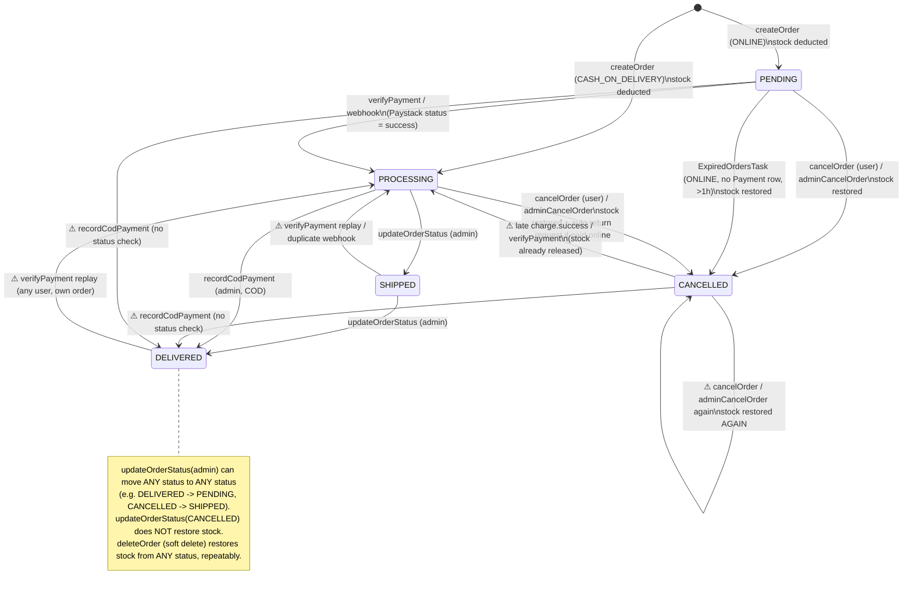
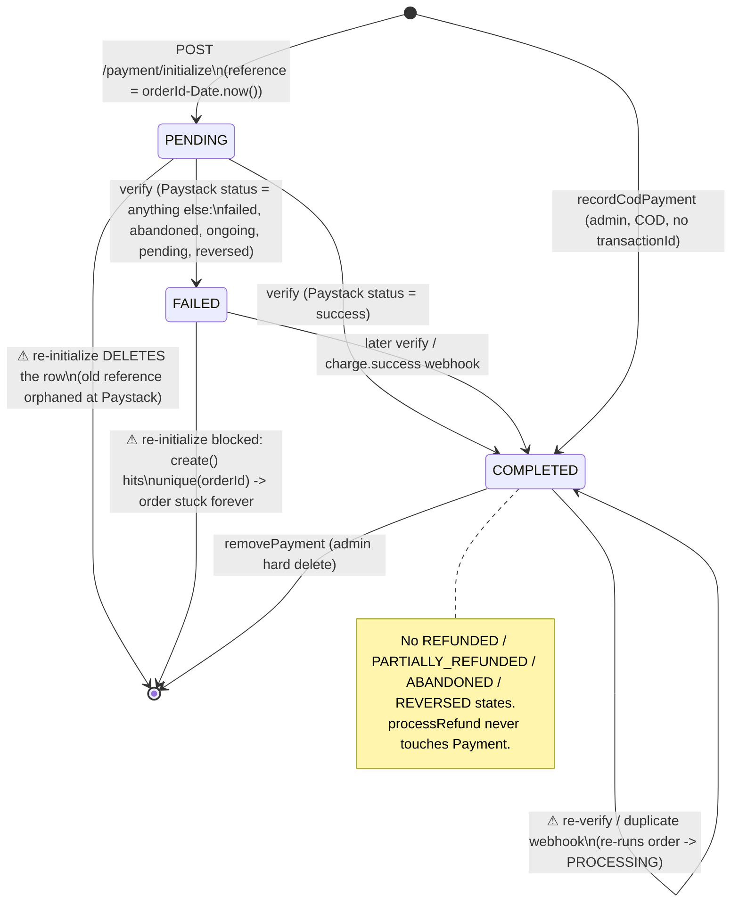
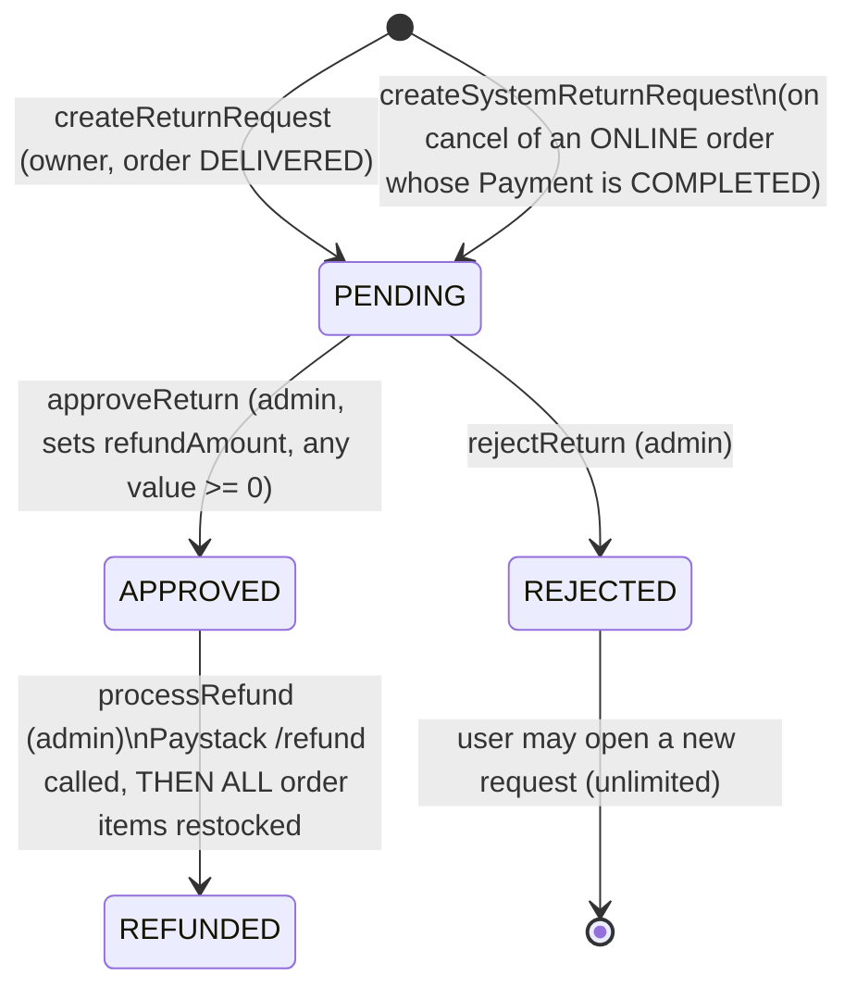

# Order / payment / return lifecycle, as implemented

Reviewed by: Order, Inventory & Payment reviewer (Claude Opus 5.5, high effort), 2026-11-16.
Source of truth is the code at HEAD of `main` plus the uncommitted working tree. Line numbers are for that state.

There is **no state machine**. Most transitions are unconditional `UPDATE order SET status = X WHERE id = ?`. The diagram below shows every edge the code can actually take, including the ones that are almost certainly unintended (marked ⚠).

## 1. Order status (`OrderStatus`: PENDING, PROCESSING, SHIPPED, DELIVERED, CANCELLED)

## 2. Payment status (`PaymentStatus`: PENDING, COMPLETED, FAILED) — one row per order (`Payment.orderId @unique`)

## 3. Return request status (`ReturnStatus`: PENDING, APPROVED, REJECTED, REFUNDED)

## 4. Transition table (every write, with location)

| # | Entity | From → To | Trigger / actor | Where | Stock effect | Guarded? | Same DB transaction? |
|---|---|---|---|---|---|---|---|
| 1 | Order | ∅ → PENDING (ONLINE) / PROCESSING (COD) | `createOrder` mutation (USER/ADMIN/SUPER_ADMIN) | `src/order/order.service.ts:345-391`, `order.repository.ts:43-79` | `product.quantity -= n` per item, rollback if < 0; `ORDER_DEDUCTION` log | Cart read and pre-checks outside tx (`order.service.ts:54-55,301`) | Deduction + log + order + coupon usage + cart clear: yes |
| 2 | Order | PENDING → PROCESSING | `verifyPayment` mutation (USER, own reference) or Paystack webhook `charge.success`/`charge.failed` → `verifyPayment` | `src/payment/payment.service.ts:347-363` → `payment.repository.ts:78-83` | none | **No** — `WHERE id` only (guard `status: PENDING` removed in commit `2470013`) | No (payment update and order update are two separate statements) |
| 3 | Order | any → PROCESSING | Same as #2, replayed (user re-verifies old reference; duplicate webhook; late webhook on CANCELLED order) | same | none (stock not re-deducted for a CANCELLED order) | No | No |
| 4 | Order | not SHIPPED/DELIVERED → CANCELLED | `cancelOrder` (Role.USER only, own order) | `src/order/order.service.ts:193-199`, `401-405`, `407-423` | `+n` per item, `RETURN_RESTORE` log | Only blocks SHIPPED/DELIVERED; **CANCELLED passes** | Stock + log in tx; status update uses `this.prisma`, **outside** the tx (`order.repository.ts:100-113`) |
| 5 | Order | not SHIPPED/DELIVERED → CANCELLED | `adminCancelOrder` (ADMIN/SUPER_ADMIN) | `order.service.ts:204-217` | same as #4 | same as #4 | same as #4 |
| 6 | Order | PENDING → CANCELLED | `ExpiredOrdersTask` hourly, ONLINE orders older than 1h with **no Payment row** | `src/order/tasks/expired-orders.task.ts:15-29` → `order.service.ts:150-157` → `order.repository.ts:165-176` | same as #4 | Selection only; not re-checked at update | same as #4 |
| 7 | Order | any → any | `updateOrderStatus` (ADMIN/SUPER_ADMIN) | `order.service.ts:162-188` | **none** (CANCELLED here leaks stock; un-cancel doesn't re-deduct) | No | n/a; audit log written |
| 8 | Order | any → DELIVERED | `recordCodPayment` (ADMIN/SUPER_ADMIN), COD only | `payment.service.ts:133-157`, `payment.repository.ts:85-90` | none | Only "no existing Payment" | No (payment insert, then order update) |
| 9 | Order | any → `deleted = true` | `deleteOrder` (ADMIN/SUPER_ADMIN) | `order.service.ts:234-244`, `437-444` | `+n` per item, **no log**, any status, repeatable | No | Stock in tx; soft-delete via `this.prisma`, outside tx |
| 10 | Order | — (tracking/carrier only) | `updateShipping` (ADMIN/SUPER_ADMIN) | `order.service.ts:249-268` | none | No; sends a "SHIPPED" email without changing status | n/a |
| 11 | Order | — (totalAmount rewritten) | `finalizeOrder` (owner, any status) | `order.resolver.ts:124-129` → `discount.service.ts:205-209`, `discount.repository.ts:152-162` | none | Ownership only | n/a |
| 12 | Payment | ∅ → PENDING (existing PENDING row deleted first) | `POST /payment/initialize` (any authenticated user, own order) | `payment.service.ts:41-60`, `248-259`, `289-305` | none | Blocks only COMPLETED payment and COD orders; **order status not checked** | No |
| 13 | Payment | any → COMPLETED / FAILED | #2 | `payment.service.ts:347-363` | — | No | No |
| 14 | Payment | ∅ → COMPLETED | `recordCodPayment` | `payment.service.ts:146-152` | — | — | No |
| 15 | Payment | soft delete / restore / hard delete | `softDeletePayment`, `restorePayment`, `removePayment` (Role.ADMIN only) | `payment.resolver.ts:56-72`, `payment.service.ts:208-234` | — | — | — |
| 16 | ReturnRequest | ∅ → PENDING | `createReturnRequest` (owner, order DELIVERED, no non-REJECTED request) | `src/returns/returns.service.ts:28-49` | none | Check-then-insert (racy) | No |
| 17 | ReturnRequest | ∅ → PENDING | system, from #4/#5/#7 when ONLINE + Payment COMPLETED | `order.service.ts:446-455` → `returns.service.ts:117-121` | none | Same dedupe check | No |
| 18 | ReturnRequest | PENDING → APPROVED / REJECTED | `approveReturn` / `rejectReturn` (ADMIN/SUPER_ADMIN) | `returns.service.ts:58-79` | none | Read-then-write, not conditional | No |
| 19 | ReturnRequest | APPROVED → REFUNDED | `processRefund` (ADMIN/SUPER_ADMIN) | `returns.service.ts:88-110`, `returns.repository.ts:51-59` | `+n` for **every** order item, **no log**, even if #4 already restored | Read-then-write; Paystack call happens before the state change | Stock + status in tx; Paystack call outside it |

## 5. End-to-end trace (happy path) and where it breaks

1. **Cart** — `addToCart` checks `isActive` and current stock (`src/cart/cart.service.ts:93-103`); no variant can be chosen (`AddToCartInput` has only `productId`, `quantity`).
2. **createOrder** — reads cart outside any transaction, re-checks stock per item (no `isActive` check), prices every item at `product.price` (ignores `currentPrice`, variant price, cart `discountedPrice`, tax), computes shipping by city, validates coupon, then in one interactive transaction: decrement stock (row lock; rollback if negative), write `ORDER_DEDUCTION` log, insert order + items, record coupon usage, clear cart. No idempotency key, so a double-click creates two orders.
3. **Payment initiation** — REST `POST /payment/initialize` with client-chosen `currency` and `paymentMethod`; amount = `order.totalAmount` × 100. Deletes any PENDING payment row first.
4. **Paystack redirect** → frontend calls `verifyPayment(reference)`; Paystack calls `/payment/webhook`. Both end in `verifyPayment(reference)` → Paystack `transaction/verify` → `status === 'success'` ⇒ Payment COMPLETED + Order PROCESSING (unconditional). Amount and currency from Paystack are stored but never compared.
5. **Fulfilment** — admin `updateShipping` (tracking + email) and `updateOrderStatus` SHIPPED → DELIVERED (any-to-any allowed). COD: admin `recordCodPayment` jumps straight to DELIVERED.
6. **Cancel** — user or admin; restores stock (repeatably); if ONLINE + COMPLETED, opens a system return request. No refund is issued automatically.
7. **Return** — owner opens a request for a DELIVERED order (no window, no items); admin approves with any amount; `processRefund` calls Paystack `/refund` then restocks the whole order.

## 6. Worked failure scenarios (all derived from the code paths above)

- **Unlimited stock inflation by any customer**: place order → `cancelOrder` → `cancelOrder` again … each call adds the quantities back (#4). Confirmed by scratch repro test.
- **Goods + refund**: order DELIVERED → customer calls `verifyPayment` with the old reference → order back to PROCESSING (#3) → `cancelOrder` → stock restored + system refund request (#4, #17) → admin approves the "automatic refund request" → `processRefund` restocks a second time (#19) and refunds money for goods the customer kept.
- **Paid but stuck / paid twice**: customer opens Paystack checkout (reference R1), MoMo approval is slow, customer clicks Pay again → R1 row deleted, R2 created (#12). Customer approves R1 → webhook for R1 → "Payment with reference not found" → logged, HTTP 200, Paystack stops retrying. Money captured, order PENDING; if they also pay R2 they are charged twice.
- **Late payment on an expired order**: order expires and stock is released (#6); customer still completes checkout (or initiates payment on the CANCELLED order, which is allowed) → order revived to PROCESSING (#3) with no stock behind it → oversell; no refund path triggers.
- **Failed MoMo attempt bricks the order**: verify while Paystack still reports `ongoing`/`pending` → Payment FAILED; any retry → `create()` violates `Payment.orderId @unique`. Order stays PENDING with a Payment row → never expires → stock locked forever.
- **Two app instances**: both run the hourly expiry over the same rows; each restores stock (#6 status update is unconditional).
