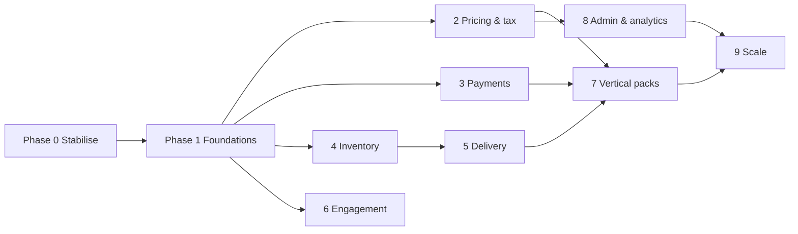

# Emma Commerce Backend — Roadmap

Date: 2026-11-16 · Basis: `docs/audit/` (all findings cite file:line there) and `docs/audit/_work/gap-analysis.md` (capability matrix, 102 rows: 47 Absent, 17 Partial, 37 Defective, 1 Present).
Rules for executing this roadmap: [`WORKING-AGREEMENT.md`](WORKING-AGREEMENT.md). Decisions: [`ADRs/`](ADRs/README.md) (all **Accepted** by Emmanuel, 2026-11-18).

**Labels**
- **Class:** 🟥 **Launch** = must have before a real client takes real money · 🟧 **Advantage** = competitive advantage · ⬜ **Later**.
- **Size:** S ≈ ½–1 session · M ≈ 2–3 sessions · L ≈ a week · XL ≈ several weeks.
- **Run:** ∥ parallel-safe with other ∥ tasks of the same epic (touches different files) · → sequential (needs the previous task merged).
- **Task IDs:** `P<phase>-<epic>.<n>`. One task = one Claude Code session = one branch (see working agreement).

**Assumptions** (from the gap analysis; confirm with Emmanuel):
- The first client is one general-retail store selling in GHS.
- No environment holds real customer data yet. **Confirmed by Emmanuel on 2026-11-16.** So migrations are re-baselined at Prisma 7, and legacy-data backfills only need to handle dev and seed data, which may be reset instead of migrated.
- Paystack is the online payment provider.

---

## Progress

Legend: `- [x]` done (commit in brackets) · `- [ ] 🔄` in progress · `- [ ]` to do. An epic shows ✅ when every task is ticked. Detailed live state and the exact next step: [`STATUS.md`](STATUS.md).

| Phase | Done | Status |
|---|---|---|
| 0 — Stabilise | 46 / 46 | ✅ complete |
| 1 — Foundations | 30 / 33 | 🔄 in progress |
| 2 — Pricing & tax engine | 10 / 15 | 🔄 in progress |
| 3 — Payments & Ghana methods | 0 / 11 | 🔄 in progress |
| 4 — Inventory | 0 / 7 | ⬜ not started |
| 5 — Delivery & fulfilment | 0 / 8 | ⬜ not started |
| 6 — Customer engagement | 0 / 17 | ⬜ not started |
| 7 — Vertical packs | 0 / 8 | ⬜ not started |
| 8 — Admin, analytics & content | 0 / 4 | ⬜ not started |
| 9 — Scale & hardening | 0 / 5 | ⬜ not started |
| **All** | **86 / 154** | |

---

## Phase overview

| Phase | Goal | Depends on | Size | Class |
|---|---|---|---|---|
| **0 — Stabilise** | Make money, stock, auth, payments and REST correct and safe. Nothing new is built. | — | XL (≈ 6–8 weeks for one developer with Claude Code) | 🟥 |
| **1 — Foundations** | Accept ADRs; CI/CD; Prisma 7; worker + outbox; RBAC; observability; core schema refactor (Store, Money, variant-as-SKU, inventory ledger, order snapshots, tax lines, Ghana addresses) | 0 | XL | 🟥 |
| **2 — Pricing & tax engine** | Deterministic promotions, coupons, Ghana tax engine, price history | 1 | L | 🟥 core / 🟧 advanced promos |
| **3 — Payments & Ghana methods** | Provider port complete, COD with risk gates, reconciliation, refunds, second provider | 0, 1 | L | 🟥 (Paystack + COD) / 🟧 (2nd provider) |
| **4 — Inventory** | Multi-location stock, stock-take, lots/expiry, serials, low-stock events, suppliers/POs | 1 | L | 🟥 basic / 🟧 lots, serials / ⬜ POs |
| **5 — Delivery & fulfilment** | Zones and rate rules, Ghana addresses, shipments, riders, proof of delivery, tracking timeline | 1, 4 | L | 🟥 zones, shipments / 🟧 riders, POD |
| **6 — Customer engagement** | Notifications (SMS/WhatsApp), search, guest checkout, reviews moderation, returns/RMA, wishlists, loyalty | 1 | XL | 🟥 notifications, returns / 🟧 rest |
| **7 — Vertical packs** | Fashion, electronics, food/grocery, furniture, beauty, digital/courses, pharmacy | 1–5 | XL (per pack M–L) | 🟧 (pharmacy ⬜ until legal sign-off) |
| **8 — Admin, analytics & content** | Correct analytics, margins, reports, CMS, bulk import/export, feature flags UI | 1, 2 | L | 🟥 correct revenue / 🟧 rest |
| **9 — Scale & hardening** | Load tests to targets, caching/CDN, DR rehearsal, pooled multi-tenancy (if chosen) | all | L | 🟥 load test + DR before first promo / ⬜ pooling |

### Launch line
A first real client can go live when **Phase 0 + Phase 1 + the 🟥 parts of Phases 2, 3, 5, 6 and 8 + the 🟥 parts of Phase 9** are done and the launch gate checklist (`docs/audit/SUMMARY.md` §5, full list in `docs/audit/_work/gap-analysis.md` §6) is fully ticked. The launch gate also needs the legal and tax sign-offs listed in SUMMARY decision 6.

---

## Phase 0 — Stabilise

**Goal:** close every Critical and High finding that touches money, stock, auth, payments, data exposure or the ability to deploy. Fix inside the current design where possible. The structural fixes (ledger, state machine) are introduced here only where the current design cannot be made correct.

**Scope:** findings rated Critical or High in `docs/audit/SUMMARY.md` §3. The repro tests on branch `audit/repro-tests` (`test/repro/`, 21 tests) are the acceptance tests: each must turn green.

**Exit criteria:**
- All 21 repro tests pass and are moved into the module specs.
- The unit suite is green, and `tsc` (including specs) is clean.
- CI runs on every PR.
- The e2e suite runs against a guarded test database.
- Every REST route works.
- No Critical or High finding remains open in the modules below.

**Risks:**
- The fixes touch the most fragile code (order/payment) with ~0–8% effective coverage. Mitigation: tests first, small PRs.
- Real data may exist (assumption A2). Do step P0-F.3 first.

### Epic P0-F — Safety rails and repo hygiene (do first)  ✅ complete
- [x] **P0-F.1** Line endings: add `.gitattributes` (`* text=auto eol=lf`) and Prettier `endOfLine: lf`, then run `git add --renormalize .` in one commit (needs approval) (`f2b323a`)
  - Accept: `npx eslint` reports only real issues (1 today); `prettier --check` passes · → first · S · 🟥
- [x] **P0-F.2** E2E safety: `test/setup.ts` fails fast unless `.env.test` exists and its `DATABASE_URL` database name ends in `_test`; add `.env.test.example`; fix `db.helper.ts` (`taxRate` → `tax`) (QA-02, DOC-11) (`758068c`)
  - Accept: Running e2e without `.env.test` aborts before touching any DB · Tests: Unit test of the guard · ∥ · S · 🟥
- [x] **P0-F.3** Environment inventory + secret hygiene: list every DB that ever ran the schema (ADR-0017 step 0); rotate the DB password in `.claude/settings.local.json`, `git rm --cached` it, add to `.gitignore`; add gitleaks (SEC-05/OPS-18) (`b246bf5`)
  - Accept: Inventory written to `docs/roadmap/environments.md`; file untracked; scanner runs in CI · ∥ · S · 🟥
- [x] **P0-F.4** ~~Retire `TODO.md`~~ (done 2026-11-16: moved to untracked `tmp/`). Adopt the remaining parts of the proposed `CLAUDE.md` from the working agreement (the session protocol is already in) (`ab01fcd`)
  - Accept: `CLAUDE.md` points to STATUS, ROADMAP and ADRs · ∥ · S · 🟥
- [x] **P0-F.5** Repair the unit suite: fix the 14 failing suites (8 spec drift, 1 jest path mapping `src/...`, 2 stale DI wiring, 3 real disagreements — keep the test where the test is right, e.g. `payment.repository.spec` PENDING guard) (QA-01) (`bcc995b`)
  - Accept: `npx jest` green; `npx tsc --noEmit -p tsconfig.json` clean · → after F.1 · M · 🟥
- [x] **P0-F.6** Minimal CI (GitHub Actions): `npm ci`, tsc incl. specs, eslint (no `--fix`), prettier check, jest, repro suite (allowed to fail until its fixes land, tracked as a list), `npm audit --omit=dev --audit-level=critical` (`b94e75b`)
  - Accept: CI required on PRs to `main` · → after F.5 · S · 🟥
- [x] **P0-F.7** E2E in CI against a Postgres service container; refresh the e2e specs that use the old `createOrder` input; un-comment refresh/signOut tests (DOC-12) (`9b3747b`)
  - Accept: e2e green in CI · Tests: e2e · → after F.2, F.6 · M · 🟥

### Epic P0-A — Request pipeline and access control (Critical)  ✅ complete
- [x] **P0-A.1** Context-aware request access: one `getRequest(ctx)` helper for `http` and `graphql`. Use it in `GraphqlLoggingInterceptor` (skip it for non-GraphQL), `AccessTokenGuard`, `RolesGuard`, `@ActiveUser` and the throttler guard (PLAT-01, IAM-07, UPL-01) (`e42d16e`)
  - Accept: `/payment/webhook`, `/payment/initialize`, `/upload/*`, `/health/*` work · Tests: repro `platform.repro-spec` PLAT-01, IAM-07 green; e2e smoke test hitting every REST route · → first · S · 🟥
- [x] **P0-A.2** Field-level authorization: `Review.user` → `PublicProfile {displayName}`; owner-or-admin policy on `User.addresses/orders/email/phoneNumber`, `Order.user`; `@FieldAuth` reads `req.user` (no DB) (SEC-01/USR-01/REV-01/PRD-01) (`c788131`)
  - Accept: No public or cross-user path to PII · Tests: repro `field-resolver-auth` green; **new anonymous e2e** `product{reviews{user…}}`; schema test: no `User` reachable from `@Auth(None)` roots · ∥ · M · 🟥
- [x] **P0-A.3** Public catalogue visibility: public `products`/`product`/`categories` force `isActive && status=PUBLISHED`; nested `products` on `categories` paginated (PRD-02, CAT-01, BRD-01) (`c6f5fe5`)
  - Accept: Draft/archived products are not visible anonymously · Tests: unit + e2e · ∥ · S · 🟥
- [x] **P0-A.4** GraphQL hardening: depth limit, complexity limit, alias limit; landing page off in prod; map Prisma P2002/P2003/P2025 and HTTP codes to standard GraphQL codes (PLAT-05, PERF-01, DOC-06, USR-14) (`c3000bf`)
  - Accept: Over-deep/over-cost queries rejected; FK errors return `CONFLICT` not 500 · Tests: unit tests on the plugin; e2e for an FK delete · ∥ · M · 🟥
- [x] **P0-A.5** Logging: stop logging variable values (allowlist operation name + argument *names* only); mask `authorization`; purge existing log files (PLAT-02, OBS-01) (`5e71ff2`)
  - Accept: No token/password/PII in logs · Tests: repro PLAT-02 green · ∥ · S · 🟥

### Epic P0-B — Orders and stock correctness (Critical/High)  ✅ complete
- [x] **P0-B.1** Order transition table (pure) + conditional status writes (`updateMany where status in allowedFrom`) **inside** the same `tx`; fix `updateStatus` using root client (ADR-0014; ORD-02, ORD-04) (`9028bb3`)
  - Accept: Invalid transitions → `CONFLICT`; concurrent cancels restore stock once · Tests: repro ORD-04; exhaustive transition-table unit test; integration test: 2 concurrent cancels · → first · M · 🟥
- [x] **P0-B.2** Cancel/delete/expire/refund restore stock **only** on the transition that releases it; soft delete never restores; inventory log on every restore (ORD-01, ORD-03, RET-01, INV-03, DB-06) (`a54fded`)
  - Accept: Repeat cancel rejected; delete of DELIVERED order restores nothing · Tests: repro ORD-01, ORD-03 green · → after B.1 · S · 🟥
- [x] **P0-B.3** Remove customer `finalizeOrder`; createOrder applies the **same** best-discount logic shown in `cartWithDiscount` (fixing the comparator to compare money saved), or switches discounts off until Phase 2 — Emmanuel to choose (DISC-01, DISC-02, MONEY-01, CART-02) (`94a9596`)
  - Accept: Charged total = displayed total; no client-callable total rewrite · Tests: repro DISC-01, DISC-02 green; e2e: cart total == order total == Paystack amount · ∥ · M · 🟥
- [x] **P0-B.4** Shipping: unmatched city → `BadRequest` (no silent 0); zone overlap rejected on write; deterministic lookup; store `shippingFee` and `subtotal` on Order (SHZ-01/02/03, MONEY-02, DB-04 part) (`53c3da4`)
  - Accept: No free delivery by accident · Tests: repro SHZ-01 green · ∥ · S · 🟥
- [x] **P0-B.5** Pickup orders validate an active pickup location and snapshot it (PCK-01, PCK-04) (`1d33fff`)
  - Accept: Inactive/unknown location → 400 · Tests: unit · ∥ · S · 🟥
- [x] **P0-B.6** Currency: charge currency fixed server-side to GHS; reject non-GHS products at checkout until multi-currency exists (CUR-01, CUR-02, PAY-05 part) (`ff15318`)
  - Accept: Client cannot pick currency · Tests: unit · ∥ · S · 🟥
- [x] **P0-B.7** Expiry job: also expires orders whose payment attempts are pending/failed beyond TTL; Postgres advisory lock so it runs once across instances (ORD-07, CRON-01) (`97c1978`)
  - Accept: No stock locked forever; single execution · Tests: integration test with 2 runners · → after B.1 · S · 🟥
- [x] **P0-B.8** Stock writes: product/variant update DTOs drop `quantity`/`stockStatus`; stock only via `restock/adjust` with log; `CHECK (quantity >= 0)` (PRD-03, INV-02, DB constraints M1) (`53b736f`)
  - Accept: Admin edits cannot overwrite live stock · Tests: unit + migration test · ∥ · S · 🟥
- [x] **P0-B.9** Coupons: validate and increment inside the order tx with conditional `usedCount < usageLimit`; release on cancel/expiry (CPN-01, CPN-02) (`c38316c`)
  - Accept: 20 parallel checkouts on a 10-use coupon → exactly 10 orders · Tests: integration concurrency test · ∥ · S · 🟥
- [x] **P0-B.10** Tax stop-gap: `UpdateProductInput.isTaxable` no default; reprice SQL fixed and run in the same tx as the Tax row; or freeze tax changes until Phase 2 (TAX-01, TAX-02) (`cade6c8`)
  - Accept: Product edit never drops tax; tax change atomic · Tests: integration test against Postgres (also confirms TAX-02) · ∥ · S · 🟥
- [x] **P0-B.11** Variants: hide variant purchase APIs (or block variant-priced products from checkout) until Phase 1 SKU model (VAR-01) — decision for Emmanuel; document in API docs (`f132a62`)
  - Accept: No sale at a wrong price · Tests: e2e · ∥ · S · 🟥

### Epic P0-C — Payments (ledger + webhook) (Critical/High)  ✅ complete
- [x] **P0-C.1** Payment ledger schema (ADR-0007): `PaymentIntent`, `PaymentAttempt (reference UNIQUE)`, `WebhookEvent (UNIQUE)`, `Refund (idempotencyKey UNIQUE)`, `CashCollection`; drop `orderId @unique`; forbid hard delete; remove `removePayment` + `Order→Payment` cascade (DB-01, DB-02, PAY-03, PAY-04, PERF-03) (`ddc81cb`)
  - Accept: Migration + backfill per migration step M3 (reconcile against Paystack export) · Tests: migration test; backfill dry-run report · → first · L · 🟥
- [x] **P0-C.2** Initiate: allowed only for `PLACED/PENDING` orders; new attempt per retry (never delete); amount from order; idempotency key (PAY-02, PAY-03) (`24b246f`)
  - Accept: Retry keeps old attempt; cancelled order cannot be paid · Tests: repro PAY-02, PAY-03 green · → after C.1 · M · 🟥
- [x] **P0-C.3** Verify rule: success only if provider status = success **and** amount and currency equal the attempt; order transitions via state machine; success on CANCELLED/EXPIRED → `PAYMENT_REVIEW` + auto-refund job, never revive (PAY-01, PAY-05, MONEY-04) (`01f3f13`)
  - Accept: Replay/late events cannot change terminal orders · Tests: repro PAY-01, PAY-05 green · → after C.2 · M · 🟥
- [x] **P0-C.4** Webhook: `rawBody: true`, HMAC over raw bytes, `timingSafeEqual`, insert into `WebhookEvent` (dedupe), return 200 only after persistence; processing failure → retry (in-process for now, queue in Phase 1); replace `paystack-api` with a thin client with timeouts (SEC-04, PAY-06, PERF-06) (`118c16a`)
  - Accept: Duplicate webhooks no-op; failures retried · Tests: unit (signature vectors from Paystack docs), e2e webhook test with real signature · ∥ after C.1 · M · 🟥
- [x] **P0-C.5** Reconciliation job: re-verify attempts PENDING > 15 min; nightly diff against Paystack transactions; alert on mismatch (`21260b0`)
  - Accept: Missed webhooks recovered · Tests: integration with stubbed provider · → after C.3 · S · 🟥
- [x] **P0-C.6** Refunds: conditional status transition **before** provider call with idempotency key; cap Σ refunds ≤ captured; no stock restore if already restored; record provider refund id (RET-02, RET-01) (`c5c0714`)
  - Accept: Double-click cannot double refund · Tests: integration test · → after C.3 · M · 🟥
- [x] **P0-C.7** COD: `recordCodPayment` only from out-for-delivery/processing; writes `CashCollection`; no jump to DELIVERED from any state (`52a7c2d`)
  - Tests: unit · ∥ · S · 🟥

### Epic P0-I — Identity and sessions (High)  ✅ complete
- [x] **P0-I.1** One password policy (8–128) for sign-up/sign-in/reset/change (IAM-05, IAM-06) (`d2445ad`)
  - Accept: 20-char passwords sign in · Tests: repro IAM-05 green · ∥ · S · 🟥
- [x] **P0-I.2** Refresh tokens: `jti`; conditional rotation (`updateMany where revoked=false`) in tx; reuse → revoke family; absolute lifetime; revoke all on password reset/change, email change, deactivation (IAM-02, IAM-03, IAM-04, DOC-10) (`dfac978`, `029fbce`)
  - Accept: Concurrent refresh: one wins; reused token kills session · Tests: integration concurrency test · ∥ · M · 🟥
- [x] **P0-I.3** Social login: link only when provider asserts verified email and the local account's email is verified; otherwise require sign-in to link; check Google `aud` and `email_verified`; FB `debug_token` app id; encode params, timeouts (IAM-01, IAM-11) (`eed1ce9`)
  - Accept: Pre-hijack impossible · Tests: unit with provider fixtures · ∥ · M · 🟥
- [x] **P0-I.4** Email verification on sign-up and on email change (+ re-auth); escape all email template values (IAM-09, SEC-02, NOT-07) (`d52eb01`)
  - Tests: unit + e2e · ∥ · M · 🟥
- [x] **P0-I.5** Admin safety: only SUPER_ADMIN manages admins; uploads admin-only with magic-byte allowlist and pixel limit (IAM-10, USR-03, UPL-02/03/04) (`fc59f37`)
  - Tests: unit · ∥ · S · 🟥
- [x] **P0-I.6** `forgotPassword` constant-time path + per-email rate limit (DOC-09) (`d11e961`)
  - Tests: unit · ∥ · S · 🟥

### Epic P0-O — Deployability and ops (High)  ✅ complete
- [x] **P0-O.1** Fix build entry: exclude `prisma/` from the app tsconfig (or point CMD/`start:prod` at `dist/src/main`); Docker: Node 22/24 LTS, non-root `USER`, `.dockerignore`, HEALTHCHECK, `prisma` CLI available for `migrate deploy` release step (PERF-18, OPS-01/03/04/20, DEP-01) (`a98a123`)
  - Accept: `docker build && docker run` serves `/health/live` · Tests: CI builds and smoke-runs the image · ∥ · M · 🟥
- [x] **P0-O.2** In-range security upgrades: `@nestjs/*` 10.4.22, axios, joi, qs, proxy-addr, sharp; remove unused deps (passport*, multer-storage-cloudinary, google-auth-library) (DEP-02, unused deps) — needs approval (`2549d67`)
  - Accept: `npm audit --omit=dev` no critical · Tests: CI · ∥ · S · 🟥
- [x] **P0-O.3** Env validation: explicit `NODE_ENV`, no placeholder secrets in prod, `REDIS_HOST` required in prod, `OTEL_*` validated, `.env.example` complete (PLAT-07, OPS-15) (`fd0543c`)
  - Accept: Boot fails on bad prod config · Tests: unit · ∥ · S · 🟥
- [x] **P0-O.4** Load `tracing.ts` before Nest bootstrap (`--require` / first import) behind `OTEL_ENABLED` (OBS-02) (`c51ee81`)
  - Accept: Spans exported in staging · Tests: manual + smoke · ∥ · S · 🟥
- [x] **P0-O.5** Health: readiness = DB (+ Redis if required); Cloudinary moved to a non-gating check (HLT-01) (`66eb517`)
  - Tests: unit · ∥ · S · 🟥
- [x] **P0-O.6** Missing indexes: `OrderItem(orderId)`, `Payment` reference unique (in C.1), `Order(createdAt)`; drop redundant indexes (PERF-02, ANA-05, DB-21) (`26efe7d`)
  - Accept: `EXPLAIN` on hot queries uses indexes · Tests: migration · ∥ · S · 🟥
- [x] **P0-O.7** Email sending: check Resend `{error}`; `.catch` on fire-and-forget; send payment-confirmation email (NOT-01, NOT-02, NOT-05) — full queue in Phase 1 (`e18cf27`)
  - Accept: Failures logged as errors · Tests: unit · ∥ · S · 🟥

### Epic P0-D — Audit and analytics correctness (High)  ✅ complete
- [x] **P0-D.1** Audit log in the same tx for refunds, role changes, user archive/delete, price/coupon/discount/tax/zone changes, COD recording, stock adjustments (AUD-01..04) (`90b6bb8`)
  - Accept: Every privileged mutation audited · Tests: unit per mutation (auth-matrix style) · ∥ · M · 🟥
- [x] **P0-D.2** Revenue = paid/collected orders minus refunds; consistent definition across reports (ANA-01, ANA-02, ANA-03) (`2324739`)
  - Accept: Reports reconcile with payments · Tests: unit with fixtures · ∥ · S · 🟥
- [x] **P0-D.3** Docs: bring `FRONTEND_API_DOCUMENTATION.md` in line with code for all 12 High and 17 Medium discrepancies; document the 32 undocumented operations (DOC-01..12) (`ddb1d87`)
  - Accept: Doc matches `schema.gql` · ∥ (last in phase) · M · 🟥

**Phase 0 parallelism:**
1. P0-F.1 → F.5 → F.6 is the critical path, and F.2–F.4 run in parallel with it.
2. Once F.6 is in place, epics A, B, C, I, O and D can proceed in parallel, each with its own branch and session.
   - Within each epic, follow its → markers.
   - B and C both touch `order.service.ts` and the order status, so B.1 must merge before C.3.

---

## Phase 1 — Foundations

**Goal:**
- Have the accepted architecture decisions in place.
- Have the core schema ready for every vertical.
- Have infrastructure that can run more than one instance safely.

**Depends on:** Phase 0, and ADRs 0001–0004, 0007–0009, 0011–0014 and 0017 **Accepted**.

**Exit criteria:**
- The variant/SKU, Money, Store, inventory ledger, order snapshot and tax line models are live.
- Migrations M5–M9 and M12–M14 are complete, with reconciliation reports reviewed.
- The worker process runs the outbox.
- RBAC permissions are enforced with an auth-matrix test.
- CI includes the drift and schema-diff gates.
- Structured logs, error tracking and alerts are live.

**Risks:**
- The data migration is the biggest risk (M7, ambiguous stock).
- The frontend breaks at the `Money` type change.
- Mitigations: expand/contract, deprecation windows, reconciliation queries.

### P1-K — CI/CD & deploy  🔄 in progress
> Accept: Gates block bad PRs; restore rehearsed · Run: ∥ · L · 🟥
- [x] **P1-K.1** `prisma migrate diff --exit-code` gate + `graphql-inspector` breaking-change gate (`13c25c2`)
- [ ] **P1-K.2** Image build + push; staging deploy; `migrate deploy` release job per client DB (silo, ADR-0001)
- [ ] **P1-K.3** IaC for one client environment (managed Postgres with PITR, Redis, object storage)
- [ ] **P1-K.4** Backup restore rehearsal runbook (timed)

### P1-P — Prisma 7 (ADR-0017)  ✅ complete
> Accept: All tests green on Prisma 7 · Run: → first schema work · M · 🟥
- [x] **P1-P.1** Upgrade to Prisma 7 + `prisma.config.ts` + driver adapter (`@prisma/adapter-pg`), Node 24; run concurrency integration tests (`848cf59`)
- [x] **P1-P.2** Re-baseline migrations (no real data) + order numbers from 10001 + CI check rejecting edits to applied migrations (`c181408`, `c6e712a`)

### P1-J — Worker, outbox, Redis (ADR-0009/0011)  ✅ complete
> Accept: Each job runs once across 2 instances; failed jobs visible · Run: J.1 → J.2 → (J.3 ∥ J.4) · L · 🟥
- [x] **P1-J.1** Redis required; Redis-backed throttler, cache, locks (`7213213`; locks stay on Postgres advisory locks)
- [x] **P1-J.2** `OutboxEvent` + relay + BullMQ + `ROLE=worker` process (`1a342e1`)
- [x] **P1-J.3** Move crons (expiry, reconciliation, low-stock) to repeatable jobs (`ba08366`)
- [x] **P1-J.4** Move emails and webhook processing onto queues with retries + DLQ (`02dcbbc`)

### P1-R — RBAC (ADR-0013)  ✅ complete
> Accept: Matrix test in CI · Run: R.1 → R.2; R.3 ∥ · L · 🟥
- [x] **P1-R.1** Permissions + roles + `StaffAssignment`; `@RequirePermission`; migration M12 [ce27858]
- [x] **P1-R.2** Auth-matrix snapshot test over all operations [b2a88de]
- [x] **P1-R.3** TOTP MFA for staff; step-up for sensitive actions [730fc79]

### P1-S — Store & Money (ADR-0001/0004)  ✅ complete
> Accept: Money arithmetic tests (allocation, rounding); no float money in pricing paths · Run: S.1 ∥ S.2 → S.3 → S.4 · L · 🟥
- [x] **P1-S.1** `Store` row + settings from env; per-store order counter (`1750f17`)
- [x] **P1-S.2** `Money` value object + lint ban on `Number()` money (`87e6746`)
- [x] **P1-S.3** Widen money columns `Decimal(14,2)` (M6) (`3fdf84d`)
- [x] **P1-S.4** GraphQL `Money` type replacing `Float` in place, `Decimal` inputs (Emmanuel 2026-11-18: no deprecation window) (`687829a`)

### P1-V — Variant as SKU + catalogue model (ADR-0002/0003)  ✅ complete
> Accept: Variants purchasable at variant price/stock (VAR-01 closed) · Run: V.1 → V.2 → V.3; V.4 ∥ · XL · 🟥
- [x] **P1-V.1** `ProductType`, `AttributeDefinition`, options/values, capability columns [47f374b]
- [x] **P1-V.2** Default SKU per product + convert size/colour (M7 a–b) with reconciliation report [1346b3e]
- [x] **P1-V.3** Cart/order/stock reference `variantId` end to end [22ebb06]
- [x] **P1-V.4** Attribute validation module (pure) used by admin create/update [c185063]

### P1-N — Inventory ledger (ADR-0008)  ✅ complete
> Accept: Concurrency tests: last unit sold once; repeat release no-ops · Run: → after V.2 · L · 🟥
- [x] **P1-N.1** `StockLocation`, `InventoryLevel`, `StockReservation`, `StockMovement` (M7 c–d) [3d7aa0a]
- [x] **P1-N.2** Reserve at placement, consume at capture/dispatch, release on cancel/expiry — all conditional [aab5a0c, 76de3d8]
- [x] **P1-N.3** Nightly reconciliation Σ movements = onHand [c7bc7d8]

### P1-O — Order snapshots & tax lines (ADR-0006/0014)  ✅ complete
> Accept: Σ lines + adjustments + tax + shipping = grand total (property test) · Run: → after V.3 · L · 🟥
- [x] **P1-O.1** Order totals/currency/pricingVersion + line snapshots + `OrderAdjustment` + `OrderLineTax` (M8; legacy = pricingVersion 0, no invented tax) [f03848a]
- [x] **P1-O.2** Order/payment/fulfilment state machines complete (statuses `PLACED…COMPLETED`, `PAYMENT_REVIEW`, history table M4) [0c523a0]

### P1-G — Ghana addresses  ✅ complete
> Accept: Checkout works without zip code · Run: ∥ · M · 🟥
- [x] **P1-G.1** Address model (region enum, city/town, area, landmark, optional GhanaPostGPS with lenient validation, recipient, phone, lat/lng; zipCode optional) (M9, ADR-01) (`850b31b`)
- [x] **P1-G.2** Phone E.164 normalisation + uniqueness (M13) (`a3a60fd`)

### P1-L — Observability  ✅ complete
> Accept: Alerts fire in staging drills · Run: ∥ · M · 🟥
- [x] **P1-L.1** JSON logs with correlation id propagated to jobs [bc9d565, 1f30351]
- [x] **P1-L.2** Error tracking (Sentry or equivalent) [7572113]
- [x] **P1-L.3** Metrics (HTTP/GraphQL latency, queue depth, webhook failures) + alerts [013a032]

### P1-U — Upgrades  ✅ complete
> Accept: All gates green · Run: U.2 ∥, U.1 → after P.1 · L · 🟥
- [x] **P1-U.1** NestJS 12 + `@nestjs/graphql`/`@nestjs/apollo` 14 + Apollo Server 5 on Express 5, Jest 30 (DEP-03, DEP-06) (`e85a399`)
- [x] **P1-U.2** TypeScript 5.9, ESLint 10 flat config + typescript-eslint 8, bcrypt 6, cloudinary 2, sharp 0.35, OpenTelemetry, test libs and types (DEP-04, DEP-07, DEP-09) (`24995e3`, `dae541e`, `5c8196b`, `87e6e5b`)

**Phase 1 ordering:**
1. K and P first.
2. Then J, R and S run in parallel, alongside G and L.
3. Then V → N → O, which are sequential and the riskiest.
4. U can run in a quiet window after P.

---

## Phase 2 — Pricing & tax engine (ADR-0005, 0006)
**Goal:** one pure pricing function; the quote shown equals the amount charged; Ghana tax handled correctly. **Exit:** property tests on the engine; tax adviser sign-off on rounding/base/shipping (SUMMARY decision 6); price history audited.

### P2-A — Engine core  ✅ complete
> Run: → · L · 🟥
- [x] **P2-A.1** `price(cart, ctx) → Quote` pure module with line/order adjustments + allocation [a6dff54]
- [x] **P2-A.2** createOrder uses quote inside tx; quote hash shown to client and checked [148e522]

### P2-B — Promotions  ✅ complete
> Run: B.1 → B.2 → (B.3 ∥ B.4 ∥ B.5 ∥ B.6) · L · 🟥 B.1–B.3 / 🟧 B.4–B.6
- [x] **P2-B.1** `Promotion`/`CouponCode`/`Redemption` (M10) replacing Discount/Coupon [6fa614d]
- [x] **P2-B.2** Stacking groups, exclusivity, priority, best-saving [40a3acc]
- [x] **P2-B.3** Per-user/global limits, first-order, segment [41a7e69]
- [x] **P2-B.4** Flash sales (time window + quantity cap) [e4b5180]
- [x] **P2-B.5** BXGY, tiered/volume, spend-X-save-Y [61df1ce]
- [x] **P2-B.6** Free-shipping promos [0335bac]

### P2-T — Tax
> Run: T.1 → T.2 → (T.3 ∥ T.4); T.5 later · L · 🟥 T.1–T.4 / ⬜ T.5
- [ ] **P2-T.1** `TaxComponent`/`TaxClass`/`TaxRate` effective-dated; seed 2026 regime (VAT 15%, NHIL 2.5%, GETFund 2.5%, non-compounding)
- [ ] **P2-T.2** Inclusive/exclusive pricing per store; per-component rounding
- [ ] **P2-T.3** Exempt/zero-rated classes (medicines, unprocessed food)
- [ ] **P2-T.4** Invoice/receipt PDF with tax breakdown; credit notes
- [ ] **P2-T.5** GRA E-VAT integration (after adviser confirms obligation)

### P2-H — Price history  ✅ complete
> Run: ∥ · S · 🟧
- [x] **P2-H.1** `PriceChange` audit on every price write; admin view [274b332]

### P2-W — B2B  ✅ complete
> Run: ∥ · M · ⬜
- [x] **P2-W.1** Price lists per customer group, quantity tiers, MOQ [08335d4]

## Phase 3 — Payments & Ghana payment methods (ADR-0007)

### P3-A — Provider port  🔄 in progress
> Run: → · M · 🟥
- [ ] 🔄 **P3-A.1** `PaymentProvider` interface + Paystack adapter refactor (from P0-C)
- [ ] 🔄 **P3-A.2** Store-level encrypted provider config

### P3-B — Pay on delivery
> Run: B.1 → B.2; B.3 ∥ · M · 🟥 (if COD at launch)
- [ ] **P3-B.1** SMS-OTP phone verification before COD
- [ ] **P3-B.2** Risk gates (open COD per phone/address, basket cap, area allow-list, blacklist, optional MoMo deposit)
- [ ] **P3-B.3** Cash collection + rider remittance + discrepancy report

### P3-C — Refund ops
> Run: → · M · 🟥
- [ ] **P3-C.1** Partial refunds per line/amount; refund reasons; customer notifications
- [ ] **P3-C.2** MoMo refund path (confirm Paystack support)

### P3-D — Second provider
> Run: → · M · 🟧
- [ ] **P3-D.1** Flutterwave adapter (API re-verify on every webhook)
- [ ] **P3-D.2** Provider routing/fallback

### P3-E — Fraud & chargebacks
> Run: ∥ · M · 🟧
- [ ] **P3-E.1** Velocity checks (orders/payments per phone/IP/card)
- [ ] **P3-E.2** Chargeback/dispute records

## Phase 4 — Inventory (ADR-0008)

### P4-A — Locations
> Run: → · M · 🟥 A.1 / 🟧 A.2
- [ ] **P4-A.1** Multi-location stock + fulfilment location rule
- [ ] **P4-A.2** Transfers between locations

### P4-B — Operations
> Run: ∥ · M · 🟥
- [ ] **P4-B.1** Adjustments with reasons, stock-take with variance
- [ ] **P4-B.2** Low-stock events → staff notifications (replace 6-hourly scan)

### P4-C — Lots & expiry
> Run: → · L · 🟧 (🟥 for food/pharmacy clients)
- [ ] **P4-C.1** `Lot` with expiry; FEFO allocation; expired lots unsellable; expiring-stock report

### P4-D — Serials
> Run: ∥ · M · 🟧
- [ ] **P4-D.1** `SerialUnit` (IMEI) assignment at pick; warranty start

### P4-E — Purchasing
> Run: ∥ · L · ⬜
- [ ] **P4-E.1** Suppliers, purchase orders, receiving into lots

## Phase 5 — Delivery & fulfilment

### P5-A — Rates
> Run: → · M · 🟥 A.1 / 🟧 A.2
- [ ] **P5-A.1** `DeliveryZone`/`ZoneArea`/`RateRule` (flat, by zone, by weight/size, free above threshold) replacing city strings (M9)
- [ ] **P5-A.2** Delivery slots (date/time windows)

### P5-B — Shipments
> Run: → · L · 🟥
- [ ] **P5-B.1** `Shipment` + items (split/partial fulfilment) + status timeline
- [ ] **P5-B.2** Customer-visible tracking timeline (polling + SMS milestones)

### P5-C — Riders & POD
> Run: → · M · 🟧
- [ ] **P5-C.1** Rider role + assignment + mobile-friendly endpoints
- [ ] **P5-C.2** Proof of delivery (photo/OTP/signature)

### P5-D — Couriers
> ⬜
- [ ] **P5-D.1** Courier port + one integration when a client needs it (REST `/integrations/v1`)

### P5-E — Pickup
> Run: ∥ · S · 🟥
- [ ] **P5-E.1** Pickup points with hours/contacts; ready-for-pickup notification

## Phase 6 — Customer engagement

### P6-N — Notifications (ADR-0015)
> Run: N.1 → (N.2 ∥ N.3 ∥ N.4) · L · 🟥 N.1–N.2 / 🟧 N.3–N.4
- [ ] **P6-N.1** Templates (escaped, versioned) + preferences + consent
- [ ] **P6-N.2** SMS adapter (Hubtel/mNotify) with sender ID
- [ ] **P6-N.3** WhatsApp via BSP
- [ ] **P6-N.4** In-app feed

### P6-R — Returns/RMA
> Run: → · L · 🟥
- [ ] **P6-R.1** Item-level returns (M11), reasons, windows per product type (Act 772 14-day rule + exemptions), inspection, restock/disposition, refund or exchange

### P6-S — Search (ADR-0010)
> Run: S.1 → S.2; S.3/S.4 later · L · 🟥 S.1 / 🟧 S.2–S.4
- [ ] **P6-S.1** Fix filters (inStock, price range, subcategory) + `websearch_to_tsquery` + GIN + pg_trgm
- [ ] **P6-S.2** Attribute facets
- [ ] **P6-S.3** Meilisearch adapter (when triggered)
- [ ] **P6-S.4** Autocomplete, synonyms

### P6-G — Guest & carts
> Run: ∥ · M · 🟧
- [ ] **P6-G.1** Guest checkout with phone/email verification
- [ ] **P6-G.2** Saved carts, abandoned-cart recovery (SMS/WhatsApp)
- [ ] **P6-G.3** Recently viewed

### P6-V — Reviews
> Run: ∥ · M · 🟧
- [ ] **P6-V.1** Verified purchase, DB unique (user, product), moderation queue, media, rating aggregates
- [ ] **P6-V.2** Product Q&A

### P6-L — Loyalty
> Run: ∥ · L · ⬜
- [ ] **P6-L.1** Loyalty points
- [ ] **P6-L.2** Referrals
- [ ] **P6-L.3** Store credit / wallet / gift cards (**legal sign-off first — BoG e-money**)

## Phase 7 — Vertical packs (each pack = product types + attribute sets + capability flags + rules)

### P7 — Fashion & beauty
> Depends: V, P6-S · M · 🟧
- [ ] **Fashion & beauty** Size charts, fit notes, swatches, per-variant images

### P7 — Electronics & phones
> Depends: P4-D · M · 🟧
- [ ] **Electronics & phones** Condition (new/refurb/used), warranty, IMEI serials (P4-D)

### P7 — Food & groceries
> Depends: P4-C, P5-A.2 · L · 🟧
- [ ] **Food & groceries** Weight/UoM pricing (per kg/bunch/crate), substitutions, perishable delivery windows, FEFO (P4-C), FDA vendor licensing data

### P7 — Furniture
> Depends: P5-A · M · 🟧
- [ ] **Furniture** Dimensions/weight freight rules, assembly option, made-to-order lead times, bulky delivery

### P7 — Digital & courses
> Depends: P3, O.2 · L · 🟧
- [ ] **Digital & courses** No-shipping fulfilment, entitlements/licences, download limits, enrolment hooks, subscriptions

### P7 — Pharmacy
> Depends: **Legal sign-off (decision 6)**, P4-C, R · XL · ⬜ until sign-off
- [ ] **Pharmacy** Rx-required flag, prescription upload (Ghana-hosted private storage, ADR-0016), pharmacist approval workflow (`rx.approve`), quantity limits, restricted items, courier restrictions, NEPP link

### P7 — Bundles, pre-orders, back-orders, MOQ
> Depends: P1-V, P2 · M · 🟧
- [ ] **Bundles, pre-orders, back-orders, MOQ** Bundle SKUs, pre-order/back-order stock states, minimum order quantity

### P7 — Services/bookings
> L · ⬜
- [ ] **Services/bookings** Appointment slots

## Phase 8 — Admin, analytics & content

### P8-A — Analytics
> L · 🟥 sales/margin / 🟧 rest
- [ ] **P8-A** Sales, margins (cost price on SKU), AOV, conversion, cohorts, inventory valuation, expiring stock, coupon performance; pre-aggregated by jobs

### P8-C — Content
> M · 🟧
- [ ] **P8-C** Banners, homepage sections, collections, SEO slugs/meta, redirects

### P8-I — Import/export
> M · 🟧
- [ ] **P8-I** CSV/Excel bulk products & stock via jobs with validation report

### P8-F — Feature flags
> S · 🟥
- [ ] **P8-F** Store-level vertical/feature toggles + admin UI endpoints

## Phase 9 — Scale & hardening

### P9-L — Load test
> M · 🟥 (before first promotion)
- [ ] **P9-L** k6 scenarios from `03-performance-review.md` §8 against staging at client peak ×3; fix regressions

### P9-C — Caching/CDN
> M · 🟧
- [ ] **P9-C** Persisted queries + CDN for anonymous catalogue; event-driven invalidation

### P9-D — DR
> S · 🟥
- [ ] **P9-D** Quarterly restore drills; zero-downtime migration playbook

### P9-T — Pooled tenancy
> XL · ⬜
- [ ] **P9-T** Only if ADR-0001 revisit trigger fires: `storeId` + RLS + merge tooling

### P9-M — Marketplace
> XL · ⬜
- [ ] **P9-M** Only after legal sign-off: sellers, sub-orders, commissions, split payouts

---

## Migration strategy (summary)

The full step-by-step plan is in `docs/audit/_work/gap-analysis.md` §5 (steps M1–M14). The rules:

1. **Step 0 (P0-F.3): inventory every environment.**
   - If no environment holds real data, re-baseline once at Prisma 7 (ADR-0017).
   - Otherwise reconcile each environment and run `migrate resolve`.
   - Export the full Paystack transaction history.
2. **Expand → backfill → switch → contract.** Each step ships as its own release. No release both starts depending on a new column and drops the old one.
3. **Backfills** are idempotent, batched (5k rows or fewer per transaction) and run as jobs, not inside `prisma migrate`.
   - Each backfill writes a **reconciliation report** of rows it could not map deterministically.
   - **Never guess money.** Two rules follow:
     - Taxable products with a null `basePrice` are reported, not reverse-computed.
     - Legacy orders get `pricingVersion = 0` and no invented tax lines.
4. **Constraints** are added `NOT VALID`, then `VALIDATE`d after a clean-up query proves zero violators. Large indexes are built `CONCURRENTLY` outside the migration transaction.
5. **Before every contract step:** a PITR-capable backup and a timed restore rehearsal.
6. **Payment history (M3)** is rebuilt from the Paystack export. Unknown successful references are DB-01 victims (customers charged on orders still marked unpaid). They go to ops for refund or fulfilment.
7. **Products that have variants (M7) need the merchant to decide which stock count is true.** The default:
   - keep the variant counts and report the product count;
   - add an archived "Legacy" variant to anchor historical order lines.
8. **Frontend-breaking changes** (`Money` type, variant-aware cart) ship behind deprecation windows. The CI schema-diff gate catches accidental breakage.
9. **Nightly reconciliation queries** catch dual-write bugs. They check:
   - Σ stock movements = on-hand;
   - Σ order lines + adjustments + tax + shipping = grand total;
   - Σ refunds ≤ captured.

## Parallel vs sequential (summary)
- **Sequential spine:**
  1. P0-F.1 → F.5 → F.6
  2. P0-B.1 → (B.2, B.7) and P0-C.1 → C.2 → C.3 → (C.5, C.6)
  3. P1-K/P → P1-V → P1-N → P1-O
  4. P2-A → P2-B
  5. P4-A → P5-B
- **Parallel lanes once CI exists:**
  - **Phase 0:** epics A, B, C, I, O and D can each run in their own session. B and C coordinate on `order.service.ts`.
  - **Phase 1:** J, R, S, G, L and U.2 run in parallel.
  - **Phases 2–6:** run in parallel lanes as long as no two sessions edit the same module.
  - **Phase 7:** vertical packs are independent of each other.
